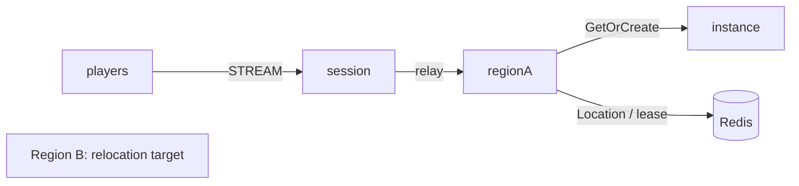

# my-game — Kotlin MMO megaserver

This template runs a single server cluster with capacity-limited Region instances. Entry chooses the first Region instance that accepts a player. Each Region owns membership and positions; Player Actors own no application state.



## Prerequisites

Docker with Compose v2 and Linux containers, network access to Maven Central and the Gradle Plugin Portal, and PowerShell 7 on Windows. JDK 25 is required only for local process debugging. The Gradle wrapper is included; public package versions are pinned in `build.gradle.kts`.

## Build

From this directory on Linux:

```sh
./run-e2e.sh --build-only
```

On Windows:

```powershell
pwsh -NoProfile -File ./run-e2e.ps1 -BuildOnly
```

## Docker e2e

Docker builds a shared node image for all roles and a runner image. The pinned Eclipse Temurin JDK/JRE bases are defined by the Dockerfile ARGs. The runner uses the Docker socket to create sibling nodes sharing its network namespace, preserving loopback listeners and stdin/stdout control. Each invocation removes its containers, network and image tags; cleanup errors return exit 1. Logs remain in `.logs/`.

For local process debugging, run `./run-e2e.sh --local` or `pwsh -NoProfile -File ./run-e2e.ps1 -Local`. Local mode uses JDK 25 and Compose Redis. Scenario and structure options work in both modes.

```sh
./run-e2e.sh
./run-e2e.sh --scenario region,movement,dungeon,reconnect,update
./run-e2e.sh --check-structure
```

```powershell
pwsh -NoProfile -File ./run-e2e.ps1
pwsh -NoProfile -File ./run-e2e.ps1 -Scenario region,movement,dungeon,reconnect,update
pwsh -NoProfile -File ./run-e2e.ps1 -CheckStructure
```

The runner checks `zlink.structure.json`, creates its own Redis Compose project and key prefix, starts each role, executes the selected scenarios, and removes only its processes and project. Logs and generated configuration are retained in `.logs/run-<id>/`.

| Scenario | Assertions |
| --- | --- |
| region | Two replicas fill; the next player receives capacity-exhausted, unknown regions and internal packets are rejected, and Sessions stay connected |
| movement | Server accepts Delta and Sequence, rejects budget exhaustion without state change, and accepts after RetryAfterMs; broadcasts remain isolated |
| dungeon | A Dungeon User Spot opens on the instance node |
| reconnect | A new physical Session binds the same Actor generation and retains Region and position |
| update | Drain preserves both clients and Region state; shutdown reaches Stopped; the replacement accepts a new Region |

`Capacity` defaults to 2 in the supplied configuration (`capacity` in Kotlin JSON). Scenarios share p1, p2, and p3 in forest-1 and forest-2. The supplied `regionLimit` is 2 per node; after draining a Region node the survivor hosts both instances, so a new desert Region is placed on the replacement. Movement uses server-authoritative deltas (MaxStep 10, bounds 0..100, speed 50/s) and increasing 64-bit sequences bounded to 2^53-1. Allowed regions are forest and desert; each region has at most two replicas. Domain checks run before nodes and separately with `--check-domain` or `-CheckDomain`. A disconnected Session retains Region membership until explicit leave.

## Known issues

Validated against the published Framework 0.30.2 packages.

## Deployment sequence

Start Redis, both Region processes, the instance process, and the Session process. Their entry points are `MyGame.region.ProgramKt`, `MyGame.instance.ProgramKt`, and `MyGame.session.ProgramKt`; supply the corresponding `server/config/<id>.json` path. Configure Redis, unique node IDs, a common key prefix, and listener endpoints before deployment. The supplied loopback port-zero settings are for local e2e; READY reports the Framework-published bound endpoints.

Send `drain` to a Region process. Wait for `RELOCATION_REQUESTED`, `RELOCATED`, and `SAFE_TO_SHUTDOWN`. Send `shutdown`, wait for `STOPPED` and process exit, then start the replacement with the same configuration. Region relocation stores only player IDs and position/sequence values; Framework preserves routes, membership, leases, and Session binding.

The e2e fixture limits each Region node to two Region Spots and keeps forest-1 and forest-2 occupied before drain. After relocation the survivor is full. Once the replacement reports `READY`, a new desert Region must be served by that replacement. Existing Region state and Session identity checks remain required. Only Region nodes register the application Entry and its first admission handler, so only those nodes declare an Entry in `zlink.structure.json`.

Message Follow is explicitly set to 30 seconds. The `SAFE_TO_SHUTDOWN` observation budget is the follow duration plus the existing relocation budget; the relocation operation deadline is unchanged.

## 한국어 실행 안내

기본 e2e는 Docker에서 실행합니다. 로컬 process 디버깅은 JDK 25를 준비하고 `--local` 또는 `-Local`로 실행합니다. Docker Compose를 설치한 뒤 이 디렉터리에서 위 Build 명령을 실행합니다. Linux에서는 `./run-e2e.sh`, Windows에서는 `pwsh -NoProfile -File ./run-e2e.ps1`로 전체 시나리오를 검증합니다.

실행별 설정과 node 로그는 `.logs/run-<id>/`에 보존됩니다. Region process에 `drain`을 보내고 `SAFE_TO_SHUTDOWN`을 확인한 뒤 `shutdown`을 보냅니다. process 종료 후 같은 설정으로 대체 process를 시작합니다.

도메인 검사: `./run-e2e.sh --check-domain` 또는 PowerShell `-CheckDomain`. 시나리오는 `region, movement, dungeon, reconnect, update` 순서이며, 이동 거부 뒤 상태 불변과 서버가 준 RetryAfterMs 이후 수락을 확인합니다.
