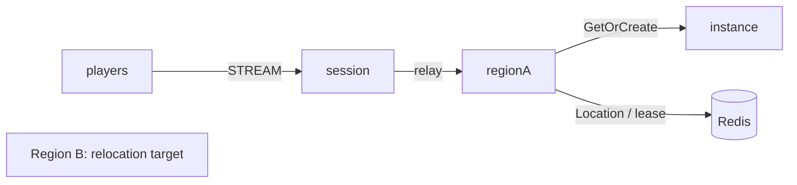

# my-game — Kotlin MMO megaserver

This template runs a single server cluster with capacity-limited Region instances. Entry chooses the first Region instance that accepts a player. Each Region owns membership and positions; Player Actors own no application state.



## Prerequisites

Install JDK 25, Docker with Compose v2, and PowerShell 7 on Windows. Gradle is included. Maven Central supplies Framework 0.30.1 and binding 1.19.0, pinned centrally in `build.gradle.kts`. The candidate Framework release must be published before the pinned build can resolve it.

## Build

From this directory on Linux:

```sh
./gradlew --no-daemon installDist
```

On Windows:

```powershell
./gradlew.bat --no-daemon installDist
```

## Local e2e

```sh
./run-e2e.sh
./run-e2e.sh --scenario region,dungeon,reconnect,update
```

```powershell
pwsh -NoProfile -File ./run-e2e.ps1
pwsh -NoProfile -File ./run-e2e.ps1 -Scenario region,dungeon,reconnect,update
```

The runner checks `zlink.structure.json`, creates its own Redis Compose project and key prefix, starts each role, executes the selected scenarios, and removes only its processes and project. Logs and generated configuration are retained in `.logs/run-<id>/`.

| Scenario | Assertions |
| --- | --- |
| region | p1 and p2 share forest-1; p3 enters forest-2; movement reaches p2 and remains isolated from p3 |
| dungeon | A Dungeon User Spot opens on the instance node |
| reconnect | A new physical Session binds the same Actor generation and retains Region and position |
| update | Drain preserves both clients and Region state; shutdown reaches Stopped; the replacement accepts a new Region |

`Capacity` defaults to 2 in the supplied configuration (`capacity` in Kotlin JSON). Scenarios share p1, p2, and p3 in forest-1 and forest-2. The supplied `regionLimit` is 2 per node; after draining a Region node the survivor hosts both instances, so a new desert Region is placed on the replacement. Movement requires a strictly increasing sequence. A disconnected Session retains Region membership until explicit leave.

## Known issues

Windows and Linux validation with Framework 0.30.0 is blocked by deferred cross-node join reporting DATA_LOST ([#1729](https://github.com/zlink-systems/zlink/issues/1729)). Keep the pinned version at 0.30.1 and verify the candidate release before deployment. Do not compensate with application retries or private API calls.

## Deployment sequence

Start Redis, both Region processes, the instance process, and the Session process. Their entry points are `MyGame.region.ProgramKt`, `MyGame.instance.ProgramKt`, and `MyGame.session.ProgramKt`; supply the corresponding `server/config/<id>.json` path. Configure Redis, unique node IDs, a common key prefix, and listener endpoints before deployment. The supplied loopback port-zero settings are for local e2e; READY reports the Framework-published bound endpoints.

Send `drain` to a Region process. Wait for `RELOCATION_REQUESTED`, `RELOCATED`, and `SAFE_TO_SHUTDOWN`. Send `shutdown`, wait for `STOPPED` and process exit, then start the replacement with the same configuration. Region relocation stores only player IDs and position/sequence values; Framework preserves routes, membership, leases, and Session binding.

The update scenario waits for the replacement process to report `READY`, then checks that a new Region is served by a live Region node. Object placement can choose either available Region node; it does not promise the replacement. Existing Region state and Session identity checks remain required. All Object Servers, including the Instance node's framework Entry, are declared in `zlink.structure.json`.

Message Follow is explicitly set to 30 seconds. The `SAFE_TO_SHUTDOWN` observation budget is the follow duration plus the existing relocation budget; the relocation operation deadline is unchanged.

## 한국어 실행 안내

JDK 25와 Docker Compose를 설치한 뒤 이 디렉터리에서 위 Build 명령을 실행합니다. Linux에서는 `./run-e2e.sh`, Windows에서는 `pwsh -NoProfile -File ./run-e2e.ps1`로 전체 시나리오를 검증합니다. 공개 Framework 0.30.1이 게시되어 있어야 기본 버전의 의존성을 받을 수 있습니다.

실행별 설정과 node 로그는 `.logs/run-<id>/`에 보존됩니다. Region process에 `drain`을 보내고 `SAFE_TO_SHUTDOWN`을 확인한 뒤 `shutdown`을 보냅니다. process 종료 후 같은 설정으로 대체 process를 시작합니다.
