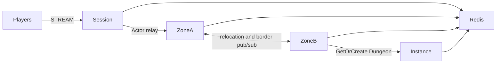

# my-game

A Kotlin seamless MMORPG template using public ZLink Framework 0.30.2 packages. Session processes bind players to Actors; Zone processes host a six-zone world; Instance processes create Dungeon User Spots on demand. Each Zone's `ZonePositionDomain` owns authoritative movement and visibility state, including the remaining movement budget captured for relocation.



## Prerequisites

Docker with Compose v2 and Linux containers, network access to Maven Central and the Gradle Plugin Portal, and PowerShell 7 on Windows. JDK 25 is required only for local process debugging. The Gradle wrapper is included; public package versions are pinned in `build.gradle.kts`.

## Build

```sh
./run-e2e.sh --build-only
```

```powershell
pwsh -NoProfile -File ./run-e2e.ps1 -BuildOnly
```

## Docker e2e

Docker builds a shared node image for all roles and a runner image. The pinned Eclipse Temurin JDK/JRE bases are defined by the Dockerfile ARGs. The runner uses the Docker socket to create sibling nodes sharing its network namespace, preserving loopback listeners and stdin/stdout control. Each invocation removes its containers, network and image tags; cleanup errors return exit 1. Logs remain in `.logs/`.

For local process debugging, run `./run-e2e.sh --local` or `pwsh -NoProfile -File ./run-e2e.ps1 -Local`. Local mode uses JDK 25 and Compose Redis. Scenario and structure options work in both modes.

```sh
./run-e2e.sh
./run-e2e.sh --scenario cross,border,reconnect,update
./run-e2e.sh --check-domain
```

```powershell
pwsh -NoProfile -File ./run-e2e.ps1
pwsh -NoProfile -File ./run-e2e.ps1 -Scenario cross,border,reconnect,update
pwsh -NoProfile -File ./run-e2e.ps1 -CheckDomain
```

The runner validates the structure, starts an isolated Redis Compose project, starts each role's entrypoint and runs the selected scenarios. Redis and Framework listeners bind ephemeral loopback ports. Each run has a unique Redis prefix and `.logs/run-<id>/` directory. Normal message-flow diagnostics go to node stderr. Cleanup failures cause a nonzero exit code.

| Scenario | Assertion |
| --- | --- |
| cross | Step-size, move-budget, world-boundary, and internal-packet rejections preserve state; movement retries only after the server delay and crosses Zone while preserving Actor and Session identity. |
| border | An observer across physical nodes receives appearance, movement, `left-zone`, and `disconnected` events as the player crosses and disconnects. |
| reconnect | A new physical Session rebinds the same Actor and preserves position, sequence and logical Zone. |
| update | Movement continues during Zone A drain; relocation signals complete; Session and Actor identity persist after replacement; fresh work remains available. |

Domain checks run before the scenarios and separately with `./run-e2e.sh --check-domain` or `pwsh -NoProfile -File ./run-e2e.ps1 -CheckDomain`. They check NaN and infinity inside the domain tests, not through the JSON message model. Structure-only validation: `./run-e2e.sh --check-structure` or `pwsh -NoProfile -File ./run-e2e.ps1 -CheckStructure`.

Message Follow is explicitly configured to 30 seconds in shared hosting. The wait for `SAFE_TO_SHUTDOWN` is derived from that period plus the existing host relocation budget. Packet deadlines and the relocation operation budget remain unchanged.

## Deployment sequence

Configure Redis and a unique prefix in `server/config`. Start Zone A and bootstrap zone-1..3 before Zone B bootstraps zone-4..6; start Instance, then Session. Every role has its own `MyGame.<role>.ProgramKt` entrypoint, executed from its installed distribution with its configuration path. READY reports the actual Framework listener endpoints.

Send `drain` to Zone A stdin. Keep gameplay active while observing `RELOCATION_REQUESTED`, `RELOCATED`, and `SAFE_TO_SHUTDOWN`. Send `shutdown` and verify `STOPPED` and successful process exit. Start the replacement with the same identity, capacity and configuration. Like every Zone node, it runs `getOrCreate` for all configured Zones at startup: Zones already moved to the relocation target end as existing and remain there, and only the closed first Zone is created on the replacement. The runner performs this sequence and exercises new player creation after replacement.

Fixed Zones are bootstrapped serially: Zone A fills its three-Spot capacity before Zone B starts. This makes the declared initial owners deterministic through public stable-type capacity. During e2e, Zone B has capacity for all but one world Zone. Before update drains Zone A, `vacate-zone` closes the unused first Zone through the public Spot manager. The remaining Zones fill Zone B; the replacement Zone A recreates the first Zone through its startup `getOrCreate`; a fresh player then joins it, and the test verifies its host and continued movement. Existing relocated players remain on Zone B.

## 한국어 실행 안내

기본 e2e는 Docker에서 실행합니다. 로컬 process 디버깅은 JDK 25를 준비하고 `--local` 또는 `-Local`로 실행합니다. Docker Compose v2를 준비한 뒤 위 Build 명령과 Docker e2e 명령을 실행합니다. Windows에서는 PowerShell 7을 사용합니다. 기본 실행은 거부 뒤 상태 불변, Zone 경계 이동, 가시성 종료, 재접속과 host 교체를 순서대로 검증합니다. `--check-domain`은 JSON으로 전송하지 않는 NaN·Infinity 입력과 경계 검사를 별도로 실행합니다.

실행별 설정과 node 로그는 `.logs/run-<id>/`에 기록됩니다. Zone A의 drain이 끝나면 Session 연결과 Actor identity를 확인하고 기존 process를 종료합니다. 대체 process는 같은 node identity, capacity와 설정으로 시작하며 시작할 때 설정된 모든 Zone에 `getOrCreate`를 실행합니다. 이미 이전한 Zone은 기존 Zone으로 끝나 Framework Location Store의 소유가 유지되고, 닫힌 첫 Zone만 대체 process에 새로 만들어집니다.
