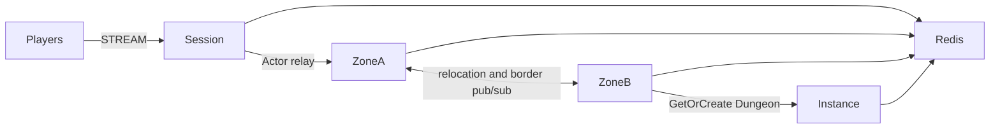

# my-game

A Kotlin seamless MMORPG template using public ZLink Framework 0.30.1 packages. Session processes bind players to Actors; Zone processes host a six-zone world; Instance processes create Dungeon User Spots on demand. Player Actors retain movement state across cross-node joins and planned host relocation.



## Prerequisites

JDK 25, Docker with Compose v2, and PowerShell 7 on Windows. Gradle is provided by the wrapper. Published Maven Central packages are used; no repository checkout is required. The binding version is pinned with the Framework version in `build.gradle.kts`.

## Build

```sh
./gradlew --no-daemon installDist
```

```powershell
./gradlew.bat --no-daemon installDist
```

## Local e2e

```sh
./run-e2e.sh
./run-e2e.sh --scenario cross,border,reconnect
```

```powershell
pwsh -NoProfile -File ./run-e2e.ps1
pwsh -NoProfile -File ./run-e2e.ps1 -Scenario cross,border,reconnect
```

The runner validates the structure, starts an isolated Redis Compose project, starts each role's entrypoint and runs the selected scenarios. Redis and Framework listeners bind ephemeral loopback ports. Each run has a unique Redis prefix and `.logs/run-<id>/` directory. Normal message-flow diagnostics go to node stderr. Cleanup failures cause a nonzero exit code.

| Scenario | Assertion |
| --- | --- |
| cross | Movement from zone-3 on Zone A to zone-4 on Zone B preserves Actor identity and Session; movement and Dungeon creation continue. |
| border | An observer on zone-4 receives zone-3's authoritative border update across physical nodes. |
| reconnect | A new physical Session rebinds the same Actor and preserves position, sequence and logical Zone. |
| update | Movement continues during Zone A drain; relocation signals complete; Session and Actor identity persist after replacement; fresh work remains available. |

Structure-only validation: `./run-e2e.sh --check-structure` or `pwsh -NoProfile -File ./run-e2e.ps1 -CheckStructure`.

Message Follow is explicitly configured to 30 seconds in shared hosting. The wait for `SAFE_TO_SHUTDOWN` is derived from that period plus the existing host relocation budget. Packet deadlines and the relocation operation budget remain unchanged.

## Deployment sequence

Configure Redis and a unique prefix in `server/config`. Start Zone A and bootstrap zone-1..3 before Zone B bootstraps zone-4..6; start Instance, then Session. Every role has its own `MyGame.<role>.ProgramKt` entrypoint, executed from its installed distribution with its configuration path. READY reports the actual Framework listener endpoints.

Send `drain` to Zone A stdin. Keep gameplay active while observing `RELOCATION_REQUESTED`, `RELOCATED`, and `SAFE_TO_SHUTDOWN`. Send `shutdown` and verify `STOPPED` and successful process exit. Start the replacement with the same identity and capacity, but set `bootstrap` to `false`: existing logical Zones remain owned by the relocation target. The runner performs this sequence and exercises new player creation after replacement.

## 한국어 실행 안내

JDK 25와 Docker Compose v2를 준비한 뒤 위 Build 명령과 Local e2e 명령을 실행합니다. Windows에서는 PowerShell 7을 사용합니다. 기본 실행은 `cross`, `border`, `reconnect`, `update`를 검증하며, 시나리오 선택 명령으로 필요한 범위만 실행할 수 있습니다.

실행별 설정과 node 로그는 `.logs/run-<id>/`에 기록됩니다. Zone A의 drain이 끝나면 Session 연결과 Actor identity를 확인하고 기존 process를 종료합니다. 대체 process는 같은 node identity와 capacity를 사용하되 `bootstrap`을 끄고 시작합니다. 이전한 Zone의 소유권은 Framework Location Store가 유지합니다.
