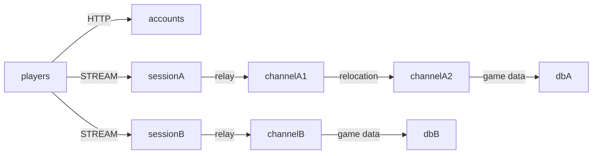

# MyGame world and channel servers

This Kotlin template separates two MMORPG worlds into independent meshes and Redis stores. Accounts publishes the world list over HTTP. Session nodes relay typed STREAM messages to Player Actors. Gold rules live in `server/channel` under `domain`, the persistence port under `application`, and Framework and Redis adapters under `infrastructure`. Each Actor owns its gold; Zone Spots identify channels and retain no application state.



## Prerequisites

JDK 25, Docker with Compose v2, and PowerShell 7 on Windows. Gradle 9.3 is included. Dependencies come from Maven Central; Framework 0.30.1 and binding 1.19.0 are pinned in `build.gradle.kts`. No repository checkout is required.

## Build

Bash:
```sh
./gradlew --no-daemon installDist
```
PowerShell:
```powershell
./gradlew.bat --no-daemon installDist
```

## Local e2e

Bash:
```sh
./run-e2e.sh
./run-e2e.sh --scenario worlds,channel,reconnect,update
```
PowerShell:
```powershell
pwsh -NoProfile -File ./run-e2e.ps1
pwsh -NoProfile -File ./run-e2e.ps1 -Scenario worlds,channel,reconnect,update
```

The runner checks `zlink.structure.json`, starts its own two Redis containers and six application processes, and records logs under `.logs/run-<id>/`. Ports, Compose project names, and Redis key prefixes are unique per run. Cleanup failures fail the run. `--check-structure` (PowerShell `-CheckStructure`) validates files without starting infrastructure.

| Scenario | Assertions |
| --- | --- |
| worlds | HTTP world endpoints; equal player IDs have independent gold in A and B |
| channel | Channel 1 to 2 preserves connection, SessionInfo, and gold |
| reconnect | A new connection retains Actor identity, channel, and gold |
| update | Drain channelA1; preserve both worlds; stop and replace it; observe new Actor creation there |

## Known issues

Framework 0.30.1 publication is pending. Validation against 0.30.0 uses a separate copy. Cross-node deferred Actor Join fails with `DATA_LOST: target rejected canonical relocation: 35` ([#1729](https://github.com/zlink-systems/zlink/issues/1729)). This blocks channel transfer, reconnect after transfer, and update verification. Initial entry can also require this path when Actor placement selects a different channel node. In the WSL 0.30.0 update run, drain reaches `RELOCATED` but never publishes `safeToShutdown=true` ([#1740](https://github.com/zlink-systems/zlink/issues/1740)). The source exits after its existing control deadline, and replacement assertions remain unverified. The template retains the public join path and its assertions.

## Deployment sequence

Start dbA and dbB, then channelA1, channelA2, and channelB in that order so each initially creates its configured fixed Zone. Start sessionA and sessionB next. Their `READY` lines publish the actual STREAM endpoints; set those values in the accounts configuration before starting accounts. Run a role with `java --enable-native-access=ALL-UNNAMED -cp 'server/<role>/build/install/<role>/lib/*' MyGame.<role>.ProgramKt server/config/<id>.json`.

World A uses mesh `my-game-world-a` and dbA; world B uses `my-game-world-b` and dbB. Keep the Redis endpoint and key prefix consistent within a world. Application data uses `<keyPrefix>player:<id>`; Framework Location and Relocation data use separate suffixes. Player IDs are supplied by this example client; a production Session must authenticate them.

For a channel update, send `drain` on its stdin and wait for `RELOCATION_REQUESTED`, `RELOCATED`, and `SAFE_TO_SHUTDOWN`. Then send `shutdown`, require `STOPPED` and a successful process exit, and start its replacement with the same configuration. Channel servers register both Player and Zone relocation adapters. The replacement does not reclaim relocated Zones: existing Location Store authority remains authoritative.

## 한국어 실행 안내

JDK 25와 Docker Compose v2를 준비한 뒤 위 Build 명령을 실행합니다. Local e2e 명령은 실행마다 Redis 두 개와 node process를 생성하며, 결과와 message-flow 로그를 `.logs/run-<id>/`에 보관합니다.

월드별 Redis와 mesh를 분리하며 Player Actor가 gold를 소유합니다. 채널 변경과 host relocation의 연결 유지는 공개 Framework API에 맡깁니다. 공개 패키지 결함으로 실패한 경우 Known issues와 node stderr를 확인하며, 재시도나 대기 시간 변경으로 실패를 숨기지 않습니다.
