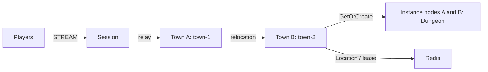

# my-game — MORPG channel town

Players gather in Town channels, form parties of up to four members, and enter a dedicated Dungeon User Spot. Player Actors preserve identity while the Framework moves them between towns and dungeons. Each Spot owns its game state; the Framework owns placement, membership, binding, and relocation.



## Prerequisites

Docker with Compose v2 and Linux containers, network access to Maven Central and the Gradle Plugin Portal, and PowerShell 7 on Windows. JDK 25 is required only for local process debugging. The Gradle wrapper is included; public package versions are pinned in `build.gradle.kts`.

## Build

Bash:

```sh
./run-e2e.sh --build-only
```

PowerShell:

```powershell
pwsh -NoProfile -File ./run-e2e.ps1 -BuildOnly
```

## Docker e2e

Docker builds a shared node image for all roles and a runner image. The pinned Eclipse Temurin JDK/JRE bases are defined by the Dockerfile ARGs. The runner uses the Docker socket to create sibling nodes sharing its network namespace, preserving loopback listeners and stdin/stdout control. Each invocation removes its containers, network and image tags; cleanup errors return exit 1. Logs remain in `.logs/`.

For local process debugging, run `./run-e2e.sh --local` or `pwsh -NoProfile -File ./run-e2e.ps1 -Local`. Local mode uses JDK 25 and Compose Redis. Scenario and structure options work in both modes.

```sh
./run-e2e.sh
./run-e2e.sh --scenario channel,dungeon,reconnect,update
./run-e2e.sh --check-structure
./run-e2e.sh --check-domain
```

```powershell
pwsh -NoProfile -File ./run-e2e.ps1
pwsh -NoProfile -File ./run-e2e.ps1 -Scenario channel,dungeon,reconnect,update
pwsh -NoProfile -File ./run-e2e.ps1 -CheckStructure
pwsh -NoProfile -File ./run-e2e.ps1 -CheckDomain
```

The runner checks the structure, starts a unique Compose project with Redis on an OS-assigned loopback port, starts the application processes, and removes its resources. Run-specific configurations and stdout, stderr, and message-flow records are in `.logs/run-<id>/`. Use `--check-structure` or `-CheckStructure` for structure validation only. Use `--check-domain` or `-CheckDomain` to run the domain checks without starting nodes.

| Scenario | Verification |
| --- | --- |
| `channel` | Session continuity while changing towns; invalid channel rejection leaves state unchanged; a forming party leaves with its member. |
| `dungeon` | Server-issued PartyId and RunId; duplicate entry sends; identical active Dungeon views; nonleader and internal packet rejection leave state unchanged; FinalStage completion; distinct dungeons for parties in town-1 and town-2. |
| `reconnect` | Actor identity and Dungeon RunId, Phase, Stage, and roster after reconnect. |
| `update` | Drain completion, preserved Dungeon state and Session identity, and a replacement instance accepting a distinct party run from the other channel. |

## Known issues

Validated against the published Framework 0.30.2 packages.

## Deployment sequence

Bootstrap Town providers sequentially and wait for each READY before starting the next. Each provider's public Town stable-type capacity must equal its configured fixed Town count; the structure checker enforces this. Earlier providers are full and later providers are absent, making each fixed Town's declared initial owner deterministic. Entry declarations describe the application Entry registered by Town and Instance, excluding Framework default Entries.

1. Start Redis and supply an independent key prefix for each deployment.
2. Start townA and townB using `server/config/townA.json` and `townB.json`; each bootstraps its configured fixed Town. Start instanceA and instanceB. Roles have separate `MyGame.town.ProgramKt` and `MyGame.instance.ProgramKt` entry points.
3. Start `MyGame.session.ProgramKt` with `server/config/session.json`. Nodes publish `READY` with their actual listener endpoints. Mesh and STREAM listeners bind port zero.
4. Send `drain` on stdin to the instance being updated. Wait for `RELOCATION_REQUESTED`, `RELOCATED`, and `SAFE_TO_SHUTDOWN`. Send `shutdown`, wait for `STOPPED`, and start the replacement with the same configuration. Each sample instance has one Dungeon slot so the update scenario can verify replacement placement.

Application distributions are under `server/<role>/build/install/<role>/`. The e2e scripts build them before starting nodes. Deployment must supply durable Redis storage and reachable listener addresses appropriate to the network.

All Object Servers that register Player factories also register the shared Entry and first-admission handler, including both Instance nodes. Entry admission joins the requested fixed Town channel. Each Instance declares its dynamic Dungeon factory in `zlink.structure.json`.

The e2e configuration uses one Dungeon slot per Instance. After drain, the surviving Instance is full, so only the replacement can accept the fresh Dungeon. The structure checker enforces this configuration. Message Follow remains 30 seconds; the SafeToShutdown observation budget is derived from that duration plus the existing relocation operation budget. Party members can leave a Forming party when changing towns; run rosters remain recorded after departure.

## 한국어 실행 안내

기본 e2e는 Docker에서 실행합니다. 로컬 process 디버깅은 JDK 25를 준비하고 `--local` 또는 `-Local`로 실행합니다. Docker Compose를 준비한 뒤 위 Build 명령을 템플릿 디렉터리에서 실행합니다. Docker e2e 명령은 구조 검사, Redis와 노드 기동, 시나리오 실행, 해당 실행의 자원 정리를 수행합니다. `./run-e2e.sh --check-domain` 또는 `-CheckDomain`은 노드를 기동하지 않고 도메인 경계를 검사합니다. 실행별 설정과 message-flow 기록은 `.logs/run-<id>/`에 보존합니다.

네 시나리오는 채널 이동, 서버 발급 ID와 중복 입장, 거부 뒤 상태 불변, FinalStage 완료, 재접속과 instance 교체 뒤 RunId·Phase·Stage 보존을 실제 응답으로 확인합니다. 운영 시에는 배포별 Redis key prefix와 네트워크에 맞는 listener 주소를 지정합니다. 노드 교체는 drain 관찰이 완료된 뒤 shutdown하고 같은 설정으로 대체 프로세스를 기동합니다.
