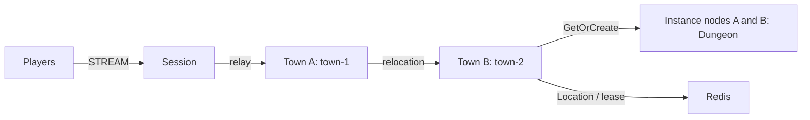

# my-game — MORPG channel town

Players gather in Town channels, form parties of up to four members, and enter a dedicated Dungeon User Spot. Player Actors preserve identity while the Framework moves them between towns and dungeons. Each Spot owns its game state; the Framework owns placement, membership, binding, and relocation.



## Prerequisites

JDK 25, Docker Compose v2 with a running Docker daemon, and Bash or PowerShell 7. The included Gradle wrapper downloads Gradle. Public Framework 0.30.1 and binding 1.19.0 versions are pinned in `build.gradle.kts`. No repository checkout is required.

## Build

Bash:

```sh
./gradlew --no-daemon build
```

PowerShell:

```powershell
./gradlew.bat --no-daemon build
```

## Local e2e

```sh
./run-e2e.sh
./run-e2e.sh --scenario channel,dungeon,reconnect,update
```

```powershell
./run-e2e.ps1
./run-e2e.ps1 -Scenario channel,dungeon,reconnect,update
```

The runner checks the structure, starts a unique Compose project with Redis on an OS-assigned loopback port, starts the application processes, and removes its resources. Run-specific configurations and stdout, stderr, and message-flow records are in `.logs/run-<id>/`. Use `--check-structure` or `-CheckStructure` for structure validation only.

| Scenario | Verification |
| --- | --- |
| channel | town-1 to town-2, nodeId townB, unchanged SessionInfo and connection |
| dungeon | same party and Dungeon for both players, stage 0 then stage 1 |
| reconnect | same Actor identity, Dungeon, host, members, and stage after reconnect |
| update | drain observed through SafeToShutdown, unchanged bindings and state on the other instance, stopped source replaced, new Dungeon accepted by replacement |

## Known issues

Validation with public 0.30.0 encounters Java deferred Actor Join DATA_LOST (#1729), including `target rejected canonical relocation: 35`. Some initial Actor creation requests also remain incomplete until cleanup; #1772 (new Actor placement on a node without an Entry Spot) is a related candidate, not a confirmed diagnosis for those runs. Framework 0.30.1 is pinned for the fixes, but its candidate feed has not been provided and its e2e verification remains pending. Do not conceal these failures with application retries or larger deadlines.

## Deployment sequence

1. Start Redis and supply an independent key prefix for each deployment.
2. Start townA and townB using `server/config/townA.json` and `townB.json`; each bootstraps its configured fixed Town. Start instanceA and instanceB. Roles have separate `MyGame.town.ProgramKt` and `MyGame.instance.ProgramKt` entry points.
3. Start `MyGame.session.ProgramKt` with `server/config/session.json`. Nodes publish `READY` with their actual listener endpoints. Mesh and STREAM listeners bind port zero.
4. Send `drain` on stdin to the instance being updated. Wait for `RELOCATION_REQUESTED`, `RELOCATED`, and `SAFE_TO_SHUTDOWN`. Send `shutdown`, wait for `STOPPED`, and start the replacement with the same configuration. Each sample instance has one Dungeon slot so the update scenario can verify replacement placement.

Application distributions are under `server/<role>/build/install/<role>/`. The e2e scripts build them before starting nodes. Deployment must supply durable Redis storage and reachable listener addresses appropriate to the network.

## 한국어 실행 안내

JDK 25와 Docker Compose를 준비한 뒤 위 Build 명령을 템플릿 디렉터리에서 실행합니다. Local e2e 명령은 구조 검사, Redis와 노드 기동, 시나리오 실행, 해당 실행의 자원 정리를 수행합니다. 실행별 설정과 message-flow 기록은 `.logs/run-<id>/`에 보존합니다.

마을 채널 변경, 파티 던전 입장과 진행도, 재접속, instance 교체를 실제 응답으로 확인합니다. 운영 시에는 배포별 Redis key prefix와 네트워크에 맞는 listener 주소를 지정합니다. 노드 교체는 drain 관찰이 완료된 뒤 shutdown하고 같은 설정으로 대체 프로세스를 기동합니다.
