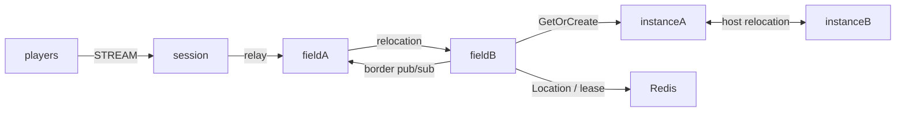

# my-game

A Kotlin MORPG template using public ZLink Framework 0.30.1 packages. Field nodes host four fixed Field User Spots; parties enter dynamically allocated Dungeon User Spots. Player Actors preserve movement state across field boundaries, while Dungeon owns party membership and stage.



## Prerequisites

JDK 25, Docker with Compose v2, and PowerShell 7 on Windows. The Gradle wrapper is included. Published Maven Central packages are used; a repository checkout is unnecessary. Framework and binding versions are pinned in `build.gradle.kts`.

## Build

```sh
./gradlew --no-daemon installDist
```

```powershell
./gradlew.bat --no-daemon installDist
```

## Local e2e

```sh
./run-e2e.sh
./run-e2e.sh --scenario field,dungeon,reconnect,update
```

```powershell
./run-e2e.ps1
./run-e2e.ps1 -Scenario field,dungeon,reconnect,update
```

The Kotlin runner checks the structure, starts an isolated Redis Compose project and starts the Field, Instance and Session entrypoints. Redis and Framework listeners bind ephemeral loopback ports. Every run uses a unique Redis prefix and `.logs/run-<id>/` directory. Normal message-flow diagnostics are recorded in node stderr. Cleanup failures produce a nonzero exit code.

| Scenario | Assertion |
| --- | --- |
| field | p1 crosses field-2 on fieldA to field-3 on fieldB with the same Session; p2 observes the border publication. |
| dungeon | Two players in the same field form a party, enter the same fresh Dungeon, and observe stage 1 together. |
| reconnect | A new physical Session binds the same Actor and observes the same Dungeon, members and stage. |
| update | The occupied instance drains through all relocation signals; both Sessions and Dungeon state persist; the replacement instance accepts a new party. |

Non-field scenarios share their party fixture. Selecting reconnect or update alone creates that fixture first. Structure-only validation is available through `./run-e2e.sh --check-structure` or `./run-e2e.ps1 -CheckStructure`.

## Known issues

The template targets 0.30.1. Tests against public 0.30.0 encounter an Actor GetOrCreate from Session that does not complete ([#1782](https://github.com/zlink-systems/zlink/issues/1782)). Deferred cross-node join `DATA_LOST` is also a known 0.30.0 defect ([#1729](https://github.com/zlink-systems/zlink/issues/1729)); later join scenarios remain unverified when Actor creation fails. The Kotlin Spot handler registry cannot yet register a runtime `(channelName, topic)` subscription ([#1783](https://github.com/zlink-systems/zlink/issues/1783)), so `server/field/.../border/BorderRoutes.kt` declares one handler per adjacent-field topic; replace it with runtime registration once that API exists. Preserve the first failure and message-flow records. Do not change join timing, transport behavior or assertions to hide a Framework failure.

## Deployment sequence

Configure Redis and a unique key prefix in `server/config`. Start fieldA and bootstrap field-1..2, then fieldB and bootstrap field-3..4. Each Field node has capacity 2 and an Entry Spot. Start instanceA and instanceB, each with Dungeon capacity 1, then session. Every role has a separate `MyGame.<role>.ProgramKt` entrypoint in its installed distribution and accepts a configuration path. READY reports the actual Framework endpoints.

Send `drain` to the instance hosting the party. Wait for `RELOCATION_REQUESTED`, `RELOCATED`, and `SAFE_TO_SHUTDOWN`. Verify Session identity and Dungeon state, send `shutdown`, and verify `STOPPED` and successful process exit. Start the replacement with the same configuration. The other instance retains the relocated Dungeon; its capacity is occupied, so the new party is allocated to the replacement instance.

Player Actor factories and the shared Entry implementation are registered on both Field and Instance nodes. Declare one Entry in `zlink.structure.json` for each Field or Instance node, where the application registers Entry and its first-entry handler. Do not declare Framework default Entries on other roles. The update scenario uses Dungeon capacity 1: after relocation, the occupied peer cannot create the new Dungeon, so the replacement must accept it.

Message Follow is explicitly 20 seconds, preserving the default 15-second route cache and its 5-second safety margin. Safe-shutdown observation is derived as Message Follow plus 10 seconds. Relocation operation deadlines are unchanged.

Initial Field placement uses public stable-type capacity and sequential startup. Set each Field node capacity to exactly its configured Field ID count. Start one Field node and wait for its READY, which follows creation of all its Fields, before starting the next Field node. Earlier nodes are full, so the newly started node is the only eligible Field host. Do not start initial Field hosts concurrently.

## 한국어 실행 안내

JDK 25와 Docker Compose v2를 준비한 뒤 위 Build와 Local e2e 명령을 실행합니다. Windows에서는 PowerShell 7을 사용합니다. 기본 실행은 `field`, `dungeon`, `reconnect`, `update`를 순서대로 검증하며 시나리오 선택도 지원합니다.

실행별 설정과 node 로그는 `.logs/run-<id>/`에 기록됩니다. update는 Dungeon을 소유한 instance의 drain과 종료, 대체 process의 신규 파티 수락을 확인합니다. Framework 결함이 발생하면 첫 실패와 message-flow 기록을 보존하고 해당 공개 패키지의 수정 여부를 확인합니다.
