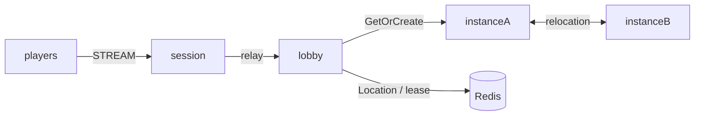

# my-game — MORPG lobby and dungeon instances

A Kotlin server template using the public ZLink Framework coroutine APIs. Players create a party in the lobby, mark every member ready, and enter a shared dungeon. The Party User Spot owns the roster and readiness; the Dungeon User Spot owns the dungeon stage. The Entry Spot owns no party state.



## Prerequisites

- JDK 25, Docker with Compose, and PowerShell 7 on Windows or Bash on Linux.
- Maven Central access for Framework 0.30.1 and binding 1.19.0. Versions are pinned in `build.gradle.kts`.
- A valid `zlink.license` when required by the installed binding. Keep license files outside version control.

## Build

```sh
./gradlew --no-daemon installDist
```

```powershell
./gradlew.bat --no-daemon installDist
```

## Local e2e

```sh
./run-e2e.sh
./run-e2e.sh --scenario party,reconnect,update
```

```powershell
pwsh -NoProfile -File ./run-e2e.ps1
pwsh -NoProfile -File ./run-e2e.ps1 -Scenario party,reconnect,update
```

The runner validates `zlink.structure.json`, starts its own Redis Compose project and node processes, then removes those resources. Each scenario has isolated nodes, a unique Redis key prefix, ephemeral listener ports, and logs in `.logs/run-<id>/`. Cleanup failure produces a failing exit code.

| Scenario | Assertions |
| --- | --- |
| `party` | Two players share the ordered roster, entry rejects `not-ready`, both readiness values become true, and both receive dungeon stage 0 and stage 1. |
| `reconnect` | A new physical Session retains the same Actor identity, object generation, dungeon, and stage; both players then receive stage 2. |
| `update` | The occupied instance drains through all control stages, Sessions and dungeon state survive relocation, the old process stops, and its replacement accepts a new dungeon. |

Run the structure checker alone with `./run-e2e.sh --check-structure` or `pwsh -NoProfile -File ./run-e2e.ps1 -CheckStructure`. Party domain tests run with `./gradlew --no-daemon :server:lobby:test`.

## Known issues

Framework 0.30.1 is the target package version. Public 0.30.0 validation stops at the first lobby response: the Session's first Actor GetOrCreate for a player never completes and no node records the request ([#1782](https://github.com/zlink-systems/zlink/issues/1782)). Do not compensate with internal APIs, manual codecs, retries, sleeps, or longer deadlines. Preserve the first failure and message-flow logs.

## Deployment sequence

1. Provision Redis, then start `lobby`, the two `instance` processes, and `session` with their respective files in `server/config/`. The application entry points are `MyGame.lobby.ProgramKt`, `MyGame.instance.ProgramKt`, and `MyGame.session.ProgramKt`. The two instances use the same executable and distinct configuration files.
2. Wait for `READY` from each process. Its JSON contains the actual bound mesh and stream endpoints; a port of zero delegates port selection to the OS.
3. Send `drain` to an occupied instance. Wait for `RELOCATION_REQUESTED`, `RELOCATED`, and `SAFE_TO_SHUTDOWN` before sending `shutdown`.
4. Confirm `STOPPED` and exit code zero. Start a replacement with the same configuration and wait for `READY` before assigning new work.

Instance capacity is one Dungeon per process to make replacement placement observable. Framework owns placement, membership, route continuity, and relocation. Application adapters capture only Party and Dungeon game state; Player has no application state. Non-request pushes use player IDs through Actor delivery handlers, without retaining Actor references in Spots.

## 한국어 실행 안내

JDK 25와 Docker Compose를 준비한 뒤 위 Build 명령으로 배포 파일을 생성합니다. Windows에서는 PowerShell 7을 사용합니다. Local e2e 명령은 구조 검사, Redis와 노드 기동, 시나리오 판정, 자원 정리를 수행하며 실행 기록은 `.logs/run-<id>/`에 남깁니다.

파티 구성과 준비 상태는 Party User Spot이 소유하고 던전 진행 상태는 Dungeon User Spot이 소유합니다. 인스턴스 교체 시에는 `drain` 뒤 `SAFE_TO_SHUTDOWN`을 확인하고 `shutdown`을 보낸 다음 같은 설정으로 대체 프로세스를 기동합니다. 공개 패키지 결함으로 실패하면 우회하지 않고 최초 오류와 message-flow 기록을 보존합니다.
