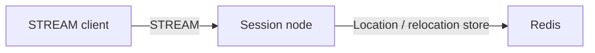

# MyGame Kotlin 시작 템플릿

[English](README.md)

Session node가 클라이언트 STREAM 연결을 받고 Redis를 Location Store와 relocation 저장소로 사용합니다. 서버 구동, 진단, 프로세스 제어와 e2e 예제를 제공합니다. 게임 Spot, Actor, Entry, 인증, 구독과 게임 패킷은 프로젝트에서 추가합니다.



이 템플릿은 참고용입니다. 새 게임은 새 프로젝트를 만든 뒤 그 게임에 맞는 노드, Spot, Actor와 메시지를 설계합니다. 이 템플릿의 구조와 규칙을 참고하고, 템플릿 자체의 이름을 바꾸거나 제자리에서 수정해 게임 프로젝트로 전환하지 않습니다.

## 실행 환경

Linux 컨테이너를 실행할 수 있는 Docker와 Compose v2를 설치합니다. 로컬 서버에는 JDK 25가 필요합니다. Windows에서 `.cmd` 파일을 실행하려면 PowerShell 7(`pwsh`)을 설치합니다. Gradle Wrapper는 Maven Central에서 Kotlin과 의존성을 받습니다. `build.gradle.kts`는 ZLink Framework `0.34.0`과 binding `1.26.0`을 사용합니다. 템플릿 디렉터리만으로 빌드할 수 있습니다.

Docker 이미지 빌드에는 `./run-e2e.sh --build-only` 또는 `.\run-e2e.cmd -BuildOnly`를 사용합니다.

## 로컬 서버와 e2e 실행

이 디렉터리에서 첫 번째 명령을 실행하면 빌드 후 Redis와 노드가 시작됩니다. `Server ready`에 표시된 WebSocket 주소로 클라이언트를 연결합니다. 두 번째 명령은 별도 터미널에서 실행합니다. 서버를 종료하려면 서버 터미널에서 Ctrl+C를 누릅니다.

```bash
./run-server.sh
./run-e2e.sh
```

```powershell
.\run-server.cmd
.\run-e2e.cmd
```

실행 중인 서버가 있으면 e2e가 자동으로 연결합니다. 서버가 없으면 Docker에서 격리 환경을 만들고 테스트 뒤에 정리합니다. 격리 실행에서는 `connect`가 Session drain도 확인합니다. 서버가 실행 중이어도 Bash에서는 `--isolated`, Windows에서는 `-Isolated`를 지정해 격리 실행할 수 있습니다.

서버 접속 정보는 `.logs/server.json`에 기록됩니다. 노드별 stdout, stderr, Framework message-flow와 시나리오 실패 상세는 `.logs/run-<id>/`에 남습니다. 연결 실행의 노드 로그는 서버가 출력한 경로에, 시나리오 실패 상세는 e2e가 출력한 경로에 기록됩니다. Docker 빌드·정리 로그는 `.logs/docker-<project>/`에 남습니다.

## 클라이언트 연결

Session node의 기본 설정은 `server/config/session.json`의 `ws://127.0.0.1:0`입니다. 포트 `0`은 OS가 빈 포트를 배정하도록 지정합니다. 이 템플릿의 연결 예제는 애플리케이션 패킷을 보내기 전에 연결과 종료를 확인합니다.

직접 구동한 노드의 실제 주소는 `READY <json>`의 `streamEndpoint`에서 확인합니다. 외부 호스트의 클라이언트를 연결할 때는 접근 가능한 인터페이스와 포트를 설정하고, 컨테이너 환경에서는 해당 포트를 공개합니다. Connector의 `<version>`은 `build.gradle.kts`의 `frameworkVersion`에 맞춥니다.

### 첫 패킷

`connect`는 공개 Connector를 사용해 STREAM에 연결하고 닫습니다. 게임 메시지를 보내기 전에 서버에 게임 계약과 dispatch handler를 추가합니다.

### Connector 설치

| 클라이언트 | Connector 설치 | 문서 |
| --- | --- | --- |
| Unity | Native/Editor에서는 NuGetForUnity로 `Zlink.Stream.Connector`를 복원합니다. WebGL에서는 `com.zlink.stream-connector.webgl` UPM Git 패키지를 추가합니다. | [.NET engine integration](https://docs.zlink.systems/dotnet/guide/stream-connector/12-engine-integration/) |
| Unreal | `framework/languages/cpp/connector/engines/unreal`을 `Plugins/ZLinkStreamConnector`에 복사하고 native connector를 `ThirdParty/ZLink`에 배치합니다. | [C++ engine integration](https://docs.zlink.systems/cpp/guide/stream-connector/12-engine-integration/) |
| Godot | .NET은 `Zlink.Stream.Connector`를 복원합니다. GDExtension은 Framework 사전 빌드와 호환되는 `godot-cpp`로 adapter를 빌드합니다. .NET 예제는 Web export를 지원하지 않습니다. | [.NET](https://docs.zlink.systems/dotnet/guide/stream-connector/12-engine-integration/), [C++](https://docs.zlink.systems/cpp/guide/stream-connector/12-engine-integration/) |
| Cocos Creator | Web target에 `npm install @zlink-systems/stream-connector@<version>`을 실행합니다. | [TypeScript engine integration](https://docs.zlink.systems/node/guide/stream-connector/12-engine-integration/) |
| Axmol | `framework/languages/cpp/connector/engines/axmol`을 `third_party/zlink_axmol_connector`에 복사하고 `zlink::stream_connector`를 링크합니다. | [C++ engine integration](https://docs.zlink.systems/cpp/guide/stream-connector/12-engine-integration/) |
| Web browser (TypeScript connector) | `npm install @zlink-systems/stream-connector@<version>`으로 설치하고 패키지 루트를 import합니다. 페이지 보안 정책에 맞춰 `ws://` 또는 `wss://`를 사용합니다. | [TypeScript connector](https://docs.zlink.systems/node/guide/stream-connector/) |
| C++ | Connector가 포함된 Framework 패키지를 설치합니다. `find_package(zlink_stream_connector_cpp CONFIG REQUIRED)`와 `zlink::stream_connector`를 사용합니다. | [C++ connector](https://docs.zlink.systems/cpp/guide/stream-connector/) |
| C#/.NET | `dotnet add package Zlink.Stream.Connector --version <version>`을 실행합니다. | [.NET connector](https://docs.zlink.systems/dotnet/guide/stream-connector/) |
| Java | `systems.zlink:zlink-stream-connector:<version>` 의존성을 추가합니다. | [Java connector](https://docs.zlink.systems/java/guide/stream-connector/) |
| Kotlin | `systems.zlink:zlink-stream-connector:<version>`과 coroutine용 `systems.zlink:zlink-framework-kotlin:<version>`을 추가합니다. | [Kotlin connector](https://docs.zlink.systems/kotlin/guide/stream-connector/) |
| Node | Node.js 22 이상에서 `npm install @zlink-systems/stream-connector@<version>`을 실행하고 패키지 루트를 import합니다. | [Node connector](https://docs.zlink.systems/node/guide/stream-connector/) |

### Kotlin 연결 예제

예제는 공개 Connector와 coroutine API를 사용합니다. 서버가 실행 중일 때 호출합니다.

```kotlin
package MyGame.e2e

import MyGame.*
import java.net.URI
import java.time.Duration
import java.util.concurrent.CompletableFuture
import kotlinx.coroutines.CompletableDeferred
import kotlinx.coroutines.withTimeout
import systems.zlink.framework.kotlin.*
import systems.zlink.stream.connector.*

suspend fun connectOnce(endpoint: String) {
    val d = ZLinkStreamConnectorOptions.createDefault(URI(endpoint))
    val connector = ZLinkStreamConnectorFactory.create(
        ZLinkStreamConnectorOptions(
            URI(endpoint), ZLinkStreamDispatchMode.IMMEDIATE, Duration.ofSeconds(5),
            d.maxReconnectAttempts(), d.connectTimeout(), d.maxSendPayloadSize(),
            d.heartbeatEnabled(), d.heartbeatInterval(), d.heartbeatTimeout(), false,
            d.reconnectInitialDelay(), d.reconnectMaxDelay(), d.reconnectBackoffFactor(),
        )
    )
    try {
        connector.kotlin().connect().await()
        println("STREAM connected; no application packets are registered")
    } finally {
        connector.kotlin().close().await()
    }
}
```

## 시나리오와 검사

| 시나리오 | 검증 내용 |
| --- | --- |
| `connect` | STREAM Connector로 연결한 뒤 닫습니다. 격리 실행에서는 drain과 종료도 확인합니다. |

```bash
./run-e2e.sh --scenario connect
./run-e2e.sh --check-structure
```

```powershell
.\run-e2e.cmd -Scenario connect
.\run-e2e.cmd -CheckStructure
```

호스트에서 디버깅할 때는 `--local` 또는 `-Local`을 사용합니다. `--no-build` 또는 `-NoBuild`는 기존 로컬 빌드를 사용합니다. e2e가 시나리오별 결과와 `Scenarios: k/n passed`를 출력합니다.

## Framework 동작

- 일반 비동기 호출은 handler turn을 유지합니다. 같은 Spot에서 다른 handler를 실행해야 하는 I/O에는 `Yield`를 사용합니다. [실행 모델](https://docs.zlink.systems/kotlin/guide/server/32-execution-model/#io-worker-wait)
- Actor 생성의 deadline과 호출 취소는 서로 다른 결과를 반환합니다. `ObjectGeneration`은 같은 ID의 논리적 Actor 인스턴스를 구분합니다. [Actor](https://docs.zlink.systems/kotlin/guide/server/22-actor/) · [Activation 수명](https://docs.zlink.systems/kotlin/guide/server/34-activation-lifetime/)
- 같은 Actor에 새 Session을 연결할 때 중복 연결을 거절하려면 Actor의 duplicate-bind callback을 사용합니다. [Session binding](https://docs.zlink.systems/kotlin/guide/server/39-session-binding/#duplicate-session-bind)
- 전송 중 용량이 부족하면 Framework는 용량이 생길 때까지 대기하고 최종 결과를 반환합니다. [Backpressure](https://docs.zlink.systems/kotlin/guide/server/33-backpressure/#send-backpressure)
- 노드의 runtime이 `Serving`에 도달한 뒤 `READY`가 출력됩니다. [운영](https://docs.zlink.systems/kotlin/guide/server/12-operations/#wait-for-serving)

## 배포 순서

Redis를 시작하고 `server/config/`에서 노드별 Redis 주소, 배포 전용 key prefix와 listener 설정을 지정합니다. 템플릿의 `zlink.structure.json`과 `e2e/src/main/kotlin/MyGame/e2e/Nodes.kt`에서 노드 구성과 시작 순서를 확인합니다. 노드의 표준 입력을 열어 두고 각 노드의 `READY`를 확인한 뒤 클라이언트 트래픽을 받습니다.

계획된 종료에는 표준 입력으로 `drain`을 보내고 `RELOCATION_REQUESTED`, `RELOCATED`, `SAFE_TO_SHUTDOWN`을 확인합니다. 이후 `shutdown`을 보내고 `STOPPED`와 종료 코드 0을 확인합니다. 등록, 설정, 구조 검사와 시나리오를 함께 수정하는 절차는 [개발 가이드](AGENTS.md)를 참고합니다.

`server/session/build/install/session/bin/session server/config/session.json`을 실행합니다. Windows에서는 `session.bat`을 사용합니다. 클라이언트가 연결을 닫은 뒤 drain을 검증합니다.
