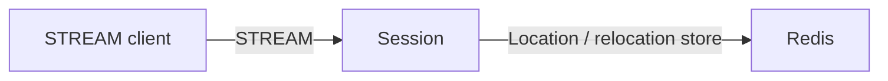

# MyGame Kotlin starter

This setup runs one Session node that accepts STREAM connections, with Redis for the Location Store and relocation storage. It provides hosting, diagnostics, process control, and an e2e starting point. It contains no application Spot, Actor, Entry, authentication, subscriptions, or game packets.



## Prerequisites

Install Docker with Compose v2 and access to a Linux container daemon. Bash or PowerShell 7 runs the scripts. Docker builds use Eclipse Temurin JDK and JRE `25.0.2+10` and Docker CLI `28.5.1`; the image references are at the top of `Dockerfile`. Network access to Maven Central and the Redis container registry is required. Host debugging also requires JDK 25 (Gradle resolves Kotlin 2.3.21).

`build.gradle.kts` pins Framework `0.30.2` and binding `1.20.0`. Gradle resolves them from Maven Central only. That Framework version must be published before building this setup; do not add repository source references or a private repository.

The Gradle wrapper and both server modules are included. Copy this directory to build it independently.

## Build

Build the node and runner images from this directory.

```sh
./run-e2e.sh --build-only
```

The build command removes its image tags after checking the build; Docker retains reusable build layers. PowerShell provides the same command.

```powershell
pwsh -NoProfile -File ./run-e2e.ps1 -BuildOnly
```

Both commands build the modules listed in `settings.gradle.kts`.

## Local e2e

Run the default Docker scenario from this directory.

```sh
./run-e2e.sh
./run-e2e.sh --scenario connect
```

The `connect` scenario waits for node READY, connects and closes one public STREAM connector, then checks the drain markers. The runner verifies a successful shutdown while it cleans up. PowerShell selects the same scenario.

```powershell
pwsh -NoProfile -File ./run-e2e.ps1
pwsh -NoProfile -File ./run-e2e.ps1 -Scenario connect
```

A successful run prints `✓ connect` and `Scenarios: 1/1 passed`. Cleanup failures return a nonzero exit code.

For host debugging, add `--local` or `-Local`; Redis still runs in Docker. Add `--no-build` or `-NoBuild` to reuse a local build. The runner assigns unique Redis keys and Compose names, binds listeners to port zero, and reads published endpoints from READY. Logs and generated run settings are in `.logs/run-<id>/`; Docker build and cleanup logs are in `.logs/docker-<project>/`.

Validate the structure without starting Redis or the node.

```sh
./run-e2e.sh --check-structure
```

```powershell
pwsh -NoProfile -File ./run-e2e.ps1 -CheckStructure
```

Changes to registrations, settings, structure, and scenarios must be made together; see [the development guide](AGENTS.md).

## Known issues

On Framework 0.30.x for Java and Kotlin, a node that registers a RouteMesh listener cannot finish `drain` while no other live node is in that mesh. The `connect` scenario's drain stops with `BLOCKED/DEADLINE_EXCEEDED` after the 30-second host deadline and the runner exits with code 1 (#1947, https://github.com/zlink-systems/zlink/issues/1947). The .NET starter passes the same scenario. The setup keeps the mesh listener and does not work around the failure; validate the scenario with a Framework release that fixes #1947 before deployment.

## Deployment sequence

Start Redis, set `redisEndpoint` and a deployment-specific `keyPrefix` in `server/config/session.json`, then start `server/session/build/install/session/bin/session server/config/session.json` (`session.bat` on Windows). Keep stdin open. Publish STREAM on a reachable interface when clients run outside the node's network namespace.

Wait for `READY <json>` before admitting clients. It contains the node ID and the mesh and STREAM endpoints actually bound by Framework. This starter registers a RouteMesh listener for future node composition but registers no object server or game Entry. Add gameplay from a separately downloaded sample before using it as a game server.

After clients disconnect, write `drain` to stdin. Wait for `RELOCATION_REQUESTED`, `RELOCATED`, and `SAFE_TO_SHUTDOWN`, then write `shutdown`, wait for `STOPPED`, and verify exit code zero. `Control` owns these markers. The starter checks an empty host drain; it does not demonstrate moving connected clients or game state to another node.

## 한국어 실행 안내

이 셋업은 STREAM 연결을 받는 Session node와 Redis를 실행한다. Docker 환경에서 Bash의 `./run-e2e.sh` 또는 PowerShell의 `pwsh -NoProfile -File ./run-e2e.ps1`을 실행하면 접속과 drain·shutdown을 검사한다. Framework pin 0.30.2이 Maven Central에 게시되어 있어야 빌드할 수 있다.

게임 기능은 포함하지 않는다. [한국어 개발 지침](AGENTS.ko.md)에 따라 필요한 샘플을 별도로 받아 실행한 뒤 Spot·Actor·Entry 등을 추가한다. 기능을 추가할 때 구조 선언과 구조 검사, e2e 시나리오도 함께 확장한다.
