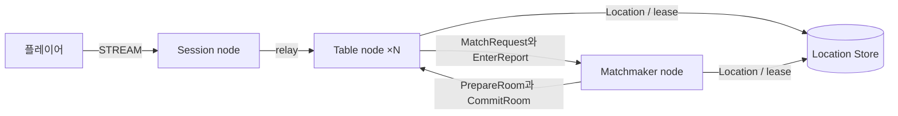

# MyGame 보드 테이블

[English](README.md)

Session node, Matchmaker node, Table node가 Redis Location Store를 공유한다. 플레이어는 매치메이킹을 요청하거나 테이블 ID로 입장할 수 있다. TypeScript E2E client는 공개 stream connector로 매치메이킹, 게임 진행, 재접속, node 교체를 확인한다. 게임 규칙을 추가할 때는 [개발 가이드](AGENTS.md)의 확장 위치를 따른다.



## 실행 환경

- 로컬 프로세스 실행에는 Node.js 22 이상과 npm이 필요하다. 공개 binding 1.26.0은 Node.js `>=22`를 지원한다.
- 현재 셸에서 Docker Engine과 Docker Compose v2를 사용할 수 있어야 한다.
- Windows에서는 PowerShell 7을, Linux와 WSL에서는 Bash를 사용한다.
- 공개 native binding을 지원하는 Windows x64 또는 Linux x64 환경이 필요하다.

Framework는 `0.34.0`, binding은 `1.26.0`으로 고정한다. 이 디렉터리만 복사한 뒤 공개 npm registry에서 설치한다.

## 빌드

```sh
./run-e2e.sh --build-only
```

```powershell
pwsh -NoProfile -File ./run-e2e.ps1 -BuildOnly
```

TypeScript를 컴파일하고 메시지 DTO에서 Framework의 기본 typed JSON schema를 생성한다. 서버는 공개 `ZLinkPacket` 등록으로 이 schema를 읽는다. 빌드 전용 실행은 서버를 시작하지 않고 도메인 검사 7개를 실행한 뒤 `Domain checks: 7/7`을 출력한다. 메시지별 codec을 추가하지 않는다.

## 로컬 서버

이 디렉터리에서 다음 명령을 실행한다. 스크립트는 `npm ci`로 패키지를 설치하고 빌드한 뒤 Docker에서 Redis를 시작한다. Session, Table, Matchmaker node는 로컬 Node.js 프로세스로 실행된다.

```sh
./run-server.sh
```

```powershell
.\run-server.cmd
```

`Server ready: ws://127.0.0.1:<port>`가 출력되면 그 주소를 client에 사용한다. 서버는 접속 주소를 `.logs/server.json`에 기록하고 node 로그 경로를 출력한다. 서버는 전경에서 실행되며 Ctrl+C를 누르면 node와 Redis를 종료하고 상태 파일을 제거한다. Windows의 CMD 래퍼는 PowerShell 7을 UTF-8 콘솔로 실행하고 종료할 때 기존 코드 페이지를 복원한다.

## Client 연결

### Endpoint와 첫 패킷

게임 client는 Session node의 `players` STREAM listener에 접속한다. `server/config/session.json`의 기본값은 `ws://127.0.0.1:0`이다. loopback의 WebSocket 경로는 `/`이며, 포트 `0`은 OS가 빈 포트를 지정한다는 뜻이다. Session 프로세스는 실제 주소를 `READY {"id":"session","endpoint":"..."}`에 출력한다. `run-server`가 출력한 주소나 이 READY 레코드의 주소를 사용한다. Table의 mesh 주소와 Redis 주소는 서버 내부 통신에 사용한다.

기본 listener는 같은 호스트와 네트워크 namespace에서 접속할 수 있다. Docker E2E의 node는 runner와 네트워크 namespace를 공유하며 실행이 끝나면 제거된다. 외부 게임 client가 접속하려면 배포를 유지하고 `streamEndpoint`를 접근 가능한 인터페이스와 포트에 설정한다. 컨테이너를 사용하면 이 포트도 공개한다. 브라우저는 기본 WebSocket listener를 사용할 수 있다. HTTPS 페이지에는 별도의 `wss://` 배포가 필요하다.

수신 handler를 등록한 뒤 직접 입장은 `JoinTableRequest{playerId, tableId}`, 매치메이킹은 `FindMatch{playerId}`를 `send(...).submit()`으로 보낸다. `e2e/client.mts`에서 두 경로를 확인할 수 있다. 매칭을 요청하면 `MatchQueued{ticketId}`가 오고, 두 플레이어가 방에 입장하면 각자 `MatchFound{ticketId, roomId, seat}`와 `TableView`를 순서대로 받는다. 취소하려면 `CancelMatch{ticketId}`를 보내고 `MatchCancelled{ticketId, reason}`을 받는다. 대기 중 연결이 끊겨도 15초 안에 다시 연결하면 같은 티켓을 사용할 수 있다.

입장에 성공하면 `TableView`의 `tableId`, `nodeId`, `yourSeat`, `handNumber`, `inHand`, `turnSeat`, `pot`, `seats`를 받는다. 동작이 거부되면 `ActionRejected`를 받는다. 입장 후 `SessionInfoRequest`를 `request(...).submit()`으로 보내면 `SessionInfo`의 `sessionId`, `actorId`, `objectGeneration`을 확인할 수 있다. 실제 게임에서는 Session을 bind하기 전에 플레이어 신원을 검증한다.

### 매치메이킹

`FindMatch{playerId}`를 보내면 `MatchQueued{ticketId}`를 받는다. 두 플레이어는 같은 `roomId`와 서로 다른 좌석을 받는다. 대기열에서 나가려면 `CancelMatch{ticketId}`를 보내고 `MatchCancelled{ticketId, reason}`을 받는다. 매칭으로 입장한 뒤에는 직접 입장과 같은 게임 메시지를 사용한다.

Matchmaker node의 Pool Spot ID는 `pool-board`다. Pool은 Spot-wide turn에서 오래 기다린 두 플레이어를 선택하고 방을 확정하거나 철회한다. Table node는 생성된 방과 Player Actor를 호스트하며, 준비 중인 방에는 배정에 명시된 플레이어만 받아들인다. Pool은 요청이 들어올 때와 500ms마다 대기열을 확인한다. 두 플레이어는 10초 안에 입장 성공을 보고해야 한다. 연결이 끊긴 채 15초가 지나면 `disconnected`, 대기가 120초를 넘기면 `expired`로 티켓을 취소한다.

### Connector 설치

아래 client는 Session WebSocket 주소와 이 템플릿의 패킷을 사용한다. `<version>`은 `package.json`의 `@zlink-systems/framework` 및 `@zlink-systems/stream-connector`에 고정된 릴리스로 바꾼다. 가이드에서 다른 릴리스를 설명할 수 있으므로 engine 설치는 연결된 README를 확인한다.

| Client        | Connector 설치                                                                                                                                                                                                                   | 가이드                                                                                                                                                                                                                                                                                                                                                                                                                   |
| ------------- | -------------------------------------------------------------------------------------------------------------------------------------------------------------------------------------------------------------------------------- | ------------------------------------------------------------------------------------------------------------------------------------------------------------------------------------------------------------------------------------------------------------------------------------------------------------------------------------------------------------------------------------------------------------------------ |
| Unity         | Native 및 Editor에서는 NuGetForUnity로 `Zlink.Stream.Connector`를 복원한다. WebGL에는 `com.zlink.stream-connector.webgl` UPM Git 패키지를 추가한다. 현재 대상의 assembly만 포함한다.                                             | [Unity README](https://github.com/zlink-systems/zlink/blob/main/framework/languages/engines/Unity/README.md), [.NET engine 연동](https://docs.zlink.systems/dotnet/guide/stream-connector/12-engine-integration/)                                                                                                                                                                                                        |
| Unreal        | `framework/languages/cpp/connector/engines/unreal`을 `Plugins/ZLinkStreamConnector`로 복사하고 `ThirdParty/ZLink`에 native connector를 패키징한다.                                                                               | [Unreal README](https://github.com/zlink-systems/zlink/blob/main/framework/languages/engines/Unreal/README.md), [C++ engine 연동](https://docs.zlink.systems/cpp/guide/stream-connector/12-engine-integration/)                                                                                                                                                                                                          |
| Godot         | .NET에서는 `Zlink.Stream.Connector` NuGet 패키지를 추가하고 `dotnet restore`를 실행한다. GDExtension에서는 Framework 배포 바이너리와 호환되는 `godot-cpp`로 C++ adapter를 빌드한다. 웹 내보내기는 .NET 샘플에서 지원하지 않는다. | [C# README](https://github.com/zlink-systems/zlink/blob/main/framework/languages/engines/Godot/csharp/README.md), [C++ README](https://github.com/zlink-systems/zlink/blob/main/framework/languages/engines/Godot/cpp/README.md), [.NET 연동](https://docs.zlink.systems/dotnet/guide/stream-connector/12-engine-integration/), [C++ 연동](https://docs.zlink.systems/cpp/guide/stream-connector/12-engine-integration/) |
| Cocos Creator | 웹 대상에서는 `npm install @zlink-systems/stream-connector@<version>`을 실행한다. Creator native adapter는 제공하지 않는다.                                                                                                      | [Cocos Creator README](https://github.com/zlink-systems/zlink/blob/main/framework/languages/engines/CocosCreator/README.md), [TypeScript engine 연동](https://docs.zlink.systems/node/guide/stream-connector/12-engine-integration/)                                                                                                                                                                                     |
| Axmol         | `framework/languages/cpp/connector/engines/axmol`을 `third_party/zlink_axmol_connector`에 복사하고 설치한 C++ Framework 패키지의 `zlink::stream_connector`를 링크한다.                                                           | [Axmol README](https://github.com/zlink-systems/zlink/blob/main/framework/languages/engines/Axmol/README.md), [C++ engine 연동](https://docs.zlink.systems/cpp/guide/stream-connector/12-engine-integration/)                                                                                                                                                                                                            |
| 웹 브라우저   | `npm install @zlink-systems/stream-connector@<version>`을 실행하고 패키지 루트를 import한다. 페이지 보안 정책에 맞는 `ws://` 또는 `wss://` 주소를 사용한다.                                                                      | [TypeScript connector](https://docs.zlink.systems/node/guide/stream-connector/)                                                                                                                                                                                                                                                                                                                                          |
| C++           | connector를 포함한 Framework 배포 바이너리를 설치한다. `find_package(zlink_stream_connector_cpp CONFIG REQUIRED)`로 찾고 `zlink::stream_connector`를 링크한다.                                                                   | [C++ connector](https://docs.zlink.systems/cpp/guide/stream-connector/)                                                                                                                                                                                                                                                                                                                                                  |
| C#/.NET       | `dotnet add package Zlink.Stream.Connector --version <version>`                                                                                                                                                                  | [.NET connector](https://docs.zlink.systems/dotnet/guide/stream-connector/)                                                                                                                                                                                                                                                                                                                                              |
| Java          | Maven 또는 Gradle에 `systems.zlink:zlink-stream-connector:<version>`을 추가한다.                                                                                                                                                 | [Java connector](https://docs.zlink.systems/java/guide/stream-connector/)                                                                                                                                                                                                                                                                                                                                                |
| Kotlin        | `systems.zlink:zlink-stream-connector:<version>`과 coroutine 래퍼 `systems.zlink:zlink-framework-kotlin:<version>`을 추가한다.                                                                                                   | [Kotlin connector](https://docs.zlink.systems/kotlin/guide/stream-connector/)                                                                                                                                                                                                                                                                                                                                            |
| Node          | `npm install @zlink-systems/stream-connector@<version>`을 실행하고 Node.js 22 이상에서 패키지 루트를 import한다.                                                                                                                 | [Node connector](https://docs.zlink.systems/node/guide/stream-connector/)                                                                                                                                                                                                                                                                                                                                                |

### 테이블 입장 예제

아래 코드를 복사한 템플릿의 `e2e/connect-once.mts`에 저장하고 `npm run build`를 실행한다. `run-server`로 실행 중인 Session 주소를 사용해 `node dist/e2e/connect-once.mjs <actual-session-endpoint>`를 실행한다. 새 플레이어 ID와 테이블 ID를 지정한다. JSON codec은 `handNumber`, `pot`, `chips` 같은 계약의 `int64` 값을 십진수 문자열로 받는다. 이 예제는 `tableId`와 `yourSeat`를 읽는다. 정수 변환과 전체 게임 흐름은 `e2e/client.mts`에서 확인할 수 있다.

```typescript
import {
  zlinkStreamConnectorFactory,
  zlinkStreamJsonCodec,
  ZlinkStreamDispatchMode
} from '@zlink-systems/stream-connector';
import { JoinTableRequest } from '../server/shared/messages.js';

const endpoint = process.argv[2];
if (!endpoint) throw new Error('Pass the actual Session endpoint from READY');
const connector = zlinkStreamConnectorFactory.create({
  endpoint,
  codec: zlinkStreamJsonCodec,
  dispatchMode: ZlinkStreamDispatchMode.Immediate,
  reconnect: { enabled: false }
});

try {
  await connector.connect();
  const response = new Promise<{ tableId: string; yourSeat: number }>((resolve, reject) => {
    connector.on<{ tableId: string; yourSeat: number }>('TableView', (message) => {
      resolve(message.payload);
    });
    connector.on('ActionRejected', () => reject(new Error('Join rejected')));
    connector.onErrorReceived((error) => reject(new Error(error.message)));
    connector.onDisconnected(() => reject(new Error('Disconnected before TableView')));
  });
  const [, view] = await Promise.all([
    connector.send(new JoinTableRequest('guide-player', 'guide-table')).submit(),
    response
  ]);
  console.log(`Joined ${view.tableId}, seat ${view.yourSeat}`);
} finally {
  await connector.close();
}
```

## E2E 시나리오

별도 터미널에서 E2E를 실행한다. `.logs/server.json`이 준비된 서버를 가리키면 스크립트가 `run-server`로 시작한 서버에 연결한다. 기본 연결 실행에서는 `table`, `reconnect`, `match`, `match-cancel`을 실행한다. Table 프로세스를 교체하는 `update`까지 실행하려면 서버를 종료한 뒤 Docker 격리 실행을 사용한다.

```sh
./run-e2e.sh
./run-e2e.sh --scenario match,match-cancel
```

```powershell
.\run-e2e.cmd
.\run-e2e.cmd -Scenario match,match-cancel
```

실행 중인 서버에 반드시 연결해야 하면 `--attach` 또는 `-Attach`를 지정한다. 실행 정책이 허용하면 PowerShell 7에서 `run-e2e.ps1`과 `run-server.ps1`을 직접 실행할 수 있다.

### 격리 실행

Docker는 E2E runner와 각 node를 컨테이너로 실행한다. 모든 node는 같은 이미지를 사용한다. runner 이미지에는 Docker CLI 28.5.1도 포함한다. `NODE_IMAGE`는 `node:22.20.0-trixie`로 고정하며, runtime에는 slim 이미지와 native binding에 필요한 OpenSSL을 포함한다. node는 runner의 네트워크 namespace를 공유하여 loopback과 OS가 할당하는 포트를 사용한다. 설정은 `docker cp`로 복사하고 표준 입출력으로 주고받는 제어 명령은 `docker start -a -i`로 전달한다. 실행마다 Compose 프로젝트, 네트워크, 이미지 태그가 분리되며 Docker 빌드 캐시는 재사용한다.

빌드와 Docker 정리 로그는 `.logs/docker-<project>/`, node 설정과 로그는 `.logs/run-<id>/`에 있다. Node.js 22 이상과 npm을 설치한 호스트에서는 `./run-e2e.sh --local` 또는 `pwsh -NoProfile -File ./run-e2e.ps1 -Local`로 로컬 프로세스를 디버깅할 수 있다. 기존 빌드를 사용하려면 `--no-build` 또는 `-NoBuild`를 추가한다. Redis는 Docker에서 실행한다.

구조 검사가 통과하면 runner가 Redis를 시작하고 node 주소와 Redis 키 접두사를 포함한 설정을 `.logs/run-<id>/`에 쓴다. node가 `READY`를 출력하면 시나리오를 실행하고, 종료할 때 실행 중 생성한 프로세스와 Compose 프로젝트를 정리한다.

두 실행 방식 모두 시나리오별 제목과 통과 또는 실패 한 줄을 출력한 뒤 `Scenarios: N/M passed`를 표시한다. 격리 실행에서는 `Domain checks: 7/7`도 출력한다. runner는 실패 세부 정보, node stderr, client JSONL을 실행 로그 디렉터리에 남긴다. 시나리오 또는 정리가 실패하면 종료 코드는 1이다. node의 OpenTelemetry exporter는 message-flow 진단을 stderr에 기록한다.

### 시나리오 검증 항목

| 시나리오       | 검증 동작                                                                                                                                                                                                                                                                         |
| -------------- | --------------------------------------------------------------------------------------------------------------------------------------------------------------------------------------------------------------------------------------------------------------------------------- |
| `table`        | 좌석, 칩, 비공개 카드, 정산을 확인한다. Session은 client가 보낸 `HandResult`를 거부한다. 차례 위반, `integer-out-of-range`, 칩 부족에 따른 거부는 `retryAfterMs: 0`을 반환하고 테이블 상태를 유지한다. 정산 후 모든 좌석의 `cardCount`는 0이며 개인 카드 조회 결과는 빈 목록이다. |
| `reconnect`    | 새 Session이 같은 Actor와 좌석을 사용하고 진행 중인 패를 받는다. 정산 후 모든 패가 비어 있으며 개인 카드 조회 결과는 빈 목록이다.                                                                                                                                                 |
| `match`        | 두 플레이어가 같은 방에 배정되어 다른 좌석에 입장하고 한 판을 정산한다.                                                                                                                                                                                                           |
| `match-cancel` | 대기 중인 플레이어가 재접속해 같은 티켓을 취소한다. 다른 두 플레이어는 매칭을 완료하고 한 판을 정산한다.                                                                                                                                                                          |
| `update`       | 두 client의 접속과 게임 상태가 relocation 중에도 유지된다. 교체 대상 node에서 판을 정산한 뒤 패가 비어 있고 개인 카드 조회 결과도 비어 있다. 교체 프로세스는 새 테이블을 호스트한다.                                                                                              |

runner는 `zlink.structure.json` 순서대로 시나리오를 실행한다.

Node 계약의 `handNumber`, bet `amount`, `chips`, `pot`은 `bigint`다. Framework 기본 JSON serializer는 이 `int64` 값을 십진수 문자열로 전달한다. `ActionRejected.retryAfterMs`는 `int32` JSON 숫자다.

구조만 검사하려면 `./run-e2e.sh --check-structure` 또는 `pwsh -NoProfile -File ./run-e2e.ps1 -CheckStructure`를 실행한다. 검사는 프로젝트의 구조와 설정 파일을 검증한다.

## Framework 동작

- **handler의 DB·파일 I/O 대기**. 일반 async terminal은 turn을 유지한다. `Yield`를 사용하면 같은 Spot의 다른 handler를 실행할 수 있다. [실행 모델](https://docs.zlink.systems/node/guide/server/32-execution-model/#io-worker-wait)
- **생성 기한 초과**. `DeadlineExceeded`와 호출자 취소는 결과가 다르다. [Actor 생성](https://docs.zlink.systems/node/guide/server/22-actor/#creation-deadline), [Session 구현](server/session/session.ts)
- **동시 로그인**. 서로 다른 ID를 생성할 때 각각 Location Store 왕복이 필요하다. 예상 부하를 측정하고 기한을 설정한다. [Location Store](https://docs.zlink.systems/node/guide/server/25-location/#creation-load)
- **부하 중 send**. Send는 전송 여유를 기다리고 애플리케이션에 최종 결과를 반환한다. [Backpressure](https://docs.zlink.systems/node/guide/server/33-backpressure/#send-backpressure), [Session 구현](server/session/session.ts)
- **중복 로그인**. 템플릿은 기본 동작을 사용해 새 Session의 bind를 허용한다. 중복 로그인을 막으려면 Actor의 duplicate-bind callback에서 거부한다. [Session binding](https://docs.zlink.systems/node/guide/server/39-session-binding/#duplicate-session-bind)
- **ObjectGeneration**. 같은 ID의 서로 다른 논리적 객체를 구분한다. [활성화 수명](https://docs.zlink.systems/node/guide/server/34-activation-lifetime/#object-generation), [Session 구현](server/session/session.ts)
- **READY와 Serving**. host는 runtime의 `Serving` 상태를 확인하고 `READY`를 출력한다. [운영 가이드](https://docs.zlink.systems/node/guide/server/12-operations/#wait-for-serving), [Hosting 구현](server/shared/hosting.ts)

## Relocation 대기 시간

격리 환경의 `update`는 공개 Framework 0.34.0 패키지로 실행한다. Message Follow는 30초로 설정한다. `SAFE_TO_SHUTDOWN`을 확인할 때는 이 기간과 기존 relocation 대기 시간을 더해 사용한다. 교체 프로세스의 `READY`가 출력되면 새 테이블이 그 프로세스에서 생성되고 한 판이 정산되는지 확인한다.

## 배포 순서

1. Redis를 준비하고 각 node 설정에서 `redisEndpoint`와 배포마다 고유한 `keyPrefix`를 지정한다.
2. `node dist/server/table/main.js server/config/table-a.json`과 같은 명령에 `table-b.json`도 각각 전달해 Table node를 시작한다. 각 node의 `meshEndpoint`는 다른 node가 접속할 수 있는 주소를 사용한다.
3. `node dist/server/matchmaker/main.js server/config/matchmaker.json`으로 Matchmaker를 시작한다.
4. `node dist/server/session/main.js server/config/session.json`으로 Session을 시작한다. 외부 접속에는 `ws://` 주소를 사용한다. 공개 계약에서 지원하는 구성에는 `wss://`를 설정할 수 있다.
5. 각 프로세스의 `READY`를 확인한다. 제어 명령 `drain`과 `shutdown`은 표준 입력으로 전달한다. Table을 drain한 뒤 종료하기 전에 `RELOCATION_REQUESTED`, `RELOCATED`, `SAFE_TO_SHUTDOWN` 순서로 확인한다.

Docker E2E runner는 구조 파일에 선언된 역할을 모두 시작한다. 배포에서 Compose로 Matchmaker를 실행하려면 `docker` profile의 `node-image`를 빌드한다. `MY_GAME_MATCHMAKER_CONFIG`에 접근 가능한 Redis와 mesh 주소가 담긴 설정을 지정하고, 같은 Compose 프로젝트에서 `deployment` profile의 `matchmaker`를 시작한다.

기본 설정의 포트는 loopback에서 자동 할당한다. 프로덕션에서는 접근 가능한 주소와 Redis를 명시한다. Table stable type의 배치와 경로 갱신은 Framework가 결정한다.

## 확장 위치와 검증

`server/table/domain/table-state.ts`가 게임 규칙과 애플리케이션 snapshot을 소유한다. Framework handler와 relocation adapter는 `server/table/infrastructure/`에 있다. Session 인증을 추가하려면 첫 `JoinTableRequest` 또는 `FindMatch`의 플레이어 신원을 확인한다. 템플릿의 `playerId`는 E2E 입력이다.

`server/matchmaker/domain/`의 MatchRule은 도착 순서에 따라 매칭한다. 등급 조건은 이 규칙에 추가한다. 참가자가 배정을 수락하는 단계가 필요하면 Pool이 배정을 확정하기 전에 처리한다.

```sh
npm run typecheck
npm run lint
npm run format:check
node --test dist/e2e/domain.test.js
```

도메인 검사 7개가 통과하면 runner가 `Domain checks: 7/7`을 출력한다. 확장할 때는 [개발 가이드](AGENTS.md)의 공개 API와 상태 소유권 규칙을 따른다.

## Windows 환경

runner는 `windowsHide: true`로 자식 프로세스를 실행한다. Windows에서는 PowerShell 7이나 CMD 래퍼를 사용한다. 프로젝트는 native addon을 사용하므로 설치 전에 Node 버전과 CPU 아키텍처가 지원 범위에 있는지 확인한다. npm 설치는 템플릿 디렉터리에서 공개 registry를 사용한다.

격리 E2E runner는 공개 Table stable-type 제한 `tableCapacity`에 선택한 시나리오 수를 지정한다. `update`에 앞선 시나리오가 각각 테이블을 남기므로 기존 node를 drain하면 남은 프로세스가 용량 한도에 도달한다. 교체 프로세스가 새 테이블을 호스트하고 두 플레이어가 그 node ID를 확인한다. 배포에서 용량 값을 생략하거나 0으로 지정하면 한도를 두지 않는다. Entry Spot은 Table node에, 고정 Pool User Spot은 Matchmaker node에 위치한다.
