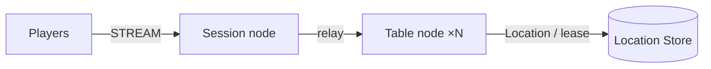

# MyGame board tables

This project runs a Session node and Table nodes that share a Redis Location Store. A TypeScript e2e client uses the public stream connector to verify the game, reconnection, and node replacement. Add game rules at the extension points described in [AGENTS.md](AGENTS.md).



## Prerequisites

- Local process debugging: Node.js 22 or later with npm. The supported range of public binding 1.20.0 is `>=22`.
- Docker Engine with Docker Compose v2, reachable from the current shell.
- PowerShell 7 on Windows; Bash on Linux and WSL.
- A Windows x64 or Linux x64 environment supported by the published native binding.

The Framework package is pinned to `0.30.2` and the binding to `1.20.0`. Copy only this directory and install from the public npm registry.

## Build

```sh
./run-e2e.sh --build-only
```

```powershell
pwsh -NoProfile -File ./run-e2e.ps1 -BuildOnly
```

This compiles TypeScript and generates the Framework default typed JSON schema from the contract DTOs. The server loads the generated schema through the public `ZLinkPacket` registration path. `--build-only` also runs the seven domain checks and prints `Domain checks: 7/7`; it does not start nodes. Do not add per-message codecs.

## Docker e2e

Docker runs the e2e runner and each node in containers. All roles use one image; the runner image adds Docker CLI 28.5.1. `NODE_IMAGE` pins `node:22.20.0-trixie` with a slim runtime and the native binding's OpenSSL dependency. Nodes share the runner network namespace, preserving loopback listeners and OS-assigned ports. Configuration is copied with `docker cp`; stdin/stdout controls use `docker start -a -i`. Each invocation owns a unique Compose project, network and image tags. Cleanup failures return exit code 1, and shared Docker build cache remains available.

Build and outer cleanup logs are in `.logs/docker-<project>/`; node configuration, stdout and message-flow stderr remain in `.logs/run-<id>/`. For local process debugging, install Node.js 22 or later and npm, then run `./run-e2e.sh --local` or `pwsh -NoProfile -File ./run-e2e.ps1 -Local`. Add `--no-build` or `-NoBuild` to reuse an existing local build. Redis remains in Docker.

```sh
./run-e2e.sh
./run-e2e.sh --scenario table,reconnect
```

```powershell
pwsh -NoProfile -File ./run-e2e.ps1
pwsh -NoProfile -File ./run-e2e.ps1 -Scenario table,reconnect
```

Both scripts build Docker images and execute the same runner in a container. After the structure check, the runner starts Redis in a uniquely named Compose project and exposes only an ephemeral loopback port. It records the node endpoints and a unique Redis prefix in the configuration under `.logs/run-<id>/`. After receiving `READY`, it runs the scenarios and then cleans up the processes and the Compose project it started.

| Scenario  | Verified behavior                                                                                                                                             |
| --------- | ------------------------------------------------------------------------------------------------------------------------------------------------------------- |
| table     | Two players take seats, cards stay private, an out-of-turn action is rejected, and settlement preserves the winner and chips.                                 |
| reconnect | A new Session restores the same Actor ID, generation, seat, chips, cards, and turn.                                                                           |
| update    | PlannedMaintenance drain, RELOCATED and SAFE_TO_SHUTDOWN, connection and state preserved, and a new hand completes on the replacement process after shutdown. |

The E2E runner prints `Domain checks: 7/7`, then `✓ <id>` or `✗ <id>` and `Scenarios: N/M passed`. A failure or a cleanup failure returns exit code 1. The node stderr and client JSONL of the first failure are retained. Node stderr records dispatch `Normal` message flow through the OpenTelemetry log exporter.

## Scenarios

| Scenario | Verified behavior |
| --- | --- |
| `table` | Seats, chips, private cards, and settlement. The Session rejects a client-sent `HandResult`; out-of-turn, `integer-out-of-range`, and insufficient-chip bets are also rejected with `retryAfterMs: 0`. Each rejection leaves the table state unchanged. Settlement reports `cardCount: 0` for every seat, and a private-hand query returns an empty list. |
| `reconnect` | The new Session keeps the same Actor and seat, receives the current hand, and settles with every hand cleared. A post-settlement private-hand query is empty. |
| `update` | Both clients retain their connection and game state through relocation. The hand settles on the replacement node with every hand cleared; a post-settlement private-hand query is empty. The replacement then hosts a new table. |

The runner executes these scenarios in the order listed in `zlink.structure.json`.

The Node contract represents `handNumber`, bet `amount`, `chips`, and `pot` as `bigint`. The default Framework JSON serializer carries those `int64` values as decimal strings. `ActionRejected.retryAfterMs` is an `int32` JSON number.

To check only the structure, run `./run-e2e.sh --check-structure` or `pwsh -NoProfile -File ./run-e2e.ps1 -CheckStructure`. The checker validates the actual structure and configuration files and does not run its own self-tests.

## Known issues

Validated against the published Framework 0.30.2 packages.

Message Follow is explicitly configured for 30 seconds. The `SAFE_TO_SHUTDOWN` observation budget is that period plus the existing relocation budget. Update waits for replacement `READY`, then asserts that the replacement hosts the new table and completes a hand.

## Deployment sequence

1. Prepare Redis and set `redisEndpoint` and a deployment-specific unique `keyPrefix` in each node configuration.
2. Start Table A and B with `node dist/server/table/main.js server/config/table-a.json` and `table-b.json`. Set mutually reachable `meshEndpoint` values.
3. Start Session with `node dist/server/session/main.js server/config/session.json`. The external client `streamEndpoint` is a `ws://` endpoint, or a `wss://` endpoint if the public contract supports it.
4. Confirm `READY` from each process. Operational control uses the standard input commands `drain` and `shutdown`. For a Table drain, confirm `RELOCATION_REQUESTED`, `RELOCATED`, and `SAFE_TO_SHUTDOWN` in that order before shutting down.

The default configuration uses loopback automatic ports. In production, specify reachable endpoints and Redis explicitly. The Framework decides placement and route updates for the Table stable type.

## Extension points and verification

`server/table/domain/table-state.ts` owns the game rules and the application snapshot. The Framework handlers and the relocation adapter are in `server/table/infrastructure/`. To add Session authentication, validate the player identity in the first `JoinTableRequest`. The current playerId is an e2e input; no product authentication is included.

```sh
npm run typecheck
npm run lint
npm run format:check
node --test dist/e2e/domain.test.js
```

The domain test reports `Domain checks: 7/7` after all seven checks pass.

When extending, follow the public API boundaries and state ownership rules in [AGENTS.md](AGENTS.md).

## Windows

The runner starts child processes with `windowsHide: true`. Run it in PowerShell 7; no Unix shell is required. The project includes a native addon, so check the Node support range and the CPU architecture. The project does not use an npm install at the repository root or a local package feed.

The e2e runner sets each node's optional `tableCapacity` to the number of selected scenarios through the public Table stable-type limit. Each scenario retains one table. After update drains the source, the surviving node is at capacity, so only the replacement can host the new table. Both new players must observe the replacement node ID. Omitted or zero capacity leaves deployment capacity unlimited. Entry declarations describe the application Entry on Table nodes only; there are no fixed User Spots in this template.

## 한국어 실행 안내

기본 빌드와 e2e는 Docker에서 runner와 node를 실행한다. Bash는 `./run-e2e.sh`, PowerShell 7은 `pwsh -NoProfile -File ./run-e2e.ps1`을 사용한다. 로컬 프로세스 디버깅은 Node.js와 npm을 설치한 뒤 `--local` 또는 `-Local`로 실행한다. `--build-only`는 일곱 도메인 검사를 실행하고 `Domain checks: 7/7`을 출력한 뒤 종료한다. Docker 빌드·정리 로그는 `.logs/docker-<project>/`에 남는다.

이 프로젝트는 Session node 하나, Table node 두 개, Redis Location Store를 실행한다. 실행기는 `table`·`reconnect`·`update` 시나리오를 순서대로 확인하고 자신이 시작한 process와 Compose project를 정리한다.

`table`은 client가 보낸 내부 `HandResult` 패킷을 `packet-not-allowed`로 거부한다. 차례 위반·`integer-out-of-range`·칩 부족 베팅도 거부하고, 각 거부 뒤 상태가 바뀌지 않았는지 확인한다. 모든 거부 응답은 `ActionRejected(reason, retryAfterMs)`이며 현재 `retryAfterMs`는 0이다. 정산 응답에서 모든 좌석의 `cardCount`가 0인지 확인하고, 정산 뒤 개인 패 조회가 빈 목록을 반환하는지도 검사한다. `reconnect`와 `update`는 상태를 유지한 채 정산하고 같은 빈 패 결과를 확인한다.

Node 계약의 `handNumber`, 베팅 `amount`, `chips`, `pot`은 `bigint`로 표현한다. 기본 Framework JSON serializer는 해당 `int64` 값을 10진 문자열로 전달한다. `ActionRejected.retryAfterMs`는 JSON `int32` 정수다.

도메인 시험의 일곱 검사가 모두 통과하면 `Domain checks: 7/7`을 출력한다.

전체 시나리오 또는 `--scenario table,reconnect`로 선택하여 실행한다. 실패하면 종료 코드 1을 반환하고 첫 실패의 node stderr와 client JSONL을 `.logs/run-<id>/` 아래에 남긴다. 공개 Framework 0.30.2 패키지로 검증했다. 게임 규칙을 추가할 위치와 공개 API 사용 규칙은 `AGENTS.md`를 따른다.
