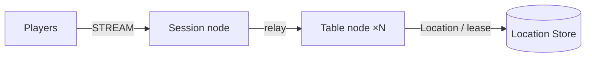

# MyGame board tables

This project runs a Session node and Table nodes that share a Redis Location Store. A TypeScript e2e client uses the public stream connector to verify the game, reconnection, and node replacement. Add game rules at the extension points described in [AGENTS.md](AGENTS.md).



## Prerequisites

- Local process debugging: Node.js 22 or later with npm. The supported range of public binding 1.23.0 is `>=22`.
- Docker Engine with Docker Compose v2, reachable from the current shell.
- Windows PowerShell 5.1 or PowerShell 7 on Windows; Bash on Linux and WSL. The examples use `pwsh -NoProfile -File`; in Windows PowerShell 5.1 run the same script with `powershell -NoProfile -ExecutionPolicy Bypass -File`.
- A Windows x64 or Linux x64 environment supported by the published native binding.

The Framework package is pinned to `0.32.0` and the binding to `1.23.0`. Copy only this directory and install from the public npm registry.

## Build

```sh
./run-e2e.sh --build-only
```

```powershell
pwsh -NoProfile -File ./run-e2e.ps1 -BuildOnly
```

This compiles TypeScript and generates the Framework default typed JSON schema from the contract DTOs. The server loads the generated schema through the public `ZLinkPacket` registration path. `--build-only` also runs the seven domain checks and prints `Domain checks: 7/7`; it does not start nodes. Do not add per-message codecs.

## Client connection

### Endpoint and first packet

Connect game clients to the Session node's `players` STREAM listener. Its default configuration in `server/config/session.json` is `ws://127.0.0.1:0`: WebSocket on loopback, with port `0` asking the OS to assign a free port and no application path (the WebSocket URL uses `/`). The Session process prints `READY {"id":"session","endpoint":"..."}` with the actual listening endpoint; use that endpoint, not port `0`. `e2e/server-host.ts` reads this value and the e2e runner passes it to the client. Table mesh endpoints and Redis are not client endpoints.

The default listener is reachable from the same host/network namespace. Docker e2e nodes share the runner's network namespace; the runner removes its nodes when it finishes. To connect an external game client, keep a deployment running, configure `streamEndpoint` with a reachable interface and port, and expose that port when using containers. Use the server's reachable host in the client URL. Browsers can use this WebSocket listener; an HTTPS page needs a secure `wss://` deployment, which the default configuration does not provide.

The first application packet is `JoinTableRequest` with `playerId` and `tableId`. Send it with `send(...).submit()`, as `e2e/client.mts` does; successful seating produces a `TableView` push containing `tableId`, `nodeId`, `yourSeat`, `handNumber`, `inHand`, `turnSeat`, `pot`, and `seats`. Register the receiver before sending. `ActionRejected` reports a rejected action. After joining, `SessionInfoRequest` can use `request(...).submit()` to receive `SessionInfo` (`sessionId`, `actorId`, `objectGeneration`). Do not request session information before joining. This template has no authentication: validate identity before binding for a production game.

### Connector installation

All clients below use the Session WebSocket endpoint and this template's packet names, rather than the Engine Lobby sample packets. Use the connector version pinned by `package.json` dependencies `@zlink-systems/framework` and `@zlink-systems/stream-connector`; replace `<version>` in the commands with that release. The linked guides may describe newer versions; engine installation instructions are in the linked repository READMEs.

| Client                             | Connector installation                                                                                                                                                                                                                                                                                                                                                                                                                                                          | Documentation guide                                                                                                                                                          |
| ---------------------------------- | ------------------------------------------------------------------------------------------------------------------------------------------------------------------------------------------------------------------------------------------------------------------------------------------------------------------------------------------------------------------------------------------------------------------------------------------------------------------------------- | ---------------------------------------------------------------------------------------------------------------------------------------------------------------------------- |
| Unity                              | Native/Editor: restore `Zlink.Stream.Connector` with NuGetForUnity. WebGL: add the `com.zlink.stream-connector.webgl` UPM Git package; include only the connector assembly for the active target. See the [Unity README](https://github.com/zlink-systems/zlink/blob/main/framework/languages/engines/Unity/README.md) and its package manifest.                                                                                                                                | [.NET engine integration](https://docs.zlink.systems/dotnet/guide/stream-connector/12-engine-integration/)                                                                   |
| Unreal                             | Copy `framework/languages/cpp/connector/engines/unreal` into `Plugins/ZLinkStreamConnector`, then package the native connector under `ThirdParty/ZLink` as described in the [Unreal README](https://github.com/zlink-systems/zlink/blob/main/framework/languages/engines/Unreal/README.md).                                                                                                                                                                                     | [C++ engine integration](https://docs.zlink.systems/cpp/guide/stream-connector/12-engine-integration/)                                                                       |
| Godot                              | .NET: add the NuGet package `Zlink.Stream.Connector` and run `dotnet restore`; see the [C# README](https://github.com/zlink-systems/zlink/blob/main/framework/languages/engines/Godot/csharp/README.md). GDExtension: build the C++ Godot adapter against the framework prebuilt and matching `godot-cpp`; see the [C++ README](https://github.com/zlink-systems/zlink/blob/main/framework/languages/engines/Godot/cpp/README.md). The .NET sample does not support Web export. | [.NET](https://docs.zlink.systems/dotnet/guide/stream-connector/12-engine-integration/), [C++](https://docs.zlink.systems/cpp/guide/stream-connector/12-engine-integration/) |
| Cocos Creator                      | Web target: `npm install @zlink-systems/stream-connector@<version>`; see the [Cocos Creator README](https://github.com/zlink-systems/zlink/blob/main/framework/languages/engines/CocosCreator/README.md). This package does not provide a Creator native adapter.                                                                                                                                                                                                               | [TypeScript engine integration](https://docs.zlink.systems/node/guide/stream-connector/12-engine-integration/)                                                               |
| Axmol                              | Copy `framework/languages/cpp/connector/engines/axmol` into `third_party/zlink_axmol_connector` and link `zlink::stream_connector` from the installed C++ framework package; see the [Axmol README](https://github.com/zlink-systems/zlink/blob/main/framework/languages/engines/Axmol/README.md).                                                                                                                                                                              | [C++ engine integration](https://docs.zlink.systems/cpp/guide/stream-connector/12-engine-integration/)                                                                       |
| Web browser (TypeScript connector) | `npm install @zlink-systems/stream-connector@<version>`; import the package root in the browser build. Use `ws://` or `wss://`, subject to the page's security policy.                                                                                                                                                                                                                                                                                                          | [TypeScript connector](https://docs.zlink.systems/node/guide/stream-connector/)                                                                                              |
| C++                                | Install the C++ framework prebuilt containing the connector; use `find_package(zlink_stream_connector_cpp CONFIG REQUIRED)` and link `zlink::stream_connector`.                                                                                                                                                                                                                                                                                                                 | [C++ connector](https://docs.zlink.systems/cpp/guide/stream-connector/)                                                                                                      |
| C#/.NET                            | `dotnet add package Zlink.Stream.Connector --version <version>`                                                                                                                                                                                                                                                                                                                                                                                                                 | [.NET connector](https://docs.zlink.systems/dotnet/guide/stream-connector/)                                                                                                  |
| Java                               | Add Maven/Gradle dependency `systems.zlink:zlink-stream-connector:<version>`.                                                                                                                                                                                                                                                                                                                                                                                                   | [Java connector](https://docs.zlink.systems/java/guide/stream-connector/)                                                                                                    |
| Kotlin                             | Add `systems.zlink:zlink-stream-connector:<version>` and `systems.zlink:zlink-framework-kotlin:<version>` for the coroutine wrapper.                                                                                                                                                                                                                                                                                                                                            | [Kotlin connector](https://docs.zlink.systems/kotlin/guide/stream-connector/)                                                                                                |
| Node                               | `npm install @zlink-systems/stream-connector@<version>`; use the package root and Node.js 22 or later.                                                                                                                                                                                                                                                                                                                                                                          | [Node connector](https://docs.zlink.systems/node/guide/stream-connector/)                                                                                                    |

### One join and its response

Save this as `e2e/connect-once.mts` in a copy of the template, run `npm run build`, then run `node dist/e2e/connect-once.mjs <actual-session-endpoint>` while the Session, Table nodes, and Redis are running. The e2e command owns a temporary deployment, so run this against a deployment kept running separately. Choose a fresh player/table ID for this example. The JSON codec leaves contract int64 values such as `handNumber`, `pot`, and seat `chips` as decimal strings on receipt; this example reads only `tableId` and `yourSeat`. See `e2e/client.mts` for integer conversion and the complete game flow.

```typescript
import {
  zlinkStreamConnectorFactory,
  zlinkStreamJsonCodec,
  ZlinkStreamDispatchMode
} from '@zlink-systems/stream-connector';
import { JoinTableRequest } from '../server/shared/messages.js';

const endpoint = process.argv[2];
if (!endpoint) throw new Error('Pass the actual Session endpoint from READY');
const connector = zlinkStreamConnectorFactory.create({
  endpoint,
  codec: zlinkStreamJsonCodec,
  dispatchMode: ZlinkStreamDispatchMode.Immediate,
  reconnect: { enabled: false }
});

try {
  await connector.connect();
  const response = new Promise<{ tableId: string; yourSeat: number }>((resolve, reject) => {
    connector.on<{ tableId: string; yourSeat: number }>('TableView', (message) => {
      resolve(message.payload);
    });
    connector.on('ActionRejected', () => reject(new Error('Join rejected')));
    connector.onErrorReceived((error) => reject(new Error(error.message)));
    connector.onDisconnected(() => reject(new Error('Disconnected before TableView')));
  });
  const [, view] = await Promise.all([
    connector.send(new JoinTableRequest('guide-player', 'guide-table')).submit(),
    response
  ]);
  console.log(`Joined ${view.tableId}, seat ${view.yourSeat}`);
} finally {
  await connector.close();
}
```

## Run the server and the e2e separately

Open two terminals in the template directory. In the first terminal, start Redis and the nodes. Wait for `Server ready:` and the Session endpoint. Each node's console lines start with its ID, such as `[session]` or `[tableA]`.

```sh
./run-server.sh
```

```powershell
pwsh -NoProfile -File ./run-server.ps1
```

In the second terminal, attach the e2e runner. Each client message appears on one line with the client name, a send (`→`) or receive (`←`) arrow, the message type, and compact JSON.

```sh
./run-e2e.sh --attach
```

```powershell
pwsh -NoProfile -File ./run-e2e.ps1 -Attach
```

Start the server again before another full e2e run: one server start reserves table capacity for one run of every scenario, and the `update` scenario replaces a table node.

Press Ctrl+C in the first terminal to shut down the nodes and remove the Redis container. The console shows each diagnostic record as its time and message; each node also appends the full records to `logs/<node-id>.log` as JSON lines, including when it is started directly with `node`. Set `logDir` in a node's JSON config to use another directory. Docker e2e nodes write that file inside their container; the runner keeps each node's stderr in `.logs/run-<id>/`. The e2e runner and server host also keep per-run logs under `.logs/`.

## Docker e2e

Docker runs the e2e runner and each node in containers. All roles use one image; the runner image adds Docker CLI 28.5.1. `NODE_IMAGE` pins `node:22.20.0-trixie` with a slim runtime and the native binding's OpenSSL dependency. Nodes share the runner network namespace, preserving loopback listeners and OS-assigned ports. Configuration is copied with `docker cp`; stdin/stdout controls use `docker start -a -i`. Each invocation owns a unique Compose project, network and image tags. Cleanup failures return exit code 1, and shared Docker build cache remains available.

Build and outer cleanup logs are in `.logs/docker-<project>/`; node configuration, stdout and message-flow stderr remain in `.logs/run-<id>/`. For local process debugging, install Node.js 22 or later and npm, then run `./run-e2e.sh --local` or `pwsh -NoProfile -File ./run-e2e.ps1 -Local`. Add `--no-build` or `-NoBuild` to reuse an existing local build. Redis remains in Docker.

```sh
./run-e2e.sh
./run-e2e.sh --scenario table,reconnect
```

```powershell
pwsh -NoProfile -File ./run-e2e.ps1
pwsh -NoProfile -File ./run-e2e.ps1 -Scenario table,reconnect
```

Both scripts build Docker images and execute the same runner in a container. After the structure check, the runner starts Redis in a uniquely named Compose project and exposes only an ephemeral loopback port. It records the node endpoints and a unique Redis prefix in the configuration under `.logs/run-<id>/`. After receiving `READY`, it runs the scenarios and then cleans up the processes and the Compose project it started.

| Scenario  | Verified behavior                                                                                                                                             |
| --------- | ------------------------------------------------------------------------------------------------------------------------------------------------------------- |
| table     | Two players take seats, cards stay private, an out-of-turn action is rejected, and settlement preserves the winner and chips.                                 |
| reconnect | A new Session restores the same Actor ID, generation, seat, chips, cards, and turn.                                                                           |
| update    | PlannedMaintenance drain, RELOCATED and SAFE_TO_SHUTDOWN, connection and state preserved, and a new hand completes on the replacement process after shutdown. |

The E2E runner prints `Domain checks: 7/7`, then `✓ <id>` or `✗ <id>` and `Scenarios: N/M passed`. A failure or a cleanup failure returns exit code 1. The node stderr and client JSONL of the first failure are retained. Node stderr records dispatch `Normal` message flow through the OpenTelemetry log exporter.

## Scenarios

| Scenario | Verified behavior |
| --- | --- |
| `table` | Seats, chips, private cards, and settlement. The Session rejects a client-sent `HandResult`; out-of-turn, `integer-out-of-range`, and insufficient-chip bets are also rejected with `retryAfterMs: 0`. Each rejection leaves the table state unchanged. Settlement reports `cardCount: 0` for every seat, and a private-hand query returns an empty list. |
| `reconnect` | The new Session keeps the same Actor and seat, receives the current hand, and settles with every hand cleared. A post-settlement private-hand query is empty. |
| `update` | Both clients retain their connection and game state through relocation. The hand settles on the replacement node with every hand cleared; a post-settlement private-hand query is empty. The replacement then hosts a new table. |

The runner executes these scenarios in the order listed in `zlink.structure.json`.

The Node contract represents `handNumber`, bet `amount`, `chips`, and `pot` as `bigint`. The default Framework JSON serializer carries those `int64` values as decimal strings. `ActionRejected.retryAfterMs` is an `int32` JSON number.

To check only the structure, run `./run-e2e.sh --check-structure` or `pwsh -NoProfile -File ./run-e2e.ps1 -CheckStructure`. The checker validates the actual structure and configuration files and does not run its own self-tests.

## Framework behavior to know

- **Waiting for DB or file I/O in a handler** — An ordinary async terminal retains the turn, while `Yield` lets other handlers on the same Spot proceed. [Guide](https://docs.zlink.systems/node/guide/server/32-execution-model/#io-worker-wait).
- **Creation that misses its deadline** — `DeadlineExceeded` and caller cancellation have distinct outcomes. [Guide](https://docs.zlink.systems/node/guide/server/22-actor/#creation-deadline). [server/session/session.ts:38](server/session/session.ts).
- **Many logins at once** — Each creation for a different ID requires a Location Store round trip, so measure expected load when setting the deadline. [Guide](https://docs.zlink.systems/node/guide/server/25-location/#creation-load).
- **Sending under load** — Send waits for capacity, and the application sees the final result. [Guide](https://docs.zlink.systems/node/guide/server/33-backpressure/#send-backpressure). [server/session/session.ts:30](server/session/session.ts).
- **Duplicate login** — Without a callback, a bind from another Session is accepted; reject it in the Actor duplicate-bind callback to prevent this. [Guide](https://docs.zlink.systems/node/guide/server/39-session-binding/#duplicate-session-bind). This template keeps the default (accepts the new Session).
- **ObjectGeneration** — `ObjectGeneration` distinguishes logical incarnations of the same ID; it is not a data version or write authority. [Guide](https://docs.zlink.systems/node/guide/server/34-activation-lifetime/#object-generation). [server/session/session.ts:54](server/session/session.ts).
- **READY and Serving** — The Framework host prints `READY` after observing runtime `Serving`. [Guide](https://docs.zlink.systems/node/guide/server/12-operations/#wait-for-serving). [server/shared/hosting.ts:86](server/shared/hosting.ts); [server/shared/hosting.ts:134](server/shared/hosting.ts).

## Known issues

Validated against the published Framework 0.32.0 packages.

Message Follow is explicitly configured for 30 seconds. The `SAFE_TO_SHUTDOWN` observation budget is that period plus the existing relocation budget. Update waits for replacement `READY`, then asserts that the replacement hosts the new table and completes a hand.

## Deployment sequence

1. Prepare Redis and set `redisEndpoint` and a deployment-specific unique `keyPrefix` in each node configuration.
2. Start Table A and B with `node dist/server/table/main.js server/config/table-a.json` and `table-b.json`. Set mutually reachable `meshEndpoint` values.
3. Start Session with `node dist/server/session/main.js server/config/session.json`. The external client `streamEndpoint` is a `ws://` endpoint, or a `wss://` endpoint if the public contract supports it.
4. Confirm `READY` from each process. Operational control uses the standard input commands `drain` and `shutdown`. For a Table drain, confirm `RELOCATION_REQUESTED`, `RELOCATED`, and `SAFE_TO_SHUTDOWN` in that order before shutting down.

The default configuration uses loopback automatic ports. In production, specify reachable endpoints and Redis explicitly. The Framework decides placement and route updates for the Table stable type.

## Extension points and verification

`server/table/domain/table-state.ts` owns the game rules and the application snapshot. The Framework handlers and the relocation adapter are in `server/table/infrastructure/`. To add Session authentication, validate the player identity in the first `JoinTableRequest`. The current playerId is an e2e input; no product authentication is included.

```sh
npm run typecheck
npm run lint
npm run format:check
node --test dist/e2e/domain.test.js
```

The domain test reports `Domain checks: 7/7` after all seven checks pass.

When extending, follow the public API boundaries and state ownership rules in [AGENTS.md](AGENTS.md).

## Windows

The runner starts child processes with `windowsHide: true`. Run it in PowerShell 7; no Unix shell is required. The project includes a native addon, so check the Node support range and the CPU architecture. The project does not use an npm install at the repository root or a local package feed.

The e2e runner sets each node's optional `tableCapacity` to the number of selected scenarios through the public Table stable-type limit. Each scenario retains one table. After update drains the source, the surviving node is at capacity, so only the replacement can host the new table. Both new players must observe the replacement node ID. Omitted or zero capacity leaves deployment capacity unlimited. Entry declarations describe the application Entry on Table nodes only; there are no fixed User Spots in this template.
