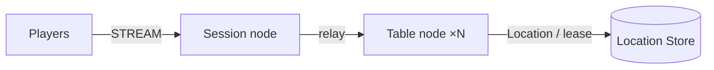

# MyGame board tables

This project runs a Session node and Table nodes that share a Redis Location Store. A TypeScript e2e client uses the public stream connector to verify the game, reconnection, and node replacement. Add game rules at the extension points described in [AGENTS.md](AGENTS.md).



## Prerequisites

- Node.js 22 or later with npm. The supported range of public binding 1.19.0 is `>=22`.
- Docker Engine with Docker Compose v2, reachable from the current shell.
- PowerShell 7 on Windows; Bash on Linux and WSL.
- A Windows x64 or Linux x64 environment supported by the published native binding.

The Framework package is pinned to `0.30.0` and the binding to `1.19.0`. Copy only this directory and install from the public npm registry.

## Build

```sh
npm ci && npm run build
```

```powershell
npm ci; npm run build
```

This compiles TypeScript and generates the Framework default typed JSON schema from the contract DTOs. The server loads the generated schema through the public `ZLinkPacket` registration path. Do not add per-message codecs.

## Local e2e

```sh
./run-e2e.sh
./run-e2e.sh --scenario table,reconnect
```

```powershell
pwsh -NoProfile -File ./run-e2e.ps1
pwsh -NoProfile -File ./run-e2e.ps1 -Scenario table,reconnect
```

Both scripts run `npm ci`, the build, and the same runner. After the structure check, the runner starts Redis in a uniquely named Compose project and exposes only an ephemeral loopback port. It records the node endpoints and a unique Redis prefix in the configuration under `.logs/run-<id>/`. After receiving `READY`, it runs the scenarios and then cleans up the processes and the Compose project it started.

| Scenario  | Verified behavior                                                                                                                                             |
| --------- | ------------------------------------------------------------------------------------------------------------------------------------------------------------- |
| table     | Two players take seats, cards stay private, an out-of-turn action is rejected, and settlement preserves the winner and chips.                                 |
| reconnect | A new Session restores the same Actor ID, generation, seat, chips, cards, and turn.                                                                           |
| update    | PlannedMaintenance drain, RELOCATED and SAFE_TO_SHUTDOWN, connection and state preserved, and a new hand completes on the replacement process after shutdown. |

Results print as `✓ <id>` or `✗ <id>` followed by `Scenarios: N/M passed`. A failure or a cleanup failure returns exit code 1. The node stderr and client JSONL of the first failure are retained. Node stderr records dispatch `Normal` message flow through the OpenTelemetry log exporter.

To check only the structure, run `npm run build` and then `node dist/e2e/runner.js --check-structure`. The checker validates the actual structure and configuration files and does not run its own self-tests.

## Known issues

Windows Node 25.6.0 and WSL Node 22.23.2 passed `table` and `reconnect` on public `0.30.0`. `update` did not reach `RELOCATED` because the target runtime failed with `Relocation payload participant inventory does not match Location Store`. This is the existing #1725, a Node host relocation participant inventory mismatch. The template reports the failure without deadlines, retries, or state workarounds, so the node replacement scenario is not considered verified on public `0.30.0`.

In the selected `table,reconnect` run, all game assertions also passed, but Table shutdown returned `ForceStopped/TeardownFailed` after the physical close. This corresponds to #1690, which is fixed in public `0.30.1`; this template uses `0.30.0` as specified. The runner therefore still returns exit code 1 in this case. Distinguish the passing scenario lines from overall run success.

Message Follow is explicitly configured for 30 seconds. The `SAFE_TO_SHUTDOWN` observation budget is that period plus the existing relocation budget. Update waits for replacement `READY`, then completes a hand at a new table; normal placement may select either live Table node.

## Deployment sequence

1. Prepare Redis and set `redisEndpoint` and a deployment-specific unique `keyPrefix` in each node configuration.
2. Start Table A and B with `node dist/server/table/main.js server/config/table-a.json` and `table-b.json`. Set mutually reachable `meshEndpoint` values.
3. Start Session with `node dist/server/session/main.js server/config/session.json`. The external client `streamEndpoint` is a `ws://` endpoint, or a `wss://` endpoint if the public contract supports it.
4. Confirm `READY` from each process. Operational control uses the standard input commands `drain` and `shutdown`. For a Table drain, confirm `RELOCATION_REQUESTED`, `RELOCATED`, and `SAFE_TO_SHUTDOWN` in that order before shutting down.

The default configuration uses loopback automatic ports. In production, specify reachable endpoints and Redis explicitly. The Framework decides placement and route updates for the Table stable type.

## Extension points and verification

`server/table/domain/table-state.ts` owns the game rules and the application snapshot. The Framework handlers and the relocation adapter are in `server/table/infrastructure/`. To add Session authentication, validate the player identity in the first `JoinTableRequest`. The current playerId is an e2e input; no product authentication is included.

```sh
npm run typecheck
npm run lint
npm run format:check
node --test dist/e2e/domain.test.js
```

When extending, follow the public API boundaries and state ownership rules in [AGENTS.md](AGENTS.md).

## Windows

The runner starts child processes with `windowsHide: true`. Run it in PowerShell 7; no Unix shell is required. The project includes a native addon, so check the Node support range and the CPU architecture. The project does not use an npm install at the repository root or a local package feed.

## 한국어 실행 안내

이 프로젝트는 Session node와 Table node 두 개, 그리고 Redis Location Store를 실행한다. `run-e2e.sh`와 `run-e2e.ps1`은 같은 runner를 사용하며, 착석과 카드 비공개, 재접속, node 교체(update)를 공개 stream connector로 확인한 뒤 자신이 시작한 process와 Compose project를 정리한다.

처음에는 `npm ci && npm run build`로 빌드하고, 전체 시나리오 또는 `--scenario table,reconnect`로 선택하여 실행한다. 실패하면 종료 코드 1을 반환하고 첫 실패의 node stderr와 client JSONL을 `.logs/run-<id>/` 아래에 남긴다. 공개 0.30.0에서는 `update`가 #1725 때문에, `table,reconnect`는 종료 단계의 #1690 때문에 종료 코드 1이 될 수 있으므로 시나리오 통과 줄과 전체 성공을 구분하여 확인한다. 게임 규칙을 추가할 위치와 공개 API 사용 규칙은 `AGENTS.md`를 따른다.
