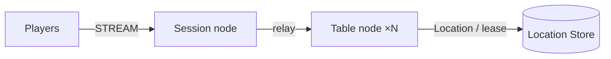

# MyGame board tables

Session node와 Table node 두 process가 Redis Location Store를 사용한다. TypeScript e2e client가 공개 stream connector로 게임과 재접속, node 교체를 검증한다.



## 준비물

- Node.js 22 이상과 npm. 공개 binding 1.19.0의 지원 범위는 `>=22`다.
- Docker Engine과 Docker Compose v2. 현재 shell에서 Docker에 접근할 수 있어야 한다.
- Windows는 PowerShell 7, Linux와 WSL은 Bash를 사용한다.
- 공개 native binding이 지원하는 Windows x64 또는 Linux x64 환경을 사용한다.

Framework package는 `0.30.0`, binding은 `1.19.0`으로 고정한다. 이 디렉터리만 복사하여 public npm registry에서 설치한다.

## Build

```sh
npm ci && npm run build
```

TypeScript를 컴파일하고 계약 DTO에서 Framework 기본 typed JSON schema를 생성한다. 서버는 생성된 schema를 공개 `ZLinkPacket` 등록 경로로 로드한다. 메시지별 codec은 추가하지 않는다.

## Local e2e

```sh
./run-e2e.sh
./run-e2e.sh --scenario table,reconnect
```

```powershell
pwsh -NoProfile -File ./run-e2e.ps1
pwsh -NoProfile -File ./run-e2e.ps1 -Scenario table,reconnect
```

두 script는 `npm ci`, build, 동일 runner를 실행한다. Runner는 구조 검사 뒤 고유 Compose project로 Redis를 시작하며 loopback 임시 포트만 공개한다. 노드 endpoint와 고유 Redis prefix를 `.logs/run-<id>/` 설정에 기록한다. `READY`를 받은 뒤 시나리오를 실행하고 자신이 시작한 process와 Compose project를 정리한다.

| 시나리오  | 판정                                                                                                     |
| --------- | -------------------------------------------------------------------------------------------------------- |
| table     | 2명 착석, 비공개 카드, 차례 위반 거부, 결산 승자와 칩 보존                                               |
| reconnect | 새 Session에 같은 Actor ID·generation·좌석·칩·카드·차례 복원                                             |
| update    | PlannedMaintenance drain, RELOCATED와 SAFE_TO_SHUTDOWN, 연결·상태 보존, 종료·대체 process에서 새 판 완료 |

결과는 `✓ <id>` 또는 `✗ <id>`와 `Scenarios: N/M passed`로 출력한다. 실패 또는 정리 실패는 종료 코드 1을 반환한다. 첫 실패의 node stderr와 client JSONL을 보존한다. node stderr에는 dispatch `Normal` message flow를 OpenTelemetry log exporter로 기록한다.

구조만 검사하려면 `npm run build` 후 `node dist/e2e/runner.js --check-structure`를 실행한다. 검사기는 실제 structure·configuration 파일을 검사하며 자체 시험은 실행하지 않는다.

## 배포 순서

1. Redis를 준비하고 각 node 설정의 `redisEndpoint`, 배포별 고유 `keyPrefix`를 지정한다.
2. Table A·B를 `node dist/server/main.js server/config/table-a.json`과 `table-b.json`으로 시작한다. 서로 접근 가능한 `meshEndpoint`를 지정한다.
3. Session을 `node dist/server/main.js server/config/session.json`으로 시작한다. 외부 client용 `streamEndpoint`는 `ws://` 또는 공개 계약이 지원하는 `wss://` endpoint다.
4. 각 process의 `READY`를 확인한다. 운영 제어는 표준 입력 `drain`, `shutdown`을 사용한다. Table drain은 `RELOCATION_REQUESTED`, `RELOCATED`, `SAFE_TO_SHUTDOWN` 순서로 확인한 뒤 종료한다.

기본 설정은 loopback 자동 포트를 사용한다. 운영에서는 접근 가능한 endpoint와 Redis를 명시한다. Table stable type의 placement와 route 갱신은 Framework가 결정한다.

## 확장 지점과 검증

`server/table/domain/table-state.ts`가 게임 규칙과 application snapshot을 소유한다. Framework handler와 relocation adapter는 `server/table/infrastructure/`에 있다. Session 인증을 추가할 때는 첫 `JoinTableRequest`에서 player identity를 검증한다. 현재 playerId는 e2e 입력이며 제품 인증 기능은 포함하지 않는다.

```sh
npm run typecheck
npm run lint
npm run format:check
node --test dist/e2e/domain.test.js
```

확장할 때 [AGENTS.md](AGENTS.md)의 공개 API 경계와 상태 소유 규칙을 따른다.

## Windows

Runner는 child process를 `windowsHide: true`로 시작한다. PowerShell 7에서 실행하며 Unix shell을 요구하지 않는다. Native addon이 포함되므로 Node 지원 범위와 CPU architecture를 확인한다. 프로젝트는 저장소 root의 npm 설치나 local package feed를 사용하지 않는다.

## 공개 0.30.0 검증 제한

Windows Node 25.6.0과 WSL Node 22.23.2에서 `table`과 `reconnect`는 통과했다. `update`는 target runtime의 `Relocation payload participant inventory does not match Location Store` 실패로 `RELOCATED`에 도달하지 못했다. 기존 #1712의 relocation 차단 경로와 관련되며, template는 deadline·retry·상태 우회 없이 실패를 보고한다. 따라서 공개 0.30.0에서 이 template의 node 교체 시나리오는 검증 완료로 판정하지 않는다.

`table,reconnect` 선택 실행에서도 게임 판정은 모두 통과했지만 physical close 뒤 Table shutdown이 `ForceStopped/TeardownFailed`를 반환했다. 기존 #1690 관련 종료 차단 항목이며, runner는 이 경우에도 종료 코드 1을 반환한다. 시나리오 통과 줄과 전체 실행 성공을 구분하여 확인한다.
