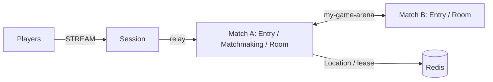

# my-game — FPS entry lobby

This Node.js FPS server template has a Session gateway and independently deployable Match nodes. Entry Spots admit Player Actors to a fixed Matchmaking User Spot. Matchmaking pairs players by mode and creates a Room User Spot for each pair. Each Room owns movement, HP, action sequences, wall intersection, cooldowns, and match results.



## Prerequisites

Docker Compose with a running Docker daemon, and PowerShell 7 for the PowerShell runner. `package.json` pins public Framework and connector packages to version `0.32.0`. The template directory builds independently of the ZLink repository.

## Build

POSIX shell:

```sh
./run-e2e.sh --build-only
```

PowerShell:

```powershell
pwsh -NoProfile -File ./run-e2e.ps1 -BuildOnly
```

The build compiles the role entrypoints and generates DTO schemas for the default Framework JSON serializer. The generator does not register a custom message codec.

## Docker e2e

Docker runs the e2e runner and each node in containers. All roles use one image; the runner image adds Docker CLI 28.5.1. `NODE_IMAGE` pins `node:22.20.0-trixie` with a slim runtime and the native binding's OpenSSL dependency. Nodes share the runner network namespace, preserving loopback listeners and OS-assigned ports. Configuration is copied with `docker cp`; stdin/stdout controls use `docker start -a -i`. Each invocation owns a unique Compose project, network, and image tags. Cleanup failures return exit code 1, and shared Docker build cache remains available.

Build and outer cleanup logs are written to `.logs/docker-<project>/`. Node configuration, stdout, and message-flow stderr are kept in `.logs/run-<id>/`. For local process debugging, install Node.js 22 or later and npm, then run `./run-e2e.sh --local` or `pwsh -NoProfile -File ./run-e2e.ps1 -Local`. Add `--no-build` or `-NoBuild` to reuse an existing local build. Redis remains in Docker.

```sh
./run-e2e.sh
./run-e2e.sh --scenario matchmaking,hit,wall,input,reconnect,update
./run-e2e.sh --check-structure
./run-e2e.sh --check-domain
```

```powershell
pwsh -NoProfile -File ./run-e2e.ps1
pwsh -NoProfile -File ./run-e2e.ps1 -Scenario matchmaking,hit,wall,input,reconnect,update
pwsh -NoProfile -File ./run-e2e.ps1 -CheckStructure
pwsh -NoProfile -File ./run-e2e.ps1 -CheckDomain
```

The default run executes `matchmaking`, `hit`, `wall`, `input`, `reconnect`, and `update` in that order. The runner checks the structure before starting nodes, assigns a unique Redis key prefix to each scenario, starts Match nodes before Session, and waits for public runtime readiness. Listeners bind port zero and publish their actual endpoints. The runner removes only processes and the Compose project that it created; cleanup failures produce a nonzero exit code.

| Scenario | Client observations |
|---|---|
| `matchmaking` | Interleaved modes form separate Rooms; each pair shares a Room; the Session rejects an internal `RoomAssignment` packet. |
| `hit` | A hit changes HP by 25; upward and out-of-range rays miss; the fourth hit finishes the match and later actions are rejected. |
| `wall` | An intervening wall blocks a ray; the wall behind the target does not block a hit. |
| `input` | Shared sequences, movement bounds, wall contact, movement budget, fire interval, rejection reasons, unchanged state, and server-issued retry delays are checked. |
| `reconnect` | A new Session retains the Actor identity, Room, position, HP, and sequence; a finished match retains its winner. |
| `update` | Relocation preserves Session bindings and Room state, safe shutdown is observed, and the replacement accepts a new Room. |

`e2e/domain-checks.ts` runs 46 domain boundary checks before any scenario starts. It covers closed ray/AABB faces, tangents, range limits, wall/player ties, movement and fire timing, rejected state, and snapshots restored under a different monotonic clock origin. `./run-e2e.sh --check-domain` or `pwsh -NoProfile -File ./run-e2e.ps1 -CheckDomain` runs these checks together with a separate local typed Session wire golden check; Redis and game scenario nodes are not started.

## FPS rules and extension points

`QueueRequest` is the first client packet. The example accepts a claimed player ID; replace this boundary with authenticated identity before deployment. Session relays only `QueueRequest`, `RoomViewRequest`, `MoveRequest`, `ShootRequest`, and `SessionInfoRequest`. Other client packets receive `ActionRejected` with `packet-not-allowed`. Messages use the default typed Framework serializer.

Coordinates use `Vec3(x, y, z)` with Y up. `ArenaMap` defines bounds X/Z=0..100 and Y=0..10, two static AABBs, and ordered server spawn points. A player box is 1 wide, 2 high, and 1 deep from its feet, with eye height 1.6. Feet remain at Y=0. Vertical movement is rejected as `vertical-move`; jumping and gravity are not implemented. Movement tests the feet-position segment against closed wall boxes, including contact at the endpoint. It does not implement swept player-volume collision.

`MoveRequest(delta, sequence)` has a maximum step of 2 and a speed budget of 10 units per second, capped at 2 since the last accepted movement. The first movement has the full budget. Nonfinite deltas, nonzero `delta.y`, oversized steps, map exits, wall intersections, and budget overruns are rejected. `ShootRequest(aimDirection, sequence)` normalizes finite nonzero aim, casts from the authoritative eye position up to 80 units, and chooses the closest wall or living player AABB. Wall ties and box contact block the ray. A hit causes 25 damage; accepted misses and wall-blocked shots still consume their sequence and 250 ms fire interval. There is no ammunition model. The Framework message model carries only finite JSON numbers, so nonfinite input reaches only the domain checks.

Move and Shoot share one increasing sequence in `1..9007199254740991`. Values above the upper bound are rejected as `integer-out-of-range`; values at or below the last accepted sequence, including zero and negative values, are rejected as `stale-sequence`. The shared domain check evaluates the upper bound before stale sequence and match phase. Rejections change neither position, HP, sequence, nor movement/fire timing. `retryAfterMs` is positive only for movement-budget or fire-interval rejection; clients wait for the reported duration and resend the same input. `MoveResult` and `ShotResult` acknowledge accepted actions; `ActionRejected` and `ShotRejected` report rejected inputs. `RoomView` includes positions, HP, last sequences, phase, and winner so a fresh client can continue with its last sequence plus one. At zero HP, the match finishes and later Move/Shoot inputs are rejected.

Hit detection uses the current server state. The template has no lag compensation, projectile simulation, or client prediction. Extend `RoomState` in `server/match/domain.ts` for weapons and match rules, `ArenaMap` for level geometry and spawn selection, and the shared contracts for client actions. `MatchmakingState` in `server/match/matchmaking-state.ts` owns mode queues and pairing. Keep cooldown, movement budget, and hit decisions in `RoomState`. `RoomSnapshot` stores remaining milliseconds for timing and never transfers a process's absolute clock reading.

Message Follow is configured explicitly to 30 seconds. After `RELOCATED`, the safe shutdown observation budget is the follow duration plus the existing relocation observation budget; the relocation operation deadline is unchanged.

`--check-domain` (`-CheckDomain` in PowerShell) runs 46 game domain checks and one separate wire golden check for four samples. The wire check runs in the Framework execution image; the runner does not load Framework. It briefly starts one local typed Session host and observes its public connector payloads; Redis and game scenario nodes are not started.

## Known issues

Validated against the published Framework 0.32.0 packages. The typed push delivery table restores declared DTO classes for the public typed-handler limitation tracked in [#1731](https://github.com/zlink-systems/zlink/issues/1731). Do not replace it with a manual codec.

## Deployment sequence

Wait for the bootstrap owner to report `READY` before starting another Match host. Its public `getOrCreate` completes while it is the only placement candidate, so the fixed Matchmaking Spot starts on its declared owner.

Configure Redis and a unique key prefix in `server/config/`. Start `dist/server/match/main.js` with `server/config/match-a.json`, then the same entrypoint with `server/config/match-b.json`. Match A bootstraps the fixed `matchmaking` Spot before peers start. Start `dist/server/session/main.js` with `server/config/session.json`. All roles use the common hosting module and report `READY` with actual listener endpoints.

Write `drain` to the selected Match process's standard input. Wait for `RELOCATION_REQUESTED`, `RELOCATED`, and `SAFE_TO_SHUTDOWN`. Write `shutdown`, verify `STOPPED` with outcome `Stopped` and reason `None`, and wait for exit. Start a replacement with the same node configuration and `bootstrapMatchmaking` disabled because the relocated Matchmaking Spot already exists. Wait for `READY` before assigning new work. Redis must remain available during this sequence.
