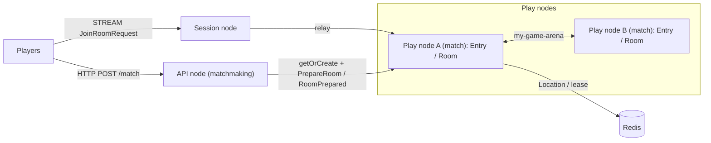

# MyGame FPS 매치메이킹 API node

API node, Session node, play node A·B(match), Redis Location Store로 구성합니다. API node는 mode가 같은 `POST /match` 요청 두 개를 짝짓고 Room을 생성합니다. `RoomPrepared`를 받은 뒤 배정 결과를 반환합니다. `RoomRoster`가 입장 대상을 관리하며 Room은 위치, HP, sequence, 벽 충돌, cooldown과 결과를 관리합니다.



이 템플릿은 참고용입니다. 새 게임을 개발할 때는 새 프로젝트를 만들고, 이 템플릿의 구조와 규칙을 참고해 그 게임에 맞는 노드, Spot, Actor, 메시지를 설계합니다. 이 템플릿의 이름을 바꾸거나 폴더 안에서 직접 수정해 새 게임으로 사용하지 않습니다.

[English README](README.md) · [개발 지침](AGENTS.md)

## 준비 및 빌드

Docker와 Compose v2를 준비합니다. 로컬 서버는 Node.js 22 이상과 npm이 필요합니다. Windows 래퍼는 PowerShell 7을 UTF-8과 프로세스 범위 실행 정책으로 실행합니다.

공개 Framework 0.34.0과 binding 1.26.0을 사용합니다. 아래 명령은 TypeScript를 컴파일하고 기본 typed JSON serializer에 사용하는 schema를 생성합니다. Docker는 `Dockerfile`에 명시된 Node.js와 Docker CLI 이미지 버전을 사용하며 재사용 가능한 build layer를 유지합니다.

```bash
./run-e2e.sh --build-only
```

```powershell
.\run-e2e.cmd -BuildOnly
```

## 로컬 서버와 e2e 실행

프로젝트 폴더에서 서버를 시작하고 다른 터미널에서 e2e를 실행합니다.

```bash
./run-server.sh
./run-e2e.sh
```

```powershell
.\run-server.cmd
.\run-e2e.cmd
```

PowerShell 7 스크립트는 `run-server.ps1`과 `run-e2e.ps1`입니다. 서버 실행은 `npm ci`와 빌드를 마친 뒤 Redis와 노드를 띄웁니다. `Server ready`에 WebSocket 주소를 표시하고 해당하는 경우 API 주소를 별도로 표시합니다. Ctrl+C를 누르면 노드와 Redis를 정리합니다. 시작 중이거나 실행 중인 서버가 있으면 두 번째 시작 요청을 거부합니다.

e2e는 `.logs/server.json`에서 준비된 로컬 서버를 확인하고 연결합니다. 연결 실행에서는 노드 교체가 필요한 `lobby`와 `update`를 제외하고 이유를 출력합니다. 전체 시나리오를 Docker에서 격리 실행하려면 서버를 종료한 뒤 e2e를 실행합니다. `--local` 또는 `-Local`은 별도 로컬 테스트 실행을 선택합니다. 이때도 Redis는 Docker에서 실행합니다. 로컬 빌드를 재사용하려면 `--no-build` 또는 `-NoBuild`를 함께 지정합니다.

`.logs/run-<id>/`에는 노드 설정, `*.out.log`, `*.err.log`, `*.flow.log`와 실패 상세 파일을 저장합니다. 연결 e2e는 별도 폴더에 client 결과를 저장합니다. Docker 빌드와 정리 로그는 `.logs/docker-<project>/`에 저장합니다.

## 클라이언트 연결

기본 Session listener는 `server/config/session.json`의 `ws://127.0.0.1:0`입니다. API 주소는 `server/config/lobby.json`의 HTTP listener에서 확인합니다. 실제 주소는 `Server ready` 또는 node의 `READY` 출력에서 확인합니다. 포트 0은 OS에 포트 할당을 요청하며 WebSocket 경로는 `/`입니다. mesh와 Redis는 내부 endpoint입니다.

서로 다른 `playerId`와 같은 `mode`로 API node에 `POST /match` 요청 두 개를 동시에 전송합니다. 기본 mode는 `duel`입니다. 응답의 `sessionEndpoint`로 STREAM에 연결하고 `JoinRoomRequest(playerId, roomId)`를 보냅니다. 배정된 이용자에게 `MatchFound`와 `RoomView` push가 도착합니다. 바인딩 후 `RoomViewRequest`와 `SessionInfoRequest`는 request/reply를 사용합니다.

게임 인증을 추가할 때는 Actor를 바인딩하기 전에 이용자 ID를 검증합니다. 거부된 게임 동작은 `ActionRejected`로 확인합니다.

### Connector 설치

루프백 listener는 같은 network namespace에서 접근합니다. 외부 클라이언트에는 접근할 수 있는 listener 주소와 컨테이너 포트를 설정합니다. 브라우저, Unity WebGL, Cocos Creator Web은 WebSocket을 사용할 수 있습니다. HTTPS 페이지에서 연결하려면 `wss://`를 사용하고, HTTP API에는 접근 가능한 origin과 CORS 정책을 설정합니다.

`<version>`에는 `package.json`에 지정된 Framework 및 STREAM connector 릴리스를 사용합니다.

| Client        | Connector 설치                                                                                                                                                                                           | 문서                                                                                                                                                                         |
| ------------- | -------------------------------------------------------------------------------------------------------------------------------------------------------------------------------------------------------- | ---------------------------------------------------------------------------------------------------------------------------------------------------------------------------- |
| Unity         | Native와 Editor는 NuGetForUnity로 `Zlink.Stream.Connector`를 복원합니다. WebGL은 `com.zlink.stream-connector.webgl` UPM Git 패키지를 사용합니다.                                                         | [Unity README](https://github.com/zlink-systems/zlink/blob/main/framework/languages/engines/Unity/README.md)                                                                 |
| Unreal        | `framework/languages/cpp/connector/engines/unreal`을 `Plugins/ZLinkStreamConnector`에 복사하고 `ThirdParty/ZLink`에 native connector를 패키징합니다.                                                     | [Unreal README](https://github.com/zlink-systems/zlink/blob/main/framework/languages/engines/Unreal/README.md)                                                               |
| Godot         | .NET은 NuGet 패키지 `Zlink.Stream.Connector`를 설치하고 `dotnet restore`를 실행합니다. GDExtension은 Framework prebuilt와 호환되는 `godot-cpp`로 빌드합니다. .NET 예제는 Web export를 지원하지 않습니다. | [.NET](https://docs.zlink.systems/dotnet/guide/stream-connector/12-engine-integration/), [C++](https://docs.zlink.systems/cpp/guide/stream-connector/12-engine-integration/) |
| Cocos Creator | Web target은 `npm install @zlink-systems/stream-connector@<version>`으로 설치합니다.                                                                                                                     | [TypeScript 엔진 통합](https://docs.zlink.systems/node/guide/stream-connector/12-engine-integration/)                                                                        |
| Axmol         | `framework/languages/cpp/connector/engines/axmol`을 `third_party/zlink_axmol_connector`로 복사하고 `zlink::stream_connector`를 링크합니다.                                                               | [Axmol README](https://github.com/zlink-systems/zlink/blob/main/framework/languages/engines/Axmol/README.md)                                                                 |
| 브라우저      | `npm install @zlink-systems/stream-connector@<version>`으로 설치하고 package root를 import합니다.                                                                                                        | [TypeScript connector](https://docs.zlink.systems/node/guide/stream-connector/)                                                                                              |
| C++           | Framework prebuilt를 설치하고 `find_package(zlink_stream_connector_cpp CONFIG REQUIRED)`로 `zlink::stream_connector`를 링크합니다.                                                                       | [C++ connector](https://docs.zlink.systems/cpp/guide/stream-connector/)                                                                                                      |
| .NET          | `dotnet add package Zlink.Stream.Connector --version <version>`                                                                                                                                          | [.NET connector](https://docs.zlink.systems/dotnet/guide/stream-connector/)                                                                                                  |
| Java          | Maven 또는 Gradle에 `systems.zlink:zlink-stream-connector:<version>`을 추가합니다.                                                                                                                       | [Java connector](https://docs.zlink.systems/java/guide/stream-connector/)                                                                                                    |
| Kotlin        | Coroutine wrapper인 `systems.zlink:zlink-framework-kotlin:<version>`을 추가합니다.                                                                                                                       | [Kotlin connector](https://docs.zlink.systems/kotlin/guide/stream-connector/)                                                                                                |
| Node.js       | Node.js 22 이상에서 `npm install @zlink-systems/stream-connector@<version>`으로 설치하고 package root를 사용합니다.                                                                                      | [Node.js connector](https://docs.zlink.systems/node/guide/stream-connector/)                                                                                                 |

### 연결 예제

별도 프로젝트 복사본의 `e2e/connect-once.mts`에 예제를 저장하고 `npm run build`를 실행합니다. 서버가 실행 중일 때 `node dist/e2e/connect-once.mjs <actual-lobby-http-endpoint>`를 실행합니다. 새 player ID를 사용합니다. JSON codec으로 받은 int64 값은 십진 문자열로 유지합니다.

```typescript
import '../.zlink-framework-json-schemas.cjs';
import {
  zlinkStreamConnectorFactory,
  zlinkStreamJsonCodec,
  ZlinkStreamDispatchMode
} from '@zlink-systems/stream-connector';
import { JoinRoomRequest } from '../server/shared/lobby-messages.js';
import type { MatchResponse } from '../server/shared/lobby-messages.js';

const lobby = process.argv[2];
if (!lobby) throw new Error('Pass the API node HTTP endpoint from READY');
const players = ['guide-player-a', 'guide-player-b'];
const assignments = await Promise.all(
  players.map(async (playerId) => {
    const response = await fetch(lobby + '/match', {
      method: 'POST',
      headers: { 'content-type': 'application/json' },
      body: JSON.stringify({ playerId, mode: 'duel' })
    });
    if (!response.ok) throw new Error(`HTTP ${response.status}: ${await response.text()}`);
    return (await response.json()) as MatchResponse;
  })
);
const clients = assignments.map((assignment) =>
  zlinkStreamConnectorFactory.create({
    endpoint: assignment.sessionEndpoint,
    codec: zlinkStreamJsonCodec,
    dispatchMode: ZlinkStreamDispatchMode.Immediate,
    reconnect: { enabled: false }
  })
);
try {
  await Promise.all(clients.map((client) => client.connect()));
  const views = clients.map(
    (client) =>
      new Promise<{ roomId: string }>((resolve, reject) => {
        client.on<{ roomId: string }>('RoomView', (message) => resolve(message.payload));
        client.on('ActionRejected', () => reject(new Error('Admission rejected')));
        client.onErrorReceived((error) => reject(new Error(error.message)));
        client.onDisconnected(() => reject(new Error('Disconnected before RoomView')));
      })
  );
  await Promise.all(
    clients.map((client, index) =>
      client.send(new JoinRoomRequest(players[index]!, assignments[index]!.roomId)).submit()
    )
  );
  console.log(await Promise.all(views));
} finally {
  await Promise.all(clients.map((client) => client.close()));
}
```

## Docker e2e

서버가 실행 중이지 않으면 runner와 각 노드를 컨테이너에서 실행합니다. 노드는 runner의 network namespace를 공유하므로 루프백과 OS 할당 포트를 사용할 수 있습니다. Runner는 고유 Compose 프로젝트와 Redis key를 쓰고 종료 시 해당 실행의 자원을 정리합니다. 시나리오 또는 정리 실패 시 종료 코드는 0이 아닙니다.

`lobby`, `hit`, `wall`, `input`, `reconnect`, `update` 순서로 실행합니다. 게임 46개, API node 19개 경계 조건을 검사합니다. `--check-domain`은 네 샘플의 typed Session wire 출력도 검사합니다.

```powershell
.\run-e2e.cmd
.\run-e2e.cmd -Scenario lobby,hit,wall,input,reconnect,update
.\run-e2e.cmd -CheckStructure
.\run-e2e.cmd -CheckDomain
```

## FPS 규칙과 확장 지점

`RoomState`가 권위 위치, HP, 입력 sequence, 이동 한도, 발사 간격과 결과를 결정합니다. `ArenaMap`은 Y를 위로 두고 X/Z 0–100, Y 0–10 범위에 두 개의 고정 AABB와 서버 spawn 위치를 정의합니다. 플레이어 상자는 너비 1, 높이 2, 깊이 1이고 시점은 발에서 1.6입니다. 발은 Y=0을 유지합니다. 이동 경로와 닫힌 벽 상자의 교차를 검사합니다. 점프, 중력, 플레이어 부피의 연속 충돌 계산은 구현하지 않습니다.

이동은 1회 최대 2, 초당 최대 10입니다. 유한하지 않은 값, 수직 이동, 범위 이탈, 벽 교차와 한도 초과는 거부합니다. `ShootRequest`는 유한한 방향을 정규화하고 서버 시점에서 최대 80까지 검사합니다. 벽 접촉과 동률은 벽이 차단합니다. 명중 피해는 25이며 빗나가거나 벽에 막혀도 승인된 발사는 sequence와 250ms 간격을 소비합니다. 탄약 모델은 없습니다.

이동과 발사는 1–9,007,199,254,740,991 범위의 sequence를 공유합니다. 거부 시 위치, HP, sequence와 시간이 유지됩니다. 이동 한도나 발사 간격으로 거부하면 양수 `retryAfterMs`를 반환합니다. `MoveResult`와 `ShotResult`는 승인된 행동을, `ActionRejected`와 `ShotRejected`는 거부를 전달합니다. HP가 0이면 매치를 끝내고 이후 행동을 거부합니다. `RoomView`의 마지막 sequence에 1을 더해 재접속 입력을 시작할 수 있습니다.

무기와 매치 규칙은 `RoomState`, 지형과 spawn 선택은 `ArenaMap`, client 행동은 공유 계약에서 확장합니다. Snapshot은 절대 시각 대신 남은 밀리초를 보관합니다. 명중 판정은 현재 서버 상태를 기준으로 하며 lag compensation, 투사체 시뮬레이션과 client prediction은 구현하지 않습니다.

## Framework 동작

- **Handler의 I/O 대기.** 일반 async terminal은 실행 turn을 유지합니다. `Yield`를 사용하면 같은 Spot의 다른 handler가 진행할 수 있습니다. [가이드](https://docs.zlink.systems/node/guide/server/32-execution-model/#io-worker-wait)
- **Actor 생성 기한.** `DeadlineExceeded`와 호출자 취소는 서로 다른 결과입니다. [가이드](https://docs.zlink.systems/node/guide/server/22-actor/#creation-deadline)
- **동시 로그인.** 고유 ID마다 Actor를 만들 때 Location Store 왕복이 필요하므로 예상 부하를 측정해 기한을 정합니다. [가이드](https://docs.zlink.systems/node/guide/server/25-location/#creation-load)
- **송신 용량 부족.** Send가 용량을 기다리고 애플리케이션은 최종 결과를 확인합니다. [가이드](https://docs.zlink.systems/node/guide/server/33-backpressure/#send-backpressure)
- **중복 로그인.** 두 번째 Session의 바인딩을 거부하려면 Actor의 duplicate-bind callback을 사용합니다. [가이드](https://docs.zlink.systems/node/guide/server/39-session-binding/#duplicate-session-bind)
- **ObjectGeneration.** 같은 ID에 속하는 서로 다른 논리 인스턴스를 구분합니다. [가이드](https://docs.zlink.systems/node/guide/server/34-activation-lifetime/#object-generation)
- **준비 상태.** Host가 Framework의 `Serving`을 관찰한 뒤 `READY`를 출력합니다. [가이드](https://docs.zlink.systems/node/guide/server/12-operations/#wait-for-serving)

## 알려진 문제

공개 Framework 0.34.0을 사용합니다. Typed push에서 DTO class를 복원하는 표는 공개 typed handler 제약(#1731)에 대응합니다. 기본 typed JSON serializer를 사용합니다.

## 배포 순서

Redis와 고유 key prefix를 설정합니다. play node A와 B를 시작하고 Session의 실제 주소를 `server/config/lobby.json`의 `sessionEndpoint`에 설정한 뒤 API node를 시작합니다. 직접 실행할 때는 `--require ./dist/server/shared/diagnostics.js`로 진단 logger를 먼저 로드합니다. Redis를 유지한 채 play node 교체와 API 재시작을 수행합니다.

운영 시 `drain`을 stdin으로 보냅니다. `RELOCATION_REQUESTED`, `RELOCATED`, `SAFE_TO_SHUTDOWN`을 순서대로 확인하고 `shutdown`을 보냅니다. 종료 코드와 `STOPPED` 결과를 확인한 뒤 원래 설정으로 교체 node를 시작합니다. Redis는 교체 중에도 유지합니다. Message Follow는 30초로 설정합니다. 안전 종료 관찰 시간에는 Message Follow와 기존 relocation 관찰 시간을 포함합니다.
