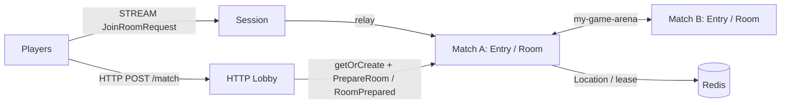

# my-game — FPS HTTP lobby

This Node.js FPS server template runs an HTTP Lobby, a Session gateway, Match hosts A and B, and a Redis Location Store. The Lobby pairs `POST /match` requests by mode, generates a GUID Room ID, creates a dynamic Room User Spot, and waits for `RoomPrepared` before returning the Room ID and Session endpoint. `RoomRoster` owns the prepared member list and admission decision. Each Room owns movement, HP, action sequences, wall intersection, cooldowns, and match results.



## Prerequisites

Docker Compose with a running Docker daemon, and PowerShell 7 for the PowerShell runner. `package.json` pins public Framework and connector packages to version `0.30.2`. The template directory builds independently of the ZLink repository.

## Build

POSIX shell:

```sh
./run-e2e.sh --build-only
```

PowerShell:

```powershell
pwsh -NoProfile -File ./run-e2e.ps1 -BuildOnly
```

The build compiles the role entrypoints and generates DTO schemas for the default Framework JSON serializer. The generator does not register a custom message codec.

## Docker e2e

Docker runs the e2e runner and each node in containers. All roles use one image; the runner image adds Docker CLI 28.5.1. `NODE_IMAGE` pins `node:22.20.0-trixie` with a slim runtime and the native binding's OpenSSL dependency. Nodes share the runner network namespace, preserving loopback listeners and OS-assigned ports. Configuration is copied with `docker cp`; stdin/stdout controls use `docker start -a -i`. Each invocation owns a unique Compose project, network, and image tags. Cleanup failures return exit code 1, and shared Docker build cache remains available.

Build and outer cleanup logs are written to `.logs/docker-<project>/`. Node configuration, stdout, and message-flow stderr are kept in `.logs/run-<id>/`. For local process debugging, install Node.js 22 or later and npm, then run `./run-e2e.sh --local` or `pwsh -NoProfile -File ./run-e2e.ps1 -Local`. Add `--no-build` or `-NoBuild` to reuse an existing local build. Redis remains in Docker.

```sh
./run-e2e.sh
./run-e2e.sh --scenario lobby,hit,wall,input,reconnect,update
./run-e2e.sh --check-structure
./run-e2e.sh --check-domain
```

```powershell
pwsh -NoProfile -File ./run-e2e.ps1
pwsh -NoProfile -File ./run-e2e.ps1 -Scenario lobby,hit,wall,input,reconnect,update
pwsh -NoProfile -File ./run-e2e.ps1 -CheckStructure
pwsh -NoProfile -File ./run-e2e.ps1 -CheckDomain
```

The default run executes `lobby`, `hit`, `wall`, `input`, `reconnect`, and `update` in that order. The runner checks the structure and 46 game plus 19 HTTP lobby boundaries before starting nodes, assigns a unique Redis key prefix to each scenario, starts Match nodes before Session and the HTTP Lobby, and waits for public runtime readiness. Listeners bind port zero and publish their actual endpoints. The runner removes only processes and the Compose project that it created; cleanup failures produce a nonzero exit code.

| Scenario | Client observations |
|---|---|
| `lobby` | An omitted mode defaults to duel; modes receive separate Rooms; each pair shares a Room and Session endpoint; an outsider is rejected from an empty Room; client `PrepareRoom` is rejected before joining and during a match; a Lobby restart preserves the existing match and provisions a new Room ID. |
| `hit` | A hit changes HP by 25; upward and out-of-range rays miss; the fourth hit finishes the match and later actions are rejected. |
| `wall` | An intervening wall blocks a ray; the wall behind the target does not block a hit. |
| `input` | Shared sequences, movement bounds, wall contact, movement budget, fire interval, rejection reasons, unchanged state, and server-issued retry delays are checked. |
| `reconnect` | A new Session retains the Actor identity, Room, position, HP, and sequence; a finished match retains its winner. |
| `update` | Relocation preserves Session bindings and Room state; an outsider is rejected after relocation; safe shutdown is observed, and the replacement accepts a new Room. |

`e2e/domain-checks.ts` runs 46 game boundary checks and `e2e/lobby-domain-checks.ts` runs 19 HTTP lobby boundary checks before any scenario starts. The game checks cover closed ray/AABB faces, tangents, range limits, wall/player ties, movement and fire timing, rejected state, and snapshots restored under a different monotonic clock origin. The Lobby checks cover roster preparation and restoration, mode pairing, Room ID uniqueness, and HTTP response timing.

## FPS rules and extension points

`MatchRequest` sends `{playerId}` or `{playerId, mode}` to `POST /match`; an omitted mode defaults to `duel`. The example accepts a claimed player ID; replace this boundary with authenticated identity before deployment. A Session binds an Actor only on the first allowed `JoinRoomRequest`. It relays only `JoinRoomRequest`, `RoomViewRequest`, `MoveRequest`, `ShootRequest`, and `SessionInfoRequest`. `PrepareRoom`, `RoomPrepared`, `HttpNodeReady`, and other client packets receive `ActionRejected` with `packet-not-allowed`. Application messages use the default typed Framework serializer.

The Lobby generates `RoomPrefix + UUID` once in `server/lobby/matchmaker.ts`. It creates the dynamic Room, sends `PrepareRoom(matchId, members)`, and returns the HTTP assignment only after receiving `RoomPrepared(matchId)`. `server/match/roster.ts` copies and validates the roster, admits only those players, accepts an identical preparation again, and rejects a changed roster. Room relocation stores `{Game, Roster}` together.

Coordinates use `Vec3(x, y, z)` with Y up. `ArenaMap` defines bounds X/Z=0..100 and Y=0..10, two static AABBs, and ordered server spawn points. A player box is 1 wide, 2 high, and 1 deep from its feet, with eye height 1.6. Feet remain at Y=0. Vertical movement is rejected as `vertical-move`; jumping and gravity are not implemented. Movement tests the feet-position segment against closed wall boxes, including contact at the endpoint. It does not implement swept player-volume collision.

`MoveRequest(delta, sequence)` has a maximum step of 2 and a speed budget of 10 units per second, capped at 2 since the last accepted movement. The first movement has the full budget. Nonfinite deltas, nonzero `delta.y`, oversized steps, map exits, wall intersections, and budget overruns are rejected. `ShootRequest(aimDirection, sequence)` normalizes finite nonzero aim, casts from the authoritative eye position up to 80 units, and chooses the closest wall or living player AABB. Wall ties and box contact block the ray. A hit causes 25 damage; accepted misses and wall-blocked shots still consume their sequence and 250 ms fire interval. There is no ammunition model. The Framework message model carries only finite JSON numbers, so nonfinite input reaches only the domain checks.

Move and Shoot share one increasing sequence in `1..9007199254740991`. Values above the upper bound are rejected as `integer-out-of-range`; values at or below the last accepted sequence, including zero and negative values, are rejected as `stale-sequence`. The shared domain check evaluates the upper bound before stale sequence and match phase. Rejections change neither position, HP, sequence, nor movement/fire timing. `retryAfterMs` is positive only for movement-budget or fire-interval rejection; clients wait for the reported duration and resend the same input. `MoveResult` and `ShotResult` acknowledge accepted actions; `ActionRejected` and `ShotRejected` report rejected inputs. `RoomView` includes positions, HP, last sequences, phase, and winner so a fresh client can continue with its last sequence plus one. At zero HP, the match finishes and later Move/Shoot inputs are rejected.

Hit detection uses the current server state. The template has no lag compensation, projectile simulation, or client prediction. Extend `RoomState` for weapons and match rules, `ArenaMap` for level geometry and spawn selection, and the shared contracts for client actions. Keep cooldown, movement budget, and hit decisions in `RoomState`. `RoomSnapshot` stores remaining milliseconds for timing and never transfers a process's absolute clock reading.

Message Follow is configured explicitly to 30 seconds. After `RELOCATED`, the safe shutdown observation budget is the follow duration plus the existing relocation observation budget; the relocation operation deadline is unchanged.

`--check-domain` (`-CheckDomain` in PowerShell) runs 46 game domain checks and one separate wire golden check for four samples. The wire check runs in the Framework execution image; the runner does not load Framework. It briefly starts one local typed Session host and observes its public connector payloads; Redis and game scenario nodes are not started.

`--check-domain`(PowerShell `-CheckDomain`)은 게임 도메인 46개와 네 표본을 비교하는 별도 wire golden 1개를 검사합니다. Wire 검사는 local typed Session host 하나를 잠시 시작하고 public connector payload를 관찰합니다. Redis와 게임 시나리오 노드는 시작하지 않습니다.

## Known issues

Validated against the published Framework 0.30.2 packages. The typed push delivery table restores declared DTO classes for the public typed-handler limitation tracked in [#1731](https://github.com/zlink-systems/zlink/issues/1731). Do not replace it with a manual codec.

## Deployment sequence

Start Redis, then Match A and Match B, Session, and the HTTP Lobby. The Lobby requires the Session endpoint; each role reports `READY` with its actual listener endpoint. The Lobby creates dynamic Room Spots through the RouteMesh and waits for Room preparation before returning an HTTP response.

Configure Redis, unique key prefixes, and listener addresses in `server/config/`. Start `dist/server/match/main.js` with `server/config/match-a.json`, then the same entrypoint with `server/config/match-b.json`. Start `dist/server/session/main.js` with `server/config/session.json`, then `dist/server/lobby/main.js` with `server/config/lobby.json` containing the actual Session endpoint. All roles use the common hosting module. To update a Match host, write `drain` to its standard input and wait for `RELOCATION_REQUESTED`, `RELOCATED`, and `SAFE_TO_SHUTDOWN`. Write `shutdown`, verify `STOPPED` with outcome `Stopped` and reason `None`, and wait for exit. Start a replacement with the same node configuration and wait for `READY`. Redis must remain available during relocation and Lobby restart.

## 한국어 실행 안내

기본 빌드와 e2e는 Docker에서 runner와 node를 실행합니다. Bash는 `./run-e2e.sh`, PowerShell 7은 `pwsh -NoProfile -File ./run-e2e.ps1`을 사용합니다. 로컬 process 디버깅은 Node.js 22 이상과 npm을 설치한 뒤 `--local` 또는 `-Local`로 실행합니다. Docker 빌드·정리 로그는 `.logs/docker-<project>/`에 남습니다.

Docker Compose를 준비하고 Build 절의 명령으로 이미지를 빌드합니다. `run-e2e.sh` 또는 PowerShell 7의 `run-e2e.ps1`을 실행하면 구조 검사, 46개 게임과 19개 HTTP Lobby 도메인 경계 검사, Redis·서버 기동, 시나리오 판정과 자원 정리를 수행합니다. 기본 시나리오는 `lobby`, `hit`, `wall`, `input`, `reconnect`, `update` 순서입니다. Wire golden 검사는 Framework 실행 image에서 실행하며 runner는 Framework를 load하지 않습니다. 실행 로그와 message-flow는 `.logs/run-<id>/`에 보존됩니다.

HTTP Matchmaker는 mode별 매칭과 Room ID 발급을 소유하고, RoomRoster는 명단과 입장 판정을 소유합니다. 위치·HP·순번·쿨다운·이동 예산·명중 판정은 `RoomState`가 소유합니다. 발 위치 Y는 항상 0이며 수직 이동은 `vertical-move`로 거부합니다. 점프와 중력은 없습니다. 현재 서버 상태를 기준으로 명중을 판정하며 지연 보정·투사체·클라이언트 예측은 없습니다. 게임 규칙은 `RoomState`와 `ArenaMap`, typed 계약을 확장합니다. 프로덕션 배포에서는 플레이어 인증과 Redis 연결 설정을 적용해야 합니다.
