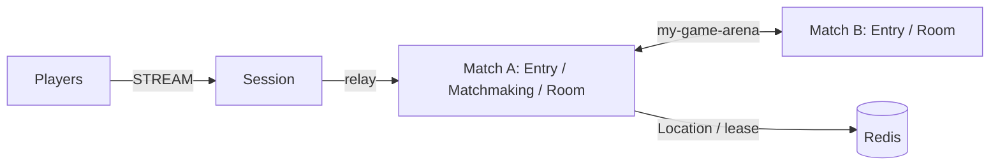

# my-game — Match entry lobby

An action/FPS server template with a Session process and independently deployable match processes. Entry Spots admit Player Actors into a fixed Matchmaking User Spot. Matchmaking pairs players by mode and creates dynamic Room User Spots. Rooms own movement, HP, action sequences, wall intersection, and match results.



## Prerequisites

Docker Compose with a running Docker daemon, and PowerShell 7 for the PowerShell runner. Dependencies are pinned in `package.json` to public Framework 0.30.1 packages. Copy this directory independently of the ZLink repository.

## Build

POSIX shell:

```sh
./run-e2e.sh --build-only
```

PowerShell:

```powershell
pwsh -NoProfile -File ./run-e2e.ps1 -BuildOnly
```

The build compiles the role entrypoints and generates DTO schemas for the default Framework JSON serializer. The generator does not register a custom message codec.

## Docker e2e

Docker runs the e2e runner and each node in containers. All roles use one image; the runner image adds Docker CLI 28.5.1. `NODE_IMAGE` pins `node:22.20.0-trixie` with a slim runtime and the native binding's OpenSSL dependency. Nodes share the runner network namespace, preserving loopback listeners and OS-assigned ports. Configuration is copied with `docker cp`; stdin/stdout controls use `docker start -a -i`. Each invocation owns a unique Compose project, network and image tags. Cleanup failures return exit code 1, and shared Docker build cache remains available.

Build and outer cleanup logs are in `.logs/docker-<project>/`; node configuration, stdout and message-flow stderr remain in `.logs/run-<id>/`. For local process debugging, install Node.js 22 or later and npm, then run `./run-e2e.sh --local` or `pwsh -NoProfile -File ./run-e2e.ps1 -Local`. Add `--no-build` or `-NoBuild` to reuse an existing local build. Redis remains in Docker.

```sh
./run-e2e.sh
./run-e2e.sh --scenario hit,reconnect,update
./run-e2e.sh --check-structure
```

```powershell
pwsh -NoProfile -File ./run-e2e.ps1
pwsh -NoProfile -File ./run-e2e.ps1 -Scenario hit,reconnect,update
pwsh -NoProfile -File ./run-e2e.ps1 --check-structure
```

`hit` verifies pairing, HP damage, closed wall intersection, range and missing-target rejections, and the winner. `reconnect` verifies the same Actor generation, room, HP, and position after a new Session binds the Actor. `update` drains the Room host, observes relocation and safe shutdown, checks unchanged bindings and game state, replaces the process, and verifies that it accepts a new Room.

The runner checks the structure, uses the invocation's isolated Compose project and a unique key prefix per scenario, starts match processes before Session, and waits for public runtime readiness. Listeners bind port zero and publish their actual endpoints. Redis prefixes are unique per run. Logs, generated configuration, message-flow events, and client observations remain in `.logs/run-<id>/`. The runner removes only its own processes and Compose project; cleanup failures produce a nonzero exit code.

Each scenario uses an isolated Redis key prefix and fresh node containers, with Room capacity set to one per match host. After relocation fills the surviving host, only the replacement has capacity for a new Room. Deployment capacity is configured independently.

Message Follow is configured explicitly to 30 seconds. After `RELOCATED`, the safe shutdown observation budget is the follow duration plus the existing relocation observation budget; the relocation operation deadline is unchanged.

## Known issues

Framework 0.30.1 is required for Node relocation inventory (#1725). The typed push delivery table restores declared DTO classes for the public typed-handler limitation tracked in #1731. Do not replace it with a manual codec.

## Deployment sequence

Wait for the bootstrap owner to report `READY` before starting another match host. Its public GetOrCreate completes while it is the only placement candidate, so the fixed Matchmaking Spot starts on its declared owner.

Configure Redis and a unique key prefix in `server/config/`. Start `dist/server/match/main.js` with `server/config/match-a.json`, then the same entrypoint with `server/config/match-b.json`. Match A bootstraps the fixed `matchmaking` Spot before peers start. Start `dist/server/session/main.js` with `server/config/session.json`. All roles use the common hosting module and report `READY` with actual listener endpoints.

Write `drain` to the selected match process's standard input. Wait for `RELOCATION_REQUESTED`, `RELOCATED`, and `SAFE_TO_SHUTDOWN`. Write `shutdown`, verify `STOPPED` with outcome `Stopped` and reason `None`, and wait for exit. Start a replacement with the same node configuration and `bootstrapMatchmaking` disabled: the relocated Matchmaking Spot already exists. Wait for `READY` before assigning new work. Redis must remain available during this sequence.

## 한국어 실행 안내

기본 빌드와 e2e는 Docker에서 runner와 node를 실행한다. Bash는 `./run-e2e.sh`, PowerShell 7은 `pwsh -NoProfile -File ./run-e2e.ps1`을 사용한다. 로컬 프로세스 디버깅은 Node.js와 npm을 설치한 뒤 `--local` 또는 `-Local`로 실행한다. Docker 빌드·정리 로그는 `.logs/docker-<project>/`에 남는다.

Docker Compose를 준비하고 Build 절의 명령으로 이미지를 빌드합니다. `run-e2e.sh` 또는 PowerShell 7의 `run-e2e.ps1`을 실행하면 구조 검사, Redis·서버 기동, 시나리오 판정과 자원 정리를 수행합니다. 실행 로그와 message flow는 `.logs/run-<id>/`에 보존됩니다. `hit`은 매칭과 사격 판정을, `reconnect`는 Actor identity와 게임 상태 복원을 확인합니다. `update`는 Room host를 drain한 뒤 연결·상태 유지와 교체 process의 새 Room 수락을 확인합니다. 배포 시에는 `SAFE_TO_SHUTDOWN`을 확인한 뒤 기존 process를 종료하고, 교체 process의 `READY`를 확인합니다.
