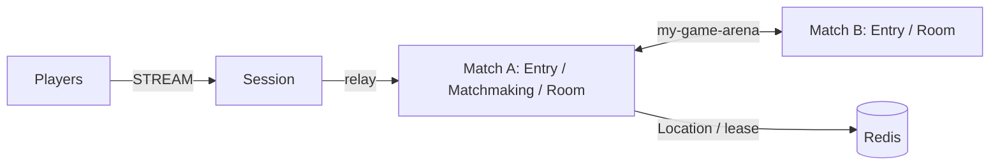

# my-game — Match entry lobby

An action/FPS server template with a Session process and independently deployable match processes. Entry Spots admit Player Actors into a fixed Matchmaking User Spot. Matchmaking pairs players by mode and creates dynamic Room User Spots. Rooms own movement, HP, action sequences, wall intersection, and match results.



## Prerequisites

Docker Compose with a running Docker daemon, and PowerShell 7 for the PowerShell runner. Dependencies are pinned in `package.json` to public Framework 0.32.0 packages. Copy this directory independently of the ZLink repository.

## Build

POSIX shell:

```sh
./run-e2e.sh --build-only
```

PowerShell:

```powershell
pwsh -NoProfile -File ./run-e2e.ps1 -BuildOnly
```

The build compiles the role entrypoints and generates DTO schemas for the default Framework JSON serializer. The generator does not register a custom message codec.

## Client connection

### Endpoint and first packet

The Session `players` STREAM listener uses `streamEndpoint` in `server/config/session.json`, defaulting to `ws://127.0.0.1:0`. This is a loopback WebSocket URL with root path `/`; port `0` requests an OS-assigned port. Use `endpoint` from the Session's `READY` JSON, as `e2e/runner.ts` does. Match mesh listeners and Redis are internal endpoints.

Send `QueueRequest(playerId, mode)` first; `duel` is the default mode. The Session creates/binds the player Actor, and matchmaking pairs two players in the same mode. Each receives `MatchFound(roomId)` and `RoomView` pushes. One queued player alone does not receive a completed match. Gameplay follows admission; `SessionInfoRequest` uses request/reply after the Actor is bound. The first operation is send/push, not a correlated request. There is no product authentication; validate identity before binding when adding it.

### Connector installation

The default loopback listener is reachable only within its host/network namespace. Docker e2e nodes share the runner network namespace and are removed at the end. External clients need a deployment kept running with a reachable listener and an exposed container port. Browser, Unity WebGL, and Cocos Creator web clients can use this WebSocket endpoint; HTTPS pages require a secure `wss://` deployment. HTTP entry points also need a browser-accessible origin/CORS policy when called from a web client.

Use the same connector release as `package.json` dependencies `@zlink-systems/framework` and `@zlink-systems/stream-connector`. Replace `<version>` in the installation commands with that release. Check linked guides against that pin; engine adapters follow the linked repository READMEs. All clients use this template's packet contract.

| Client                             | Connector installation                                                                                                                                                                                                                                                                                                                                                                                                                                                          | Documentation guide                                                                                                                                                          |
| ---------------------------------- | ------------------------------------------------------------------------------------------------------------------------------------------------------------------------------------------------------------------------------------------------------------------------------------------------------------------------------------------------------------------------------------------------------------------------------------------------------------------------------- | ---------------------------------------------------------------------------------------------------------------------------------------------------------------------------- |
| Unity                              | Native/Editor: restore `Zlink.Stream.Connector` with NuGetForUnity. WebGL: add the `com.zlink.stream-connector.webgl` UPM Git package; include only the connector assembly for the active target. See the [Unity README](https://github.com/zlink-systems/zlink/blob/main/framework/languages/engines/Unity/README.md) and its package manifest.                                                                                                                                | [.NET engine integration](https://docs.zlink.systems/dotnet/guide/stream-connector/12-engine-integration/)                                                                   |
| Unreal                             | Copy `framework/languages/cpp/connector/engines/unreal` into `Plugins/ZLinkStreamConnector`, then package the native connector under `ThirdParty/ZLink` as described in the [Unreal README](https://github.com/zlink-systems/zlink/blob/main/framework/languages/engines/Unreal/README.md).                                                                                                                                                                                     | [C++ engine integration](https://docs.zlink.systems/cpp/guide/stream-connector/12-engine-integration/)                                                                       |
| Godot                              | .NET: add the NuGet package `Zlink.Stream.Connector` and run `dotnet restore`; see the [C# README](https://github.com/zlink-systems/zlink/blob/main/framework/languages/engines/Godot/csharp/README.md). GDExtension: build the C++ Godot adapter against the framework prebuilt and matching `godot-cpp`; see the [C++ README](https://github.com/zlink-systems/zlink/blob/main/framework/languages/engines/Godot/cpp/README.md). The .NET sample does not support Web export. | [.NET](https://docs.zlink.systems/dotnet/guide/stream-connector/12-engine-integration/), [C++](https://docs.zlink.systems/cpp/guide/stream-connector/12-engine-integration/) |
| Cocos Creator                      | Web target: `npm install @zlink-systems/stream-connector@<version>`; see the [Cocos Creator README](https://github.com/zlink-systems/zlink/blob/main/framework/languages/engines/CocosCreator/README.md). This package does not provide a Creator native adapter.                                                                                                                                                                                                               | [TypeScript engine integration](https://docs.zlink.systems/node/guide/stream-connector/12-engine-integration/)                                                               |
| Axmol                              | Copy `framework/languages/cpp/connector/engines/axmol` into `third_party/zlink_axmol_connector` and link `zlink::stream_connector` from the installed C++ framework package; see the [Axmol README](https://github.com/zlink-systems/zlink/blob/main/framework/languages/engines/Axmol/README.md).                                                                                                                                                                              | [C++ engine integration](https://docs.zlink.systems/cpp/guide/stream-connector/12-engine-integration/)                                                                       |
| Web browser (TypeScript connector) | `npm install @zlink-systems/stream-connector@<version>`; import the package root in the browser build. Use `ws://` or `wss://`, subject to the page's security policy.                                                                                                                                                                                                                                                                                                          | [TypeScript connector](https://docs.zlink.systems/node/guide/stream-connector/)                                                                                              |
| C++                                | Install the C++ framework prebuilt containing the connector; use `find_package(zlink_stream_connector_cpp CONFIG REQUIRED)` and link `zlink::stream_connector`.                                                                                                                                                                                                                                                                                                                 | [C++ connector](https://docs.zlink.systems/cpp/guide/stream-connector/)                                                                                                      |
| C#/.NET                            | `dotnet add package Zlink.Stream.Connector --version <version>`                                                                                                                                                                                                                                                                                                                                                                                                                 | [.NET connector](https://docs.zlink.systems/dotnet/guide/stream-connector/)                                                                                                  |
| Java                               | Add Maven/Gradle dependency `systems.zlink:zlink-stream-connector:<version>`.                                                                                                                                                                                                                                                                                                                                                                                                   | [Java connector](https://docs.zlink.systems/java/guide/stream-connector/)                                                                                                    |
| Kotlin                             | Add `systems.zlink:zlink-stream-connector:<version>` and `systems.zlink:zlink-framework-kotlin:<version>` for the coroutine wrapper.                                                                                                                                                                                                                                                                                                                                            | [Kotlin connector](https://docs.zlink.systems/kotlin/guide/stream-connector/)                                                                                                |
| Node                               | `npm install @zlink-systems/stream-connector@<version>`; use the package root and Node.js 22 or later.                                                                                                                                                                                                                                                                                                                                                                          | [Node connector](https://docs.zlink.systems/node/guide/stream-connector/)                                                                                                    |

### First match example

Save as `e2e/connect-once.mts` in a copy of this template, run `npm run build`, then `node dist/e2e/connect-once.mjs <actual-session-endpoint>`. Keep Session, Match nodes, and Redis running separately from the temporary e2e deployment. The example queues two fresh players and receives their matching pushes. The JSON codec leaves contract int64 values as decimal strings on receipt; this example reads only the room ID.

```typescript
import '../.zlink-framework-json-schemas.cjs';
import {
  zlinkStreamConnectorFactory,
  zlinkStreamJsonCodec,
  ZlinkStreamDispatchMode
} from '@zlink-systems/stream-connector';
import { QueueRequest } from '../server/shared/messages.js';

const endpoint = process.argv[2];
if (!endpoint) throw new Error('Pass the Session endpoint from READY');
const clients = ['guide-player-a', 'guide-player-b'].map(() =>
  zlinkStreamConnectorFactory.create({
    endpoint,
    codec: zlinkStreamJsonCodec,
    dispatchMode: ZlinkStreamDispatchMode.Immediate,
    reconnect: { enabled: false }
  })
);
try {
  await Promise.all(clients.map((client) => client.connect()));
  const matches = clients.map(
    (client) =>
      new Promise<{ roomId: string }>((resolve, reject) => {
        client.on<{ roomId: string }>('MatchFound', (message) => resolve(message.payload));
        client.on('ActionRejected', () => reject(new Error('Queue rejected')));
        client.onErrorReceived((error) => reject(new Error(error.message)));
        client.onDisconnected(() => reject(new Error('Disconnected before matching')));
      })
  );
  await Promise.all(
    clients.map((client, index) =>
      client.send(new QueueRequest(`guide-player-${index}`, 'duel')).submit()
    )
  );
  console.log(await Promise.all(matches));
} finally {
  await Promise.all(clients.map((client) => client.close()));
}
```

## Docker e2e

Docker runs the e2e runner and each node in containers. All roles use one image; the runner image adds Docker CLI 28.5.1. `NODE_IMAGE` pins `node:22.20.0-trixie` with a slim runtime and the native binding's OpenSSL dependency. Nodes share the runner network namespace, preserving loopback listeners and OS-assigned ports. Configuration is copied with `docker cp`; stdin/stdout controls use `docker start -a -i`. Each invocation owns a unique Compose project, network and image tags. Cleanup failures return exit code 1, and shared Docker build cache remains available.

Build and outer cleanup logs are in `.logs/docker-<project>/`; node configuration, stdout and message-flow stderr remain in `.logs/run-<id>/`. For local process debugging, install Node.js 22 or later and npm, then run `./run-e2e.sh --local` or `pwsh -NoProfile -File ./run-e2e.ps1 -Local`. Add `--no-build` or `-NoBuild` to reuse an existing local build. Redis remains in Docker.

```sh
./run-e2e.sh
./run-e2e.sh --scenario hit,wall,input,reconnect,update
./run-e2e.sh --check-structure
```

```powershell
pwsh -NoProfile -File ./run-e2e.ps1
pwsh -NoProfile -File ./run-e2e.ps1 -Scenario hit,wall,input,reconnect,update
pwsh -NoProfile -File ./run-e2e.ps1 -CheckStructure
```

| Scenario | Checks |
| --- | --- |
| hit | Matchmaking, client `RoomAssignment` rejection, HP damage, wall and range rejections without damage, absent target, HP zero, and winner |
| wall | Wall blocks a shot and movement at its segment; walking below its endpoint reaches the other side, where a shot succeeds |
| input | Duplicate and reversed sequences, `MaxStep`, map and wall bounds, movement and fire cooldown responses, state immutability after rejection, and first retry acceptance after the server-provided delay |
| reconnect | A new Session retains Actor identity and the Room's position, HP, last sequence, phase, and winner, including after the match finishes |
| update | Relocation retains Room state and client Sessions, then the replacement node accepts new work |

`QueueRequest` is the first client packet. The Session relays only `QueueRequest`, `RoomViewRequest`, `MoveRequest`, `ShootRequest`, and `SessionInfoRequest`; internal packets receive `ActionRejected("packet-not-allowed", 0)`. The example accepts a claimed player ID; replace this boundary with authenticated identity before deployment. Requests use typed messages and the default Framework serializer. The Framework message model carries only finite JSON numbers, so nonfinite input reaches only the domain checks.

`RoomState` owns movement, shooting, action sequence, cooldown, and winner decisions. It places players at `(40, 10)` and `(60, 10)`. `MoveRequest` carries displacement; the server checks finite values, `MaxStep` 2.0, map bounds `[0, 100]` on each axis, the closed wall segment at `x=50, y=20..60`, and movement budget `min(MaxStep, MaxSpeed × elapsed)` with `MaxSpeed` 10 units per second. Shots use server positions and have a 250 ms fire interval. Contract integers are limited to `9,007,199,254,740,991`; values above that limit are rejected. Only accepted moves and shots advance `lastSequence`; rejected actions preserve room state. `ActionRejected` carries `reason` and `retryAfterMs`; only time-limited rejections have a positive delay, and clients wait for that returned value before retrying the same request. `RoomView` includes each player's `lastSequence`, the room `phase`, and `winner`. Relocation snapshots store remaining cooldown and movement-budget time in milliseconds, not process timestamps. The domain test exercises the same boundaries with an injected monotonic test clock.

The runner checks the structure, uses the invocation's isolated Compose project and a unique key prefix per scenario, starts match processes before Session, and waits for public runtime readiness. Listeners bind port zero and publish their actual endpoints. Redis prefixes are unique per run. Logs, generated configuration, message-flow events, and client observations remain in `.logs/run-<id>/`. The runner removes only its own processes and Compose project; cleanup failures produce a nonzero exit code.

Each scenario uses an isolated Redis key prefix and fresh node containers, with Room capacity set to one per match host. After relocation fills the surviving host, only the replacement has capacity for a new Room. Deployment capacity is configured independently.

Message Follow is configured explicitly to 30 seconds. After `RELOCATED`, the safe shutdown observation budget is the follow duration plus the existing relocation observation budget; the relocation operation deadline is unchanged.

## Known issues

Validated against the published Framework 0.32.0 packages.

The typed push delivery table restores declared DTO classes for the public typed-handler limitation tracked in #1731. Do not replace it with a manual codec.

## Deployment sequence

Wait for the bootstrap owner to report `READY` before starting another match host. Its public GetOrCreate completes while it is the only placement candidate, so the fixed Matchmaking Spot starts on its declared owner.

Configure Redis and a unique key prefix in `server/config/`. Start `dist/server/match/main.js` with `server/config/match-a.json`, then the same entrypoint with `server/config/match-b.json`. Match A bootstraps the fixed `matchmaking` Spot before peers start. Start `dist/server/session/main.js` with `server/config/session.json`. All roles use the common hosting module and report `READY` with actual listener endpoints.

Write `drain` to the selected match process's standard input. Wait for `RELOCATION_REQUESTED`, `RELOCATED`, and `SAFE_TO_SHUTDOWN`. Write `shutdown`, verify `STOPPED` with outcome `Stopped` and reason `None`, and wait for exit. Start a replacement with the same node configuration and `bootstrapMatchmaking` disabled: the relocated Matchmaking Spot already exists. Wait for `READY` before assigning new work. Redis must remain available during this sequence.
