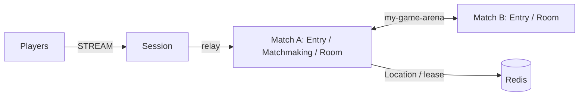

# my-game — Match entry lobby

An action/FPS server template with a Session process and independently deployable match processes. Entry Spots admit Player Actors into a fixed Matchmaking User Spot. Matchmaking pairs players by mode and creates dynamic Room User Spots. Rooms own movement, HP, action sequences, wall intersection, and match results.



## Prerequisites

Node.js 22 or later, npm, Docker Compose with a running Docker daemon, and PowerShell 7 for the PowerShell runner. Dependencies are pinned in `package.json` to public Framework 0.30.1 packages. Copy this directory independently of the ZLink repository.

## Build

POSIX shell:

```sh
npm install && npm run build
```

PowerShell:

```powershell
npm install; if ($LASTEXITCODE -eq 0) { npm run build }
```

The build compiles the role entrypoints and generates DTO schemas for the default Framework JSON serializer. The generator does not register a custom message codec.

## Local e2e

```sh
./run-e2e.sh
./run-e2e.sh --scenario hit,reconnect,update
```

```powershell
pwsh -NoProfile -File ./run-e2e.ps1
pwsh -NoProfile -File ./run-e2e.ps1 -Scenario hit,reconnect,update
```

`hit` verifies pairing, HP damage, closed wall intersection, range and missing-target rejections, and the winner. `reconnect` verifies the same Actor generation, room, HP, and position after a new Session binds the Actor. `update` drains the Room host, observes relocation and safe shutdown, checks unchanged bindings and game state, replaces the process, and verifies that it accepts a new Room.

The runner checks the structure, creates an isolated Compose project per scenario, starts match processes before Session, and waits for public runtime readiness. Listeners bind port zero and publish their actual endpoints. Redis prefixes are unique per run. Logs, generated configuration, message-flow events, and client observations remain in `.logs/run-<id>/`. The runner removes only its own processes and Compose project; cleanup failures produce a nonzero exit code.

Each scenario uses isolated Redis and node processes, with Room capacity set to one per match host. After relocation fills the surviving host, only the replacement has capacity for a new Room. Deployment capacity is configured independently.

Message Follow is configured explicitly to 30 seconds. After `RELOCATED`, the safe shutdown observation budget is the follow duration plus the existing relocation observation budget; the relocation operation deadline is unchanged.

## Known issues

Framework 0.30.1 is required for Node relocation inventory (#1725). The typed push delivery table restores declared DTO classes for the public typed-handler limitation tracked in #1731. Do not replace it with a manual codec.

## Deployment sequence

Configure Redis and a unique key prefix in `server/config/`. Start `dist/server/match/main.js` with `server/config/match-a.json`, then the same entrypoint with `server/config/match-b.json`. Match A bootstraps the fixed `matchmaking` Spot before peers start. Start `dist/server/session/main.js` with `server/config/session.json`. All roles use the common hosting module and report `READY` with actual listener endpoints.

Write `drain` to the selected match process's standard input. Wait for `RELOCATION_REQUESTED`, `RELOCATED`, and `SAFE_TO_SHUTDOWN`. Write `shutdown`, verify `STOPPED` with outcome `Stopped` and reason `None`, and wait for exit. Start a replacement with the same node configuration and `bootstrapMatchmaking` disabled: the relocated Matchmaking Spot already exists. Wait for `READY` before assigning new work. Redis must remain available during this sequence.

## 한국어 실행 안내

Node.js 22 이상과 Docker Compose를 준비하고 Build 절의 명령으로 빌드합니다. `run-e2e.sh` 또는 PowerShell 7의 `run-e2e.ps1`을 실행하면 구조 검사, Redis·서버 기동, 시나리오 판정과 자원 정리를 수행합니다. 실행 로그와 message flow는 `.logs/run-<id>/`에 보존됩니다.

`hit`은 매칭과 사격 판정을, `reconnect`는 Actor identity와 게임 상태 복원을 확인합니다. `update`는 Room host를 drain한 뒤 연결·상태 유지와 교체 process의 새 Room 수락을 확인합니다. 배포 시에는 `SAFE_TO_SHUTDOWN`을 확인한 뒤 기존 process를 종료하고, 교체 process의 `READY`를 확인합니다.
