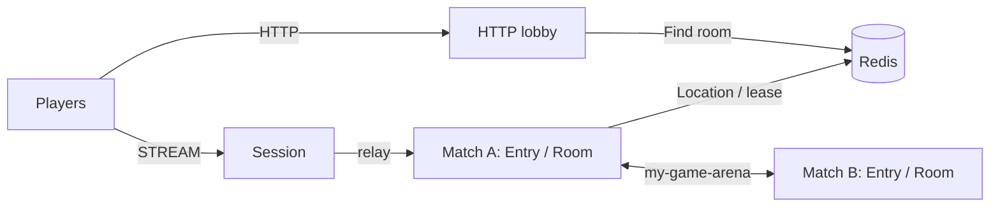

# my-game — HTTP lobby

An action/FPS template with an HTTP matchmaking process, a STREAM Session process, and independently deployable match processes. The HTTP lobby pairs players by mode, prepares a dynamic Room through the public object client, and returns its ID and the Session endpoint. Room User Spots own positions, HP, action sequences, wall intersection, and match results.



## Prerequisites

Docker Compose with a running Docker daemon, and PowerShell 7 for the PowerShell runner. Public Framework packages are pinned to 0.30.2 in `package.json`. This directory can be copied independently of the repository.

## Build

POSIX shell:

```sh
./run-e2e.sh --build-only
```

PowerShell:

```powershell
pwsh -NoProfile -File ./run-e2e.ps1 -BuildOnly
```

The build compiles separate lobby, Session, and match entrypoints and generates DTO schemas for the default Framework JSON serializer. It does not register a custom codec.

## Docker e2e

Docker runs the e2e runner and each node in containers. All roles use one image; the runner image adds Docker CLI 28.5.1. `NODE_IMAGE` pins `node:22.20.0-trixie` with a slim runtime and the native binding's OpenSSL dependency. Nodes share the runner network namespace, preserving loopback listeners and OS-assigned ports. Configuration is copied with `docker cp`; stdin/stdout controls use `docker start -a -i`. Each invocation owns a unique Compose project, network and image tags. Cleanup failures return exit code 1, and shared Docker build cache remains available.

Build and outer cleanup logs are in `.logs/docker-<project>/`; node configuration, stdout and message-flow stderr remain in `.logs/run-<id>/`. For local process debugging, install Node.js 22 or later and npm, then run `./run-e2e.sh --local` or `pwsh -NoProfile -File ./run-e2e.ps1 -Local`. Add `--no-build` or `-NoBuild` to reuse an existing local build. Redis remains in Docker.

```sh
./run-e2e.sh
./run-e2e.sh --scenario lobby,hit,wall,input,reconnect,update
./run-e2e.sh --check-structure
./run-e2e.sh --check-domain
```

```powershell
pwsh -NoProfile -File ./run-e2e.ps1
pwsh -NoProfile -File ./run-e2e.ps1 -Scenario lobby,hit,wall,input,reconnect,update
pwsh -NoProfile -File ./run-e2e.ps1 -CheckStructure
pwsh -NoProfile -File ./run-e2e.ps1 -CheckDomain
```

| Scenario | Observed behavior |
| --- | --- |
| `lobby` | Omitting `mode` selects `duel`; both players receive the same prepared Room assignment with a `room-` prefix and 32 lowercase UUID hex characters. Before either matched player joins, an outsider is rejected with `admission-rejected` and the first Room view confirms the rejection did not change state. A client `PrepareRoom` packet is rejected with `packet-not-allowed`, and restarting the lobby produces a new Room ID. |
| `hit` | Accepted shots reduce HP and advance `LastSequence`. If a cooldown rejection occurs, the client waits for its `RetryAfterMs` before retrying the same sequence. Out-of-range and missing-target rejections leave the Room view unchanged. The lethal hit reports `Phase` and `Winner`. Domain checks exercise the cooldown boundary deterministically. |
| `wall` | Players on opposite sides of the wall cannot shoot through it; each `blocked-by-wall` rejection leaves HP and sequence unchanged. Moving both players below the wall opens a clear shot lane. |
| `input` | Accepted and rejected movement requests are sent consecutively before waiting for replies, followed by consecutive shot requests. `MoveResult` and `ShotResult` identify accepted actions; `move-budget` and `fire-too-soon` preserve accepted state and sequence. Retrying the same request after the server's `RetryAfterMs` succeeds. Oversized, stale, out-of-map, wall-crossing and over-limit sequences are also rejected without state changes. |
| `reconnect` | A new Session binds the same Actor generation and restores the finished Room view, including sequence, `Phase`, and `Winner`. |
| `update` | Planned maintenance relocates the Room and its `{Game, Roster}` snapshot, preserves Session bindings and matched membership, and lets the replacement node accept a new Room. |

The runner validates structure before starting an isolated Compose project. It starts match processes, Session, then lobby; the lobby receives the Session's actual published endpoint. HTTP, mesh, and STREAM listeners bind port zero. Each scenario uses a unique Redis prefix and records node output, message-flow diagnostics, and client observations in `.logs/run-<id>/`. Cleanup failures fail the run.

## Known issues

Validated against the published Framework 0.30.2 packages.

Typed push delivery restores the declared DTO class through the packet-name-to-class table in `handlers.ts` (#1731).

## Deployment sequence

Configure Redis and a unique shared key prefix in `server/config/`. Start `node dist/server/match/main.js server/config/match-a.json`, then the same entrypoint with `server/config/match-b.json`. Start `node dist/server/session/main.js server/config/session.json`. Read its `READY.streamEndpoint`, set the lobby's `sessionEndpoint` to that actual address, and start `node dist/server/lobby/main.js server/config/lobby.json`. The HTTP lobby announces its bound address in `READY.httpEndpoint`.

Clients send `POST /match` with `{playerId, mode}`; omitted `mode` defaults to `duel`. The first request waits until another player in the same mode arrives. The lobby generates a Room ID from `room-` and a 32-character lowercase UUID, creates the Room, sends `PrepareRoom(matchId, members)`, and waits for `RoomPrepared` before returning `{roomId, sessionEndpoint}`. `RoomRoster` owns admission and rejects players outside the matched list. Session relays only `JoinRoomRequest`, `RoomViewRequest`, `MoveRequest`, `ShootRequest`, and `SessionInfoRequest`; internal packets receive `ActionRejected("packet-not-allowed", 0)`. Integer contract values use the common maximum `9,007,199,254,740,991`. Domain time uses a monotonic clock, and relocation snapshots store movement and fire timers as remaining milliseconds.

The lobby queue remains in process memory and is not relocated. The e2e runner sets each match host's Room capacity to one so that the replacement must accept the next Room while its peer hosts the relocated Room. Deployment configurations allow multiple Rooms.

Write `drain` to the Room host's standard input and wait for `RELOCATION_REQUESTED`, `RELOCATED`, and `SAFE_TO_SHUTDOWN`. Write `shutdown`, verify `STOPPED` with outcome `Stopped` and reason `None`, and wait for process exit. Start a replacement with the same configuration and wait for `READY` before assigning new work. Keep Redis, the lobby, and Session available throughout the update.

## 한국어 실행 안내

기본 빌드와 e2e는 Docker에서 runner와 node를 실행한다. Bash는 `./run-e2e.sh`, PowerShell 7은 `pwsh -NoProfile -File ./run-e2e.ps1`을 사용한다. 로컬 프로세스 디버깅은 Node.js와 npm을 설치한 뒤 `--local` 또는 `-Local`로 실행한다. Docker 빌드·정리 로그는 `.logs/docker-<project>/`에 남는다.

Docker Compose를 준비하고 Build 절의 명령으로 이미지를 빌드합니다. `run-e2e.sh` 또는 PowerShell 7의 `run-e2e.ps1`은 구조 검사, domain 경계 검사, Redis와 서버 기동, 시나리오 판정, 자원 정리를 수행합니다. node 로그와 message flow는 `.logs/run-<id>/`에 보존됩니다. HTTP 요청으로 받은 `sessionEndpoint`에 접속한 뒤 `JoinRoomRequest`로 대전에 참가합니다. `lobby`는 생략한 mode의 `duel` 기본값, UUID Room ID, 외부인·client `PrepareRoom` 거부, Lobby 재시작 뒤 새 Room ID를 확인합니다. `hit`은 out-of-range·no-target 뒤 상태 불변, cooldown 거부가 오면 응답의 `RetryAfterMs`만 기다리는 재시도, HP·sequence·phase·winner를 확인합니다. domain 경계 검사는 cooldown을 결정적으로 확인합니다. `input`은 oversized·stale·벽 통과 이동 거부와 상태 불변, move budget의 서버 `RetryAfterMs` 대기를 확인합니다. `reconnect`는 종료된 Room의 sequence·phase·winner 복원을 확인하고, `update`는 relocation 뒤 명단·상태 유지와 교체 process의 새 Room 수락을 확인합니다. 배포에서는 `SAFE_TO_SHUTDOWN`을 확인한 뒤 기존 process를 종료하고 교체 process의 `READY`를 확인합니다.

`input`은 이동 요청 두 개와 사격 요청 두 개를 각각 응답 대기 없이 연속 전송한다. 수락 결과와 시간 제한 거부를 모두 확인하고, 거부 뒤 값·순번·쿨다운 불변 및 서버가 준 `RetryAfterMs` 뒤 같은 요청의 수락을 검사한다. 게임 경계는 기준 match-entry-lobby의 게임 범주 9개로 검사하며, 매칭 범주는 HTTP 경계 19개에서 검사한다. `wall`은 벽 반대편 사격 거부와 HP 불변 및 벽 구간 밖 명중을 확인한다.
