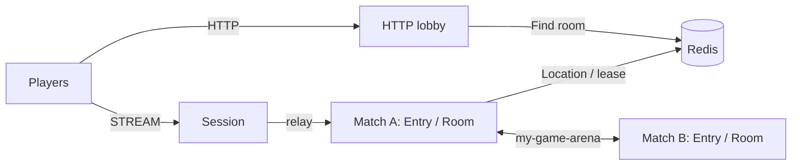

# my-game — HTTP lobby

An action/FPS template with an HTTP matchmaking process, a STREAM Session process, and independently deployable match processes. The HTTP lobby pairs players by mode, prepares a dynamic Room through the public object client, and returns its ID and the Session endpoint. Room User Spots own positions, HP, action sequences, wall intersection, and match results.



## Prerequisites

Docker Compose with a running Docker daemon, and PowerShell 7 for the PowerShell runner. Public Framework packages are pinned to 0.30.2 in `package.json`. This directory can be copied independently of the repository.

## Build

POSIX shell:

```sh
./run-e2e.sh --build-only
```

PowerShell:

```powershell
pwsh -NoProfile -File ./run-e2e.ps1 -BuildOnly
```

The build compiles separate lobby, Session, and match entrypoints and generates DTO schemas for the default Framework JSON serializer. It does not register a custom codec.

## Docker e2e

Docker runs the e2e runner and each node in containers. All roles use one image; the runner image adds Docker CLI 28.5.1. `NODE_IMAGE` pins `node:22.20.0-trixie` with a slim runtime and the native binding's OpenSSL dependency. Nodes share the runner network namespace, preserving loopback listeners and OS-assigned ports. Configuration is copied with `docker cp`; stdin/stdout controls use `docker start -a -i`. Each invocation owns a unique Compose project, network and image tags. Cleanup failures return exit code 1, and shared Docker build cache remains available.

Build and outer cleanup logs are in `.logs/docker-<project>/`; node configuration, stdout and message-flow stderr remain in `.logs/run-<id>/`. For local process debugging, install Node.js 22 or later and npm, then run `./run-e2e.sh --local` or `pwsh -NoProfile -File ./run-e2e.ps1 -Local`. Add `--no-build` or `-NoBuild` to reuse an existing local build. Redis remains in Docker.

```sh
./run-e2e.sh
./run-e2e.sh --scenario lobby,hit,reconnect,update
./run-e2e.sh --check-structure
```

```powershell
pwsh -NoProfile -File ./run-e2e.ps1
pwsh -NoProfile -File ./run-e2e.ps1 -Scenario lobby,hit,reconnect,update
pwsh -NoProfile -File ./run-e2e.ps1 -CheckStructure
```

`lobby` checks identical HTTP assignments and Room views for both players. `hit` checks HP damage, wall and range rejection, missing targets, and the winner. `reconnect` checks the same Actor generation, room, HP, and positions through a new Session. `update` checks relocation signals, unchanged Session bindings and state, process shutdown, and a replacement accepting a new Room.

The runner validates structure before starting an isolated Compose project. It starts match processes, Session, then lobby; the lobby receives the Session's actual published endpoint. HTTP, mesh, and STREAM listeners bind port zero. Each scenario uses a unique Redis prefix and records node output, message-flow diagnostics, and client observations in `.logs/run-<id>/`. Cleanup failures fail the run.

## Known issues

Framework 0.30.2 includes Node relocation inventory fixes (#1725). Typed push delivery restores the declared DTO class through the packet-name-to-class table in `handlers.ts` (#1731). Framework defects must be recorded with their first message-flow failure rather than compensated for in game code.

## Deployment sequence

Configure Redis and a unique shared key prefix in `server/config/`. Start `node dist/server/match/main.js server/config/match-a.json`, then the same entrypoint with `server/config/match-b.json`. Start `node dist/server/session/main.js server/config/session.json`. Read its `READY.streamEndpoint`, set the lobby's `sessionEndpoint` to that actual address, and start `node dist/server/lobby/main.js server/config/lobby.json`. The HTTP lobby announces its bound address in `READY.httpEndpoint`.

Clients send `POST /match` with `{playerId, mode}`. The first request waits until another player in the same mode arrives. Both requests receive `{roomId, sessionEndpoint}` after Room preparation. Clients connect to that Session endpoint and send `JoinRoomRequest`. The lobby queue remains in process memory and is not relocated. The e2e runner sets each match host's Room capacity to one so that the replacement must accept the next Room while its peer hosts the relocated Room. Deployment configurations allow multiple Rooms.

Write `drain` to the Room host's standard input and wait for `RELOCATION_REQUESTED`, `RELOCATED`, and `SAFE_TO_SHUTDOWN`. Write `shutdown`, verify `STOPPED` with outcome `Stopped` and reason `None`, and wait for process exit. Start a replacement with the same configuration and wait for `READY` before assigning new work. Keep Redis, the lobby, and Session available throughout the update.

## 한국어 실행 안내

기본 빌드와 e2e는 Docker에서 runner와 node를 실행한다. Bash는 `./run-e2e.sh`, PowerShell 7은 `pwsh -NoProfile -File ./run-e2e.ps1`을 사용한다. 로컬 프로세스 디버깅은 Node.js와 npm을 설치한 뒤 `--local` 또는 `-Local`로 실행한다. Docker 빌드·정리 로그는 `.logs/docker-<project>/`에 남는다.

Docker Compose를 준비하고 Build 절의 명령으로 이미지를 빌드합니다. `run-e2e.sh` 또는 PowerShell 7의 `run-e2e.ps1`은 구조 검사, Redis와 서버 기동, 시나리오 판정, 자원 정리를 수행합니다. node 로그와 message flow는 `.logs/run-<id>/`에 보존됩니다. HTTP 요청으로 받은 `sessionEndpoint`에 접속한 뒤 `JoinRoomRequest`로 대전에 참가합니다. `lobby`는 HTTP 배정과 Room 참가, `hit`은 사격 판정, `reconnect`는 Actor와 게임 상태 유지, `update`는 Room 이동과 교체 process의 새 작업 수락을 확인합니다. 배포에서는 `SAFE_TO_SHUTDOWN`을 확인한 뒤 기존 process를 종료하고 교체 process의 `READY`를 확인합니다.
