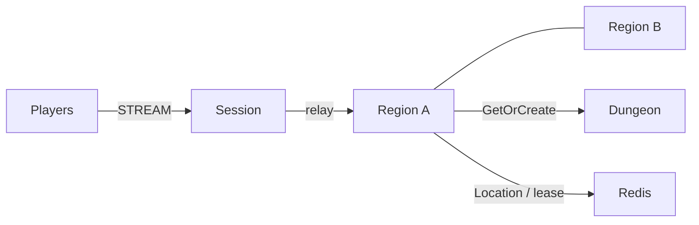

# MyGame megaserver

Players share one world mesh. Entry selects the first region instance with room; each Region owns its admission, membership and positions. Dungeon Spots run on the instance process. A Session binds a persistent Player Actor and relays typed packets.



## Prerequisites

Docker Compose v2, and PowerShell 7 for the PowerShell runner. Framework packages are pinned to 0.30.2 in `package.json`. The binding package installs its published native runtime. Configuration defaults bind listeners to port zero.

## Build

From this directory, on Bash:

```sh
./run-e2e.sh --build-only
```

On PowerShell:

```powershell
pwsh -NoProfile -File ./run-e2e.ps1 -BuildOnly
```

The build generates the Framework JSON schemas from the shared DTO classes. Application packets use the default typed serializer.

## Docker e2e

Docker runs the e2e runner and each node in containers. All roles use one image; the runner image adds Docker CLI 28.5.1. `NODE_IMAGE` pins `node:22.20.0-trixie` with a slim runtime and the native binding's OpenSSL dependency. Nodes share the runner network namespace, preserving loopback listeners and OS-assigned ports. Configuration is copied with `docker cp`; stdin/stdout controls use `docker start -a -i`. Each invocation owns a unique Compose project, network and image tags. Cleanup failures return exit code 1, and shared Docker build cache remains available.

Build and outer cleanup logs are in `.logs/docker-<project>/`; node configuration, stdout and message-flow stderr remain in `.logs/run-<id>/`. For local process debugging, install Node.js 22 or later and npm, then run `./run-e2e.sh --local` or `pwsh -NoProfile -File ./run-e2e.ps1 -Local`. Add `--no-build` or `-NoBuild` to reuse an existing local build. Redis remains in Docker.

```sh
./run-e2e.sh
./run-e2e.sh --scenario region,movement,dungeon,reconnect,update
./run-e2e.sh --check-structure
./run-e2e.sh --check-domain
```

```powershell
pwsh -NoProfile -File ./run-e2e.ps1
pwsh -NoProfile -File ./run-e2e.ps1 -Scenario region,movement,dungeon,reconnect,update
pwsh -NoProfile -File ./run-e2e.ps1 -CheckStructure
pwsh -NoProfile -File ./run-e2e.ps1 -CheckDomain
```

| Scenario  | Assertions                                                                                                             |
| --------- | ---------------------------------------------------------------------------------------------------------------------- |
| region    | Region replicas reach capacity, unknown regions are rejected, and the client remains connected after both replies. |
| movement  | The server validates delta and sequence, keeps state after rejection, and accepts after its `RetryAfterMs`. |
| dungeon   | Region creates a Dungeon and receives its identity from the instance process.                                          |
| reconnect | A new connection preserves Actor identity, generation, instance and position.                                          |
| update    | Region host relocation preserves connected Sessions and game state. The stopped host is replaced and accepts new work. |

Each scenario uses an isolated Compose project, Redis prefix and `.logs/run-<id>/` directory. Redis uses an OS-assigned loopback port. The runner observes protocol output and cleans up its own nodes and Compose project. Cleanup failure returns a nonzero exit code.

## Known issues

Validated against the published Framework 0.30.2 packages.

Node typed handler forwarding requires the packet-name-to-class table in `server/region/infrastructure/zlink/handlers.ts` until #1731 is fixed in 0.32.0. No Framework state is included in application relocation snapshots.

## Deployment sequence

Start Redis, then the region and instance processes, then the Session process. Each role has its own entrypoint under `server/`; pass its JSON configuration path as the first argument. Use a unique node ID, shared Redis prefix and mesh name, and reachable advertised endpoints in deployed configurations.

Send `drain` to the selected region process. Wait for `RELOCATION_REQUESTED`, `RELOCATED` and `SAFE_TO_SHUTDOWN`. Send `shutdown`, verify `STOPPED` with outcome Stopped and reason None, then start the replacement with the same configuration. Capacity defaults to two players per Region and Region stable-type limit defaults to two instances per region process. Ensure the surviving host has capacity for relocation.

The e2e fixture limits each Region node to two Region Spots and keeps forest-1 and forest-2 occupied before drain. After relocation the survivor is full. Once the replacement reports `READY`, a new desert Region must be served by that replacement. Existing Region state and Session identity checks remain required. Only Region nodes register the application Entry and its first admission handler, so only those nodes declare an Entry in `zlink.structure.json`.

Message Follow is explicitly set to 30 seconds. The `SAFE_TO_SHUTDOWN` observation budget is the follow duration plus the existing relocation budget; the relocation operation deadline is unchanged.

## 한국어 실행 안내

기본 빌드와 e2e는 Docker에서 runner와 node를 실행한다. Bash는 `./run-e2e.sh`, PowerShell 7은 `pwsh -NoProfile -File ./run-e2e.ps1`을 사용한다. `--check-domain` 또는 `-CheckDomain`은 Redis와 node 없이 이동 경계를 검사한다. `region`은 복제본 수용량·알 수 없는 지역·Session 허용 목록을, `movement`는 서버 권위 이동과 거부 뒤 상태 불변을 확인한다. 로컬 프로세스 디버깅은 Node.js와 npm을 설치한 뒤 `--local` 또는 `-Local`로 실행한다. Docker 빌드·정리 로그는 `.logs/docker-<project>/`에 남는다.

Docker Compose v2를 준비한 뒤 이 디렉터리에서 위 Build 명령으로 이미지를 빌드한다. Bash에서는 `./run-e2e.sh`, PowerShell 7에서는 `pwsh -NoProfile -File ./run-e2e.ps1`로 지역 분리, 던전 생성, 재접속, host 교체 시나리오를 실행합니다. 개별 실행 방법은 위 Docker e2e 절에 있습니다. 각 실행은 고유 Redis prefix와 Compose project를 사용하며 로그를 `.logs/run-<id>/`에 보존합니다. 지역 host를 교체할 때는 `drain` 이후 relocation 완료와 `SAFE_TO_SHUTDOWN`을 확인하고 종료합니다. Framework 패키지 0.30.2의 공개 게시가 빌드 전제입니다.
