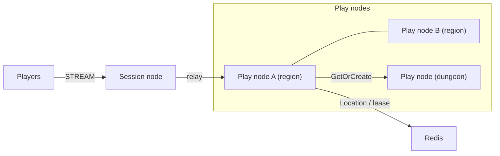

# MyGame megaserver

Players share one world mesh. Entry selects the first region instance with room; each Region owns its admission, membership and positions. Dungeon Spots run on the play node (dungeon). A Session binds a persistent Player Actor and relays typed packets.



## Prerequisites

Docker Compose v2, and PowerShell 7 for the PowerShell runner. Framework packages are pinned to 0.32.0 in `package.json`. The binding package installs its published native runtime. Configuration defaults bind listeners to port zero.

## Build

From this directory, on Bash:

```sh
./run-e2e.sh --build-only
```

On PowerShell:

```powershell
pwsh -NoProfile -File ./run-e2e.ps1 -BuildOnly
```

The build generates the Framework JSON schemas from the shared DTO classes. Application packets use the default typed serializer.

## Client connection

### Endpoint and first packet

Connect to the Session `players` STREAM listener. `server/config/session.json` sets `streamEndpoint` to `ws://127.0.0.1:0`: loopback WebSocket, OS-assigned port, root path `/`. Use the actual `endpoint` in Session `READY` JSON, as `e2e/runner.ts` does. Region/Instance mesh listeners and Redis are internal endpoints.

Send `EnterRegionRequest(playerId, region)` first. `forest` and `desert` are allowed regions. The Session creates/binds the Actor; a successful entry produces a `RegionView` push. `RegionUnavailable` reports an unknown region or exhausted capacity, and `ActionRejected` reports rejected actions. This is send/push; `SessionInfoRequest` is a correlated request after binding. The template uses the supplied player ID without product authentication; validate identity before binding when adding it.

### Connector installation

The default loopback listener is reachable only within its host/network namespace. Docker e2e nodes share the runner network namespace and are removed at the end. External clients need a deployment kept running with a reachable listener and an exposed container port. Browser, Unity WebGL, and Cocos Creator web clients can use this WebSocket endpoint; HTTPS pages require a secure `wss://` deployment. HTTP entry points also need a browser-accessible origin/CORS policy when called from a web client.

Use the same connector release as `package.json` dependencies `@zlink-systems/framework` and `@zlink-systems/stream-connector`. Replace `<version>` in the installation commands with that release. Check linked guides against that pin; engine adapters follow the linked repository READMEs. All clients use this template's packet contract.

| Client                             | Connector installation                                                                                                                                                                                                                                                                                                                                                                                                                                                          | Documentation guide                                                                                                                                                          |
| ---------------------------------- | ------------------------------------------------------------------------------------------------------------------------------------------------------------------------------------------------------------------------------------------------------------------------------------------------------------------------------------------------------------------------------------------------------------------------------------------------------------------------------- | ---------------------------------------------------------------------------------------------------------------------------------------------------------------------------- |
| Unity                              | Native/Editor: restore `Zlink.Stream.Connector` with NuGetForUnity. WebGL: add the `com.zlink.stream-connector.webgl` UPM Git package; include only the connector assembly for the active target. See the [Unity README](https://github.com/zlink-systems/zlink/blob/main/framework/languages/engines/Unity/README.md) and its package manifest.                                                                                                                                | [.NET engine integration](https://docs.zlink.systems/dotnet/guide/stream-connector/12-engine-integration/)                                                                   |
| Unreal                             | Copy `framework/languages/cpp/connector/engines/unreal` into `Plugins/ZLinkStreamConnector`, then package the native connector under `ThirdParty/ZLink` as described in the [Unreal README](https://github.com/zlink-systems/zlink/blob/main/framework/languages/engines/Unreal/README.md).                                                                                                                                                                                     | [C++ engine integration](https://docs.zlink.systems/cpp/guide/stream-connector/12-engine-integration/)                                                                       |
| Godot                              | .NET: add the NuGet package `Zlink.Stream.Connector` and run `dotnet restore`; see the [C# README](https://github.com/zlink-systems/zlink/blob/main/framework/languages/engines/Godot/csharp/README.md). GDExtension: build the C++ Godot adapter against the framework prebuilt and matching `godot-cpp`; see the [C++ README](https://github.com/zlink-systems/zlink/blob/main/framework/languages/engines/Godot/cpp/README.md). The .NET sample does not support Web export. | [.NET](https://docs.zlink.systems/dotnet/guide/stream-connector/12-engine-integration/), [C++](https://docs.zlink.systems/cpp/guide/stream-connector/12-engine-integration/) |
| Cocos Creator                      | Web target: `npm install @zlink-systems/stream-connector@<version>`; see the [Cocos Creator README](https://github.com/zlink-systems/zlink/blob/main/framework/languages/engines/CocosCreator/README.md). This package does not provide a Creator native adapter.                                                                                                                                                                                                               | [TypeScript engine integration](https://docs.zlink.systems/node/guide/stream-connector/12-engine-integration/)                                                               |
| Axmol                              | Copy `framework/languages/cpp/connector/engines/axmol` into `third_party/zlink_axmol_connector` and link `zlink::stream_connector` from the installed C++ framework package; see the [Axmol README](https://github.com/zlink-systems/zlink/blob/main/framework/languages/engines/Axmol/README.md).                                                                                                                                                                              | [C++ engine integration](https://docs.zlink.systems/cpp/guide/stream-connector/12-engine-integration/)                                                                       |
| Web browser (TypeScript connector) | `npm install @zlink-systems/stream-connector@<version>`; import the package root in the browser build. Use `ws://` or `wss://`, subject to the page's security policy.                                                                                                                                                                                                                                                                                                          | [TypeScript connector](https://docs.zlink.systems/node/guide/stream-connector/)                                                                                              |
| C++                                | Install the C++ framework prebuilt containing the connector; use `find_package(zlink_stream_connector_cpp CONFIG REQUIRED)` and link `zlink::stream_connector`.                                                                                                                                                                                                                                                                                                                 | [C++ connector](https://docs.zlink.systems/cpp/guide/stream-connector/)                                                                                                      |
| C#/.NET                            | `dotnet add package Zlink.Stream.Connector --version <version>`                                                                                                                                                                                                                                                                                                                                                                                                                 | [.NET connector](https://docs.zlink.systems/dotnet/guide/stream-connector/)                                                                                                  |
| Java                               | Add Maven/Gradle dependency `systems.zlink:zlink-stream-connector:<version>`.                                                                                                                                                                                                                                                                                                                                                                                                   | [Java connector](https://docs.zlink.systems/java/guide/stream-connector/)                                                                                                    |
| Kotlin                             | Add `systems.zlink:zlink-stream-connector:<version>` and `systems.zlink:zlink-framework-kotlin:<version>` for the coroutine wrapper.                                                                                                                                                                                                                                                                                                                                            | [Kotlin connector](https://docs.zlink.systems/kotlin/guide/stream-connector/)                                                                                                |
| Node                               | `npm install @zlink-systems/stream-connector@<version>`; use the package root and Node.js 22 or later.                                                                                                                                                                                                                                                                                                                                                                          | [Node connector](https://docs.zlink.systems/node/guide/stream-connector/)                                                                                                    |

### First region example

Save as `e2e/connect-once.mts` in a copy, run `npm run build`, then `node dist/e2e/connect-once.mjs <actual-session-endpoint>`. Keep Session, Region/play nodes (dungeon), and Redis running separately; e2e removes its temporary deployment. Use a fresh player ID. Received contract int64 values remain decimal strings with the JSON codec; the example prints the payload without numeric conversion. See `e2e/client.mts` for the complete flow.

```typescript
import '../.zlink-framework-json-schemas.cjs';
import {
  zlinkStreamConnectorFactory,
  zlinkStreamJsonCodec,
  ZlinkStreamDispatchMode
} from '@zlink-systems/stream-connector';
import { EnterRegionRequest } from '../server/shared/messages.js';

const endpoint = process.argv[2];
if (!endpoint) throw new Error('Pass the Session endpoint from READY');
const client = zlinkStreamConnectorFactory.create({
  endpoint,
  codec: zlinkStreamJsonCodec,
  dispatchMode: ZlinkStreamDispatchMode.Immediate,
  reconnect: { enabled: false }
});
try {
  const view = new Promise<unknown>((resolve, reject) => {
    client.on('RegionView', (message) => resolve(message.payload));
    client.on('RegionUnavailable', () => reject(new Error('Region unavailable')));
    client.on('ActionRejected', () => reject(new Error('Entry rejected')));
    client.onErrorReceived((error) => reject(new Error(error.message)));
    client.onDisconnected(() => reject(new Error('Disconnected before RegionView')));
  });
  await client.connect();
  await client.send(new EnterRegionRequest('guide-player', 'forest')).submit();
  console.log(await view);
} finally {
  await client.close();
}
```

## Docker e2e

Docker runs the e2e runner and each node in containers. All roles use one image; the runner image adds Docker CLI 28.5.1. `NODE_IMAGE` pins `node:22.20.0-trixie` with a slim runtime and the native binding's OpenSSL dependency. Nodes share the runner network namespace, preserving loopback listeners and OS-assigned ports. Configuration is copied with `docker cp`; stdin/stdout controls use `docker start -a -i`. Each invocation owns a unique Compose project, network and image tags. Cleanup failures return exit code 1, and shared Docker build cache remains available.

Build and outer cleanup logs are in `.logs/docker-<project>/`; node configuration, stdout and message-flow stderr remain in `.logs/run-<id>/`. For local process debugging, install Node.js 22 or later and npm, then run `./run-e2e.sh --local` or `pwsh -NoProfile -File ./run-e2e.ps1 -Local`. Add `--no-build` or `-NoBuild` to reuse an existing local build. Redis remains in Docker.

```sh
./run-e2e.sh
./run-e2e.sh --scenario region,movement,dungeon,reconnect,update
./run-e2e.sh --check-structure
./run-e2e.sh --check-domain
```

```powershell
pwsh -NoProfile -File ./run-e2e.ps1
pwsh -NoProfile -File ./run-e2e.ps1 -Scenario region,movement,dungeon,reconnect,update
pwsh -NoProfile -File ./run-e2e.ps1 -CheckStructure
pwsh -NoProfile -File ./run-e2e.ps1 -CheckDomain
```

| Scenario  | Assertions                                                                                                             |
| --------- | ---------------------------------------------------------------------------------------------------------------------- |
| region    | Region replicas reach capacity, unknown regions are rejected, and the client remains connected after both replies. |
| movement  | The server validates delta and sequence, keeps state after rejection, and accepts after its `RetryAfterMs`. |
| dungeon   | Region creates a Dungeon and receives its identity from the play node (dungeon).                                          |
| reconnect | A new connection preserves Actor identity, generation, instance and position.                                          |
| update    | play node (region) relocation preserves connected Sessions and game state. The stopped host is replaced and accepts new work. |

Each scenario uses an isolated Compose project, Redis prefix and `.logs/run-<id>/` directory. Redis uses an OS-assigned loopback port. The runner observes protocol output and cleans up its own nodes and Compose project. Cleanup failure returns a nonzero exit code.

## Framework behavior to know

- **Waiting for DB or file I/O in a handler** — An ordinary async terminal retains the turn, while `Yield` lets other handlers on the same Spot proceed. [Guide](https://docs.zlink.systems/node/guide/server/32-execution-model/#io-worker-wait).
- **Creation that misses its deadline** — `DeadlineExceeded` and caller cancellation have distinct outcomes. [Guide](https://docs.zlink.systems/node/guide/server/22-actor/#creation-deadline). [server/session/session.ts:35](server/session/session.ts).
- **Many logins at once** — Each creation for a different ID requires a Location Store round trip, so measure expected load when setting the deadline. [Guide](https://docs.zlink.systems/node/guide/server/25-location/#creation-load).
- **Sending under load** — Send waits for capacity, and the application sees the final result. [Guide](https://docs.zlink.systems/node/guide/server/33-backpressure/#send-backpressure). [server/session/session.ts:27](server/session/session.ts).
- **Duplicate login** — Without a callback, a bind from another Session is accepted; reject it in the Actor duplicate-bind callback to prevent this. [Guide](https://docs.zlink.systems/node/guide/server/39-session-binding/#duplicate-session-bind). This template keeps the default (accepts the new Session).
- **ObjectGeneration** — `ObjectGeneration` distinguishes logical incarnations of the same ID; it is not a data version or write authority. [Guide](https://docs.zlink.systems/node/guide/server/34-activation-lifetime/#object-generation). [server/session/session.ts:47](server/session/session.ts).
- **READY and Serving** — The Framework host prints `READY` after observing runtime `Serving`. [Guide](https://docs.zlink.systems/node/guide/server/12-operations/#wait-for-serving). [server/shared/hosting.ts:89](server/shared/hosting.ts); [server/shared/hosting.ts:138](server/shared/hosting.ts).

## Known issues

Validated against the published Framework 0.32.0 packages.

Node typed handler forwarding requires the packet-name-to-class table in `server/region/infrastructure/zlink/handlers.ts` until #1731 is fixed in 0.32.0. No Framework state is included in application relocation snapshots.

## Deployment sequence

Start Redis, then the region and instance processes, then the Session node. Each role has its own entrypoint under `server/`; pass its JSON configuration path as the first argument. Use a unique node ID, shared Redis prefix and mesh name, and reachable advertised endpoints in deployed configurations.

Send `drain` to the selected play node (region). Wait for `RELOCATION_REQUESTED`, `RELOCATED` and `SAFE_TO_SHUTDOWN`. Send `shutdown`, verify `STOPPED` with outcome Stopped and reason None, then start the replacement with the same configuration. Capacity defaults to two players per Region and Region stable-type limit defaults to two instances per play node (region). Ensure the surviving host has capacity for relocation.

The e2e fixture limits each play node (region) to two Region Spots and keeps forest-1 and forest-2 occupied before drain. After relocation the survivor is full. Once the replacement reports `READY`, a new desert Region must be served by that replacement. Existing Region state and Session identity checks remain required. Only play nodes (region) register the application Entry and its first admission handler, so only those nodes declare an Entry in `zlink.structure.json`.

Message Follow is explicitly set to 30 seconds. The `SAFE_TO_SHUTDOWN` observation budget is the follow duration plus the existing relocation budget; the relocation operation deadline is unchanged.
