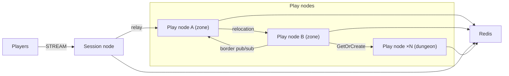

# MyGame seamless world

This Node.js template runs a Session node, two Zone processes and a Dungeon process. `ZonePositionDomain` owns authoritative position, sequence, movement budget, and visibility state. Zone User Spots publish typed appearance, movement, and departure through the `border` channel. Framework relocation moves Actors across Zones while preserving their Session binding.



## Prerequisites

Install Docker with Compose v2 and PowerShell 7 on Windows. Local debugging also requires Node.js 22 or later and npm. The project pins public ZLink packages to 0.34.0. No repository source or local package feed is required by this template.

## Build

Shell:

```sh
./run-e2e.sh --build-only
```

PowerShell:

```powershell
pwsh -NoProfile -File ./run-e2e.ps1 -BuildOnly
```

Docker builds a shared role image and a runner image using the pinned `NODE_IMAGE` ARG (`node:22.20.0-trixie`, with a slim runtime stage). The runner image also includes Docker CLI 28.5.1. The build compiles TypeScript and generates packet schemas for the Framework's default typed JSON serializer. Relocation adapters serialize only application state.

## Client connection

### Endpoint and first packet

Connect to the Session `players` STREAM listener. `server/config/session.json` sets `streamEndpoint` to `ws://127.0.0.1:0`: loopback WebSocket, OS-assigned port, root path `/`. Use the actual `endpoint` in Session `READY` JSON, as `e2e/runner.ts` does. Zone/Instance mesh listeners and Redis are internal endpoints.

Send `JoinWorldRequest(playerId, x)` first; `x: 0` starts in the first Zone. The Session creates/binds the Actor and world entry produces a `WorldState` push. `ActionRejected` reports rejected actions. This is send/push, not request/reply; request `SessionInfoRequest` only after binding. There is no product authentication; validate identity before binding when adding it. Rejoining may restore existing state instead of using the supplied initial position.

### Connector installation

The default loopback listener is reachable only within its host/network namespace. Docker e2e nodes share the runner network namespace and are removed at the end. External clients need a deployment kept running with a reachable listener and an exposed container port. Browser, Unity WebGL, and Cocos Creator web clients can use this WebSocket endpoint; HTTPS pages require a secure `wss://` deployment. HTTP entry points also need a browser-accessible origin/CORS policy when called from a web client.

Use the same connector release as `package.json` dependencies `@zlink-systems/framework` and `@zlink-systems/stream-connector`. Replace `<version>` in the installation commands with that release. Check linked guides against that pin; engine adapters follow the linked repository READMEs. All clients use this template's packet contract.

| Client                             | Connector installation                                                                                                                                                                                                                                                                                                                                                                                                                                                          | Documentation guide                                                                                                                                                          |
| ---------------------------------- | ------------------------------------------------------------------------------------------------------------------------------------------------------------------------------------------------------------------------------------------------------------------------------------------------------------------------------------------------------------------------------------------------------------------------------------------------------------------------------- | ---------------------------------------------------------------------------------------------------------------------------------------------------------------------------- |
| Unity                              | Native/Editor: restore `Zlink.Stream.Connector` with NuGetForUnity. WebGL: add the `com.zlink.stream-connector.webgl` UPM Git package; include only the connector assembly for the active target. See the [Unity README](https://github.com/zlink-systems/zlink/blob/main/framework/languages/engines/Unity/README.md) and its package manifest.                                                                                                                                | [.NET engine integration](https://docs.zlink.systems/dotnet/guide/stream-connector/12-engine-integration/)                                                                   |
| Unreal                             | Copy `framework/languages/cpp/connector/engines/unreal` into `Plugins/ZLinkStreamConnector`, then package the native connector under `ThirdParty/ZLink` as described in the [Unreal README](https://github.com/zlink-systems/zlink/blob/main/framework/languages/engines/Unreal/README.md).                                                                                                                                                                                     | [C++ engine integration](https://docs.zlink.systems/cpp/guide/stream-connector/12-engine-integration/)                                                                       |
| Godot                              | .NET: add the NuGet package `Zlink.Stream.Connector` and run `dotnet restore`; see the [C# README](https://github.com/zlink-systems/zlink/blob/main/framework/languages/engines/Godot/csharp/README.md). GDExtension: build the C++ Godot adapter against the framework prebuilt and matching `godot-cpp`; see the [C++ README](https://github.com/zlink-systems/zlink/blob/main/framework/languages/engines/Godot/cpp/README.md). The .NET sample does not support Web export. | [.NET](https://docs.zlink.systems/dotnet/guide/stream-connector/12-engine-integration/), [C++](https://docs.zlink.systems/cpp/guide/stream-connector/12-engine-integration/) |
| Cocos Creator                      | Web target: `npm install @zlink-systems/stream-connector@<version>`; see the [Cocos Creator README](https://github.com/zlink-systems/zlink/blob/main/framework/languages/engines/CocosCreator/README.md). This package does not provide a Creator native adapter.                                                                                                                                                                                                               | [TypeScript engine integration](https://docs.zlink.systems/node/guide/stream-connector/12-engine-integration/)                                                               |
| Axmol                              | Copy `framework/languages/cpp/connector/engines/axmol` into `third_party/zlink_axmol_connector` and link `zlink::stream_connector` from the installed C++ framework package; see the [Axmol README](https://github.com/zlink-systems/zlink/blob/main/framework/languages/engines/Axmol/README.md).                                                                                                                                                                              | [C++ engine integration](https://docs.zlink.systems/cpp/guide/stream-connector/12-engine-integration/)                                                                       |
| Web browser (TypeScript connector) | `npm install @zlink-systems/stream-connector@<version>`; import the package root in the browser build. Use `ws://` or `wss://`, subject to the page's security policy.                                                                                                                                                                                                                                                                                                          | [TypeScript connector](https://docs.zlink.systems/node/guide/stream-connector/)                                                                                              |
| C++                                | Install the C++ framework prebuilt containing the connector; use `find_package(zlink_stream_connector_cpp CONFIG REQUIRED)` and link `zlink::stream_connector`.                                                                                                                                                                                                                                                                                                                 | [C++ connector](https://docs.zlink.systems/cpp/guide/stream-connector/)                                                                                                      |
| C#/.NET                            | `dotnet add package Zlink.Stream.Connector --version <version>`                                                                                                                                                                                                                                                                                                                                                                                                                 | [.NET connector](https://docs.zlink.systems/dotnet/guide/stream-connector/)                                                                                                  |
| Java                               | Add Maven/Gradle dependency `systems.zlink:zlink-stream-connector:<version>`.                                                                                                                                                                                                                                                                                                                                                                                                   | [Java connector](https://docs.zlink.systems/java/guide/stream-connector/)                                                                                                    |
| Kotlin                             | Add `systems.zlink:zlink-stream-connector:<version>` and `systems.zlink:zlink-framework-kotlin:<version>` for the coroutine wrapper.                                                                                                                                                                                                                                                                                                                                            | [Kotlin connector](https://docs.zlink.systems/kotlin/guide/stream-connector/)                                                                                                |
| Node                               | `npm install @zlink-systems/stream-connector@<version>`; use the package root and Node.js 22 or later.                                                                                                                                                                                                                                                                                                                                                                          | [Node connector](https://docs.zlink.systems/node/guide/stream-connector/)                                                                                                    |

### First world entry example

Save as `e2e/connect-once.mts` in a copy, run `npm run build`, then `node dist/e2e/connect-once.mjs <actual-session-endpoint>`. Keep Session, Zone/play nodes (dungeon), and Redis running separately; e2e removes its temporary deployment. Use a fresh player ID. Received contract int64 values remain decimal strings with the JSON codec; this example prints the payload without numeric conversion. See `e2e/client.mts` for the complete flow.

```typescript
import '../.zlink-framework-json-schemas.cjs';
import {
  zlinkStreamConnectorFactory,
  zlinkStreamJsonCodec,
  ZlinkStreamDispatchMode
} from '@zlink-systems/stream-connector';
import { JoinWorldRequest } from '../server/shared/messages.js';

const endpoint = process.argv[2];
if (!endpoint) throw new Error('Pass the Session endpoint from READY');
const client = zlinkStreamConnectorFactory.create({
  endpoint,
  codec: zlinkStreamJsonCodec,
  dispatchMode: ZlinkStreamDispatchMode.Immediate,
  reconnect: { enabled: false }
});
try {
  const view = new Promise<unknown>((resolve, reject) => {
    client.on('WorldState', (message) => resolve(message.payload));
    client.on('ActionRejected', () => reject(new Error('Entry rejected')));
    client.onErrorReceived((error) => reject(new Error(error.message)));
    client.onDisconnected(() => reject(new Error('Disconnected before WorldState')));
  });
  await client.connect();
  await client.send(new JoinWorldRequest('guide-player', 0)).submit();
  console.log(await view);
} finally {
  await client.close();
}
```

## Docker e2e

```sh
./run-e2e.sh
./run-e2e.sh --scenario cross,border,reconnect
./run-e2e.sh --check-domain
./run-e2e.sh --check-structure
```

```powershell
pwsh -NoProfile -File ./run-e2e.ps1
pwsh -NoProfile -File ./run-e2e.ps1 -Scenario cross,border,reconnect
pwsh -NoProfile -File ./run-e2e.ps1 -CheckDomain
pwsh -NoProfile -File ./run-e2e.ps1 -CheckStructure
```

The default order is `cross`, `border`, `reconnect`, `update`. Cross verifies rejected movement leaves state unchanged, uses the server-provided retry delay, crosses Zones, preserves Actor identity and reaches Dungeon placement. Border verifies adjacent visibility, `out-of-range` when a player moves into the Zone interior beyond the border band, and the existing `left-zone` and `disconnected` events. Reconnect verifies preserved movement with a new physical Session. Update drains Zone A while movement continues, observes relocation and SafeToShutdown, stops the old process, starts its replacement and verifies continued game traffic. `--check-domain` verifies finite input, bounds, sequence, budget, and snapshot boundaries without sending non-finite JSON.

Each run validates `zlink.structure.json`, creates a unique Redis Compose project and key prefix, binds listeners to OS-assigned ports, and saves node stdout, stderr message-flow records and client packets in `.logs/run-<id>/`. Cleanup failure causes exit code 1. The runner uses separate role entrypoints and starts Zone A before Zone B so fixed Zone placement follows the declared configuration.

Docker runs the e2e runner and each node in containers. Nodes share the runner's network namespace, preserving loopback endpoints and OS-assigned ports. The runner controls stdin and captures stdout through `docker start -a -i`. Each run owns a unique Compose project, network and image tags. Shell logs are in `.logs/docker-<project>/`; node and message-flow logs remain in `.logs/run-<id>/`. Cleanup removes only that run's resources and returns exit code 1 on failure. Shared Docker build cache is retained.

For local process debugging, run `./run-e2e.sh --local` or `pwsh -NoProfile -File ./run-e2e.ps1 -Local`. These commands install packages, build and run the same scenarios with Redis in Docker. Add `--no-build` or `-NoBuild` to reuse an existing local build.

## Framework behavior to know

- **Waiting for DB or file I/O in a handler** — An ordinary async terminal retains the turn, while `Yield` lets other handlers on the same Spot proceed. [Guide](https://docs.zlink.systems/node/guide/server/32-execution-model/#io-worker-wait).
- **Creation that misses its deadline** — `DeadlineExceeded` and caller cancellation have distinct outcomes. [Guide](https://docs.zlink.systems/node/guide/server/22-actor/#creation-deadline). [server/session/session.ts:34](server/session/session.ts).
- **Many logins at once** — Each creation for a different ID requires a Location Store round trip, so measure expected load when setting the deadline. [Guide](https://docs.zlink.systems/node/guide/server/25-location/#creation-load).
- **Sending under load** — Send waits for capacity, and the application sees the final result. [Guide](https://docs.zlink.systems/node/guide/server/33-backpressure/#send-backpressure). [server/session/session.ts:26](server/session/session.ts).
- **Duplicate login** — Without a callback, a bind from another Session is accepted; reject it in the Actor duplicate-bind callback to prevent this. [Guide](https://docs.zlink.systems/node/guide/server/39-session-binding/#duplicate-session-bind). This template keeps the default (accepts the new Session).
- **ObjectGeneration** — `ObjectGeneration` distinguishes logical incarnations of the same ID; it is not a data version or write authority. [Guide](https://docs.zlink.systems/node/guide/server/34-activation-lifetime/#object-generation). [server/session/session.ts:43](server/session/session.ts).
- **READY and Serving** — The Framework host prints `READY` after observing runtime `Serving`. [Guide](https://docs.zlink.systems/node/guide/server/12-operations/#wait-for-serving). [server/shared/hosting.ts:92](server/shared/hosting.ts); [server/shared/hosting.ts:142](server/shared/hosting.ts).

## Known issues

Validated against the published Framework 0.34.0 packages.

Node typed handlers receive fields without the declared DTO class (#1731, scheduled for 0.32.0); the template reconstructs declared packet classes before forwarding through typed APIs.

Message Follow is explicitly configured to 30 seconds in shared hosting. The wait for `SAFE_TO_SHUTDOWN` is derived from that period plus the existing host relocation budget. Packet deadlines and the relocation operation budget remain unchanged.

## Deployment sequence

1. Start Redis and configure a deployment-specific key prefix.
2. Start Zone A with `server/config/zone-a.json` and wait for `READY`. Start Zone B, Instance and Session in that order. Session's `READY` includes the published STREAM endpoint.
3. To replace Zone A, send `drain` on its stdin. Wait for `RELOCATION_REQUESTED`, `RELOCATED` and `SAFE_TO_SHUTDOWN` in order.
4. Send `shutdown`, require `STOPPED` with a successful outcome and process exit, and start a replacement using the same configuration. Like every play node (zone), it runs `getOrCreate` for all configured Zones at startup: Zones already moved to Zone B end as existing and remain there, and only the closed first Zone is created on the replacement. Replacement placement is available for new Actors.

Each process is started with `node dist/server/<role>/main.js server/config/<node>.json`. Use deployment listener endpoints in those configuration files. The e2e runner overrides Redis and listener endpoints for its isolated run.

Fixed Zones are bootstrapped serially: Zone A fills its three-Spot capacity before Zone B starts. This makes the declared initial owners deterministic through public stable-type capacity. During e2e, Zone B has capacity for all but one world Zone. Before update drains Zone A, `vacate-zone` closes the unused first Zone through the public Spot manager. The remaining Zones fill Zone B; the replacement Zone A recreates the first Zone through its startup `getOrCreate`; a fresh player then joins it, and the test verifies its host and continued movement. Existing relocated players remain on Zone B.
