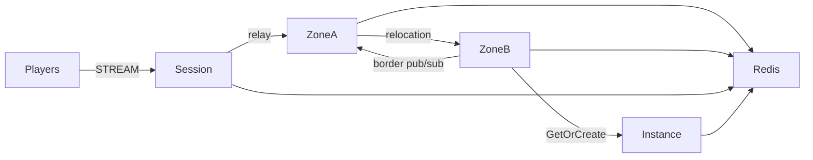

# MyGame seamless world

This Node.js template runs a Session process, two Zone processes and a Dungeon process. A Player Actor owns movement state. Zone User Spots maintain visibility projections and publish nearby positions through the `border` channel. Framework relocation moves Actors across Zones while preserving their Session binding.



## Prerequisites

Install Docker with Compose v2 and PowerShell 7 on Windows. Local debugging also requires Node.js 22 or later and npm. The project pins public ZLink packages to 0.30.2. No repository source or local package feed is required by this template.

## Build

Shell:

```sh
./run-e2e.sh --build-only
```

PowerShell:

```powershell
pwsh -NoProfile -File ./run-e2e.ps1 -BuildOnly
```

Docker builds a shared role image and a runner image using the pinned `NODE_IMAGE` ARG (`node:22.20.0-trixie`, with a slim runtime stage). The runner image also includes Docker CLI 28.5.1. The build compiles TypeScript and generates packet schemas for the Framework's default typed JSON serializer. Relocation adapters serialize only application state.

## Docker e2e

```sh
./run-e2e.sh
./run-e2e.sh --scenario cross,border,reconnect
./run-e2e.sh --check-structure
```

```powershell
pwsh -NoProfile -File ./run-e2e.ps1
pwsh -NoProfile -File ./run-e2e.ps1 -Scenario cross,border,reconnect
pwsh -NoProfile -File ./run-e2e.ps1 -CheckStructure
```

The default order is `cross`, `border`, `reconnect`, `update`. Cross verifies Zone A to Zone B movement, Actor identity, uninterrupted Session binding and Dungeon placement. Border verifies adjacent visibility across physical processes. Reconnect verifies preserved movement with a new physical Session. Update drains Zone A while movement continues, observes relocation and SafeToShutdown, stops the old process, starts its replacement and verifies continued game traffic.

Each run validates `zlink.structure.json`, creates a unique Redis Compose project and key prefix, binds listeners to OS-assigned ports, and saves node stdout, stderr message-flow records and client packets in `.logs/run-<id>/`. Cleanup failure causes exit code 1. The runner uses separate role entrypoints and starts Zone A before Zone B so fixed Zone placement follows the declared configuration.

Docker runs the e2e runner and each node in containers. Nodes share the runner's network namespace, preserving loopback endpoints and OS-assigned ports. The runner controls stdin and captures stdout through `docker start -a -i`. Each run owns a unique Compose project, network and image tags. Shell logs are in `.logs/docker-<project>/`; node and message-flow logs remain in `.logs/run-<id>/`. Cleanup removes only that run's resources and returns exit code 1 on failure. Shared Docker build cache is retained.

For local process debugging, run `./run-e2e.sh --local` or `pwsh -NoProfile -File ./run-e2e.ps1 -Local`. These commands install packages, build and run the same scenarios with Redis in Docker. Add `--no-build` or `-NoBuild` to reuse an existing local build.

## Known issues

Validated against the published Framework 0.30.2 packages.

Node typed handlers receive fields without the declared DTO class (#1731, scheduled for 0.32.0); the template reconstructs declared packet classes before forwarding through typed APIs.

Message Follow is explicitly configured to 30 seconds in shared hosting. The wait for `SAFE_TO_SHUTDOWN` is derived from that period plus the existing host relocation budget. Packet deadlines and the relocation operation budget remain unchanged.

## Deployment sequence

1. Start Redis and configure a deployment-specific key prefix.
2. Start Zone A with `server/config/zone-a.json` and wait for `READY`. Start Zone B, Instance and Session in that order. Session's `READY` includes the published STREAM endpoint.
3. To replace Zone A, send `drain` on its stdin. Wait for `RELOCATION_REQUESTED`, `RELOCATED` and `SAFE_TO_SHUTDOWN` in order.
4. Send `shutdown`, require `STOPPED` with a successful outcome and process exit, and start a replacement using the same configuration. Like every Zone node, it runs `getOrCreate` for all configured Zones at startup: Zones already moved to Zone B end as existing and remain there, and only the closed first Zone is created on the replacement. Replacement placement is available for new Actors.

Each process is started with `node dist/server/<role>/main.js server/config/<node>.json`. Use deployment listener endpoints in those configuration files. The e2e runner overrides Redis and listener endpoints for its isolated run.

Fixed Zones are bootstrapped serially: Zone A fills its three-Spot capacity before Zone B starts. This makes the declared initial owners deterministic through public stable-type capacity. During e2e, Zone B has capacity for all but one world Zone. Before update drains Zone A, `vacate-zone` closes the unused first Zone through the public Spot manager. The remaining Zones fill Zone B; the replacement Zone A recreates the first Zone through its startup `getOrCreate`; a fresh player then joins it, and the test verifies its host and continued movement. Existing relocated players remain on Zone B.

## 한국어 실행 안내

Docker Compose v2를 설치한 뒤 위 Build 명령으로 이미지를 빌드합니다. 기본 e2e는 runner와 node를 컨테이너에서 실행합니다. 로컬 프로세스 디버깅은 Node.js 22 이상을 설치하고 `--local` 또는 `-Local`로 실행합니다. Windows에서는 PowerShell 7로 `run-e2e.ps1`을 실행하고, Linux에서는 `run-e2e.sh`를 실행합니다.

기본 검증은 Zone 경계 이동, 인접 Zone의 위치 관찰, 재접속과 host 교체를 순서대로 실행합니다. 실행별 node 로그와 message-flow 기록은 `.logs/run-<id>/`에 보존됩니다. 공개 Framework 0.30.2 패키지로 검증했습니다.
