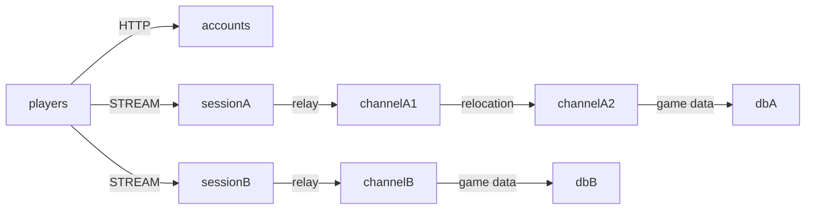

# my-game — MMO worlds and channels

Each world has a separate Session endpoint, mesh, Redis database and Player Actors.
Accounts publishes the world list over HTTP. Players earn persistent gold and move
between fixed Zone User Spots without replacing their connected Session.



## Prerequisites

Use Node.js 22 or later, npm, Docker Compose v2 and PowerShell 7 on Windows.
Install the public ZLink Framework 0.30.1 packages specified in `package.json`.
Redis ports and node listeners use OS-assigned ports in the e2e runner.

## Build

From this directory on Bash:

```sh
npm install && npm run build
```

On PowerShell:

```powershell
npm install; if ($LASTEXITCODE -eq 0) { npm run build }
```

The build emits TypeScript and generates the Framework JSON schema catalog from
the shared DTO declarations. Messages use the default typed JSON serializer.

## Local e2e

```sh
./run-e2e.sh
./run-e2e.sh --scenario worlds,channel,reconnect,update
```

```powershell
pwsh -NoProfile -File ./run-e2e.ps1
pwsh -NoProfile -File ./run-e2e.ps1 -Scenario worlds,channel,reconnect,update
```

| Scenario  | Assertions                                                                                                    |
| --------- | ------------------------------------------------------------------------------------------------------------- |
| worlds    | HTTP world list and Session endpoints; the same player ID has independent gold in A and B.                    |
| channel   | Channel 1 to 2 preserves Session identity, Actor generation, connection and gold.                             |
| reconnect | A new Session binds the original Actor with its saved channel and gold.                                       |
| update    | Drain channelA1 into channelA2, preserve client state and world B, stop the source and start its replacement. |

After replacement, update verifies replacement readiness and new Player work in the
live world. Actor factory placement is selected by Framework; the new Player enters
the relocated `field@1` on `channelA2`. Message Follow is explicitly 30 seconds;
the safe shutdown observation budget is derived from that duration and the existing
operation budget.

The runner checks `zlink.structure.json` before creating its own Compose project.
It preserves node stdout, stderr message-flow records, client events and Redis
logs in `.logs/run-<id>/`. Any scenario or cleanup failure returns exit code 1.
It stops after the first failure to preserve its evidence.

## Known issues

Public 0.30.0 validation reaches game assertions for worlds, channel and reconnect,
but channel cleanup can return `ForceStopped / TeardownFailed` (candidate related
to #1690). Host drain can complete relocation without publishing a
`safeToShutdown` observation before the existing deadline. This observation
defect is not assigned an issue number here. WSL drain can also return the
generic `RelocationFailed` result before completion (#1712/#1725 candidates;
not confirmed as the same defects). Do not bypass either failure.
The pinned 0.30.1 packages require verification when available.

## Deployment sequence

Start the separate world databases, then channelA1, channelA2 and channelB using
their dedicated channel entrypoint. Start sessionA and sessionB using the Session
entrypoint. Configure Accounts with their published STREAM endpoints and start
its HTTP entrypoint. Configuration files are in `server/config/`; replace the
local Redis endpoints and key prefixes for deployment.

The node entrypoints are `dist/server/channel/main.js`,
`dist/server/session/main.js` and `dist/server/accounts/main.js`. Pass the
configuration path as their first argument. Read `READY` for bound endpoints.

To update a channel host, write `drain` to its stdin. Wait for
`RELOCATION_REQUESTED`, `RELOCATED` and `SAFE_TO_SHUTDOWN`. Then write `shutdown`,
verify `STOPPED`, and start a replacement with the same configuration. Framework
owns relocation, routing and membership. Accounts is an ordinary HTTP service;
its control protocol accepts `shutdown` and it does not host relocatable objects.

## 한국어 실행 안내

이 템플릿은 월드별 Session endpoint, mesh, Redis와 Player Actor를 분리합니다.
Player Actor가 gold를 소유하며 변경 값을 해당 월드 Redis에 저장합니다. 채널 변경은
공개 Actor join API를 사용하므로 client 연결을 유지합니다.

Node.js와 Docker Compose를 준비한 뒤 위 Build 명령으로 빌드하고 Local e2e 명령으로
검증하십시오. 실행별 로그는 `.logs/run-<id>/`에 남습니다. channel node를 교체할 때는
`drain` 완료와 `SAFE_TO_SHUTDOWN`을 확인한 뒤 종료하고 같은 설정으로 다시 기동합니다.
