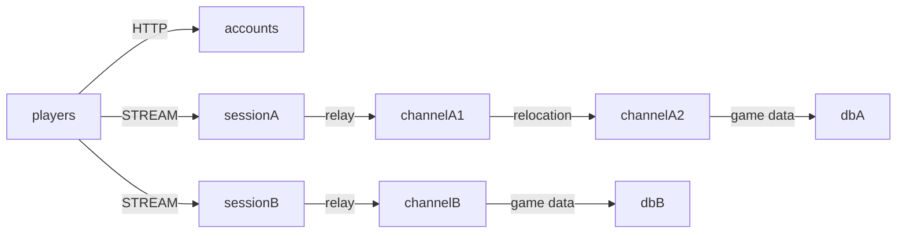

# my-game — MMO worlds and channels

Each world has a separate Session endpoint, mesh, Redis database and Player Actors.
Accounts publishes the world list over HTTP. Players earn persistent gold and move
between fixed Zone User Spots without replacing their connected Session.



## Prerequisites

Use Docker Compose v2 and PowerShell 7 on Windows.
Install the public ZLink Framework 0.32.0 packages specified in `package.json`.
Redis ports and node listeners use OS-assigned ports in the e2e runner.

## Build

From this directory on Bash:

```sh
./run-e2e.sh --build-only
```

On PowerShell:

```powershell
pwsh -NoProfile -File ./run-e2e.ps1 -BuildOnly
```

The build emits TypeScript and generates the Framework JSON schema catalog from
the shared DTO declarations. Messages use the default typed JSON serializer.

## Docker e2e

Docker runs the e2e runner and each node in containers. All roles use one image; the runner image adds Docker CLI 28.5.1. `NODE_IMAGE` pins `node:22.20.0-trixie` with a slim runtime and the native binding's OpenSSL dependency. Nodes share the runner network namespace, preserving loopback listeners and OS-assigned ports. Configuration is copied with `docker cp`; stdin/stdout controls use `docker start -a -i`. Each invocation owns a unique Compose project, network and image tags. Cleanup failures return exit code 1, and shared Docker build cache remains available.

Build and outer cleanup logs are in `.logs/docker-<project>/`; node configuration, stdout and message-flow stderr remain in `.logs/run-<id>/`. For local process debugging, install Node.js 22 or later and npm, then run `./run-e2e.sh --local` or `pwsh -NoProfile -File ./run-e2e.ps1 -Local`. Add `--no-build` or `-NoBuild` to reuse an existing local build. Redis remains in Docker.

```sh
./run-e2e.sh
./run-e2e.sh --scenario worlds,channel,reconnect,update
./run-e2e.sh --check-structure
```

```powershell
pwsh -NoProfile -File ./run-e2e.ps1
pwsh -NoProfile -File ./run-e2e.ps1 -Scenario worlds,channel,reconnect,update
pwsh -NoProfile -File ./run-e2e.ps1 -CheckStructure
```

| Scenario  | Assertions                                                                                                    |
| --------- | ------------------------------------------------------------------------------------------------------------- |
| worlds    | HTTP world list and Session endpoints; fixed reward, cooldown rejection and server retry delay; the same player ID has independent gold in A and B. |
| channel   | Same-channel visibility, cross-channel isolation, channel-move and disconnect removal; oversized channel requests return `integer-out-of-range` without changing membership; connection and gold persist; internal packets return `packet-not-allowed`. |
| reconnect | A new Session binds the original Actor with its saved channel and gold.                                       |
| update    | Drain channelA1 into channelA2, preserve client state, Zone player list and world B, stop the source and start its replacement. |

ChannelA1 has a one-Zone capacity and starts before channelA2, whose capacity is two.
This places each fixed Zone on its declared initial owner and leaves room for drain.
After replacement, update sends `create-update-zone` and waits for `UPDATE_ZONE_CREATED`.
The command creates verification Zone `field@3` through the public Spot manager.
ChannelA2 already holds two Zones, so the replacement must host the new Zone.
A new Player joins it and earns gold; the test checks channelA1 in both responses.
Existing Players remain in their relocated Zones. The replacement uses the same configuration.
`ZoneRelocation` saves and restores connected player IDs in the Zone relocation snapshot. A channel move keeps the client Session bound while the Player Actor changes Zones, so the list follows Zone membership callbacks.
Message Follow is explicitly 30 seconds; the safe shutdown observation budget is
derived from that duration and the existing operation budget.

The runner checks `zlink.structure.json` before creating its own Compose project.
It preserves node stdout, stderr message-flow records, client events and Redis
logs in `.logs/run-<id>/`. Any scenario or cleanup failure returns exit code 1.
It stops after the first failure to preserve its evidence.

## Known issues

Validated against the published Framework 0.32.0 packages.

## Deployment sequence

Start the separate world databases, then channelA1, channelA2 and channelB using
their dedicated channel entrypoint. Start sessionA and sessionB using the Session
entrypoint. Configure Accounts with their published STREAM endpoints and start
its HTTP entrypoint. Configuration files are in `server/config/`; replace the
local Redis endpoints and key prefixes for deployment.

The node entrypoints are `dist/server/channel/main.js`,
`dist/server/session/main.js` and `dist/server/accounts/main.js`. Pass the
configuration path as their first argument. Read `READY` for bound endpoints.

To update a channel host, write `drain` to its stdin. Wait for
`RELOCATION_REQUESTED`, `RELOCATED` and `SAFE_TO_SHUTDOWN`. Then write `shutdown`,
verify `STOPPED`, and start a replacement with the same configuration. Framework
owns relocation, routing and membership. Accounts is an ordinary HTTP service;
its control protocol accepts `shutdown` and it does not host relocatable objects.
