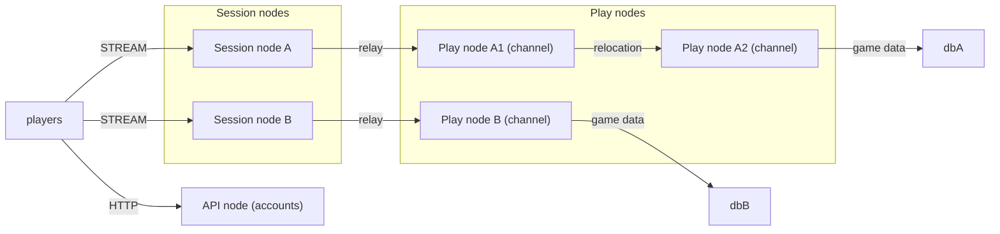

# my-game — MMO worlds and channels

Each world has a separate Session endpoint, mesh, Redis database and Player Actors.
The accounts API node publishes the world list over HTTP. Players earn persistent gold and move
between fixed Zone User Spots without replacing their connected Session.



## Prerequisites

Use Docker Compose v2 and PowerShell 7 on Windows.
Install the public ZLink Framework 0.34.0 packages specified in `package.json`.
Redis ports and node listeners use OS-assigned ports in the e2e runner.

## Build

From this directory on Bash:

```sh
./run-e2e.sh --build-only
```

On PowerShell:

```powershell
.\run-e2e.cmd -BuildOnly
```

The build emits TypeScript and generates the Framework JSON schema catalog from
the shared DTO declarations. Messages use the default typed JSON serializer.

## Run the server and e2e

Install Node.js 22 or later, npm and Docker Compose v2 for local hosting. From this directory, leave the first command running and execute the second in another terminal.

```bash
./run-server.sh
./run-e2e.sh
```

```powershell
.\run-server.cmd
.\run-e2e.cmd
```

The Windows wrappers start PowerShell 7 with UTF-8 output and a process-scoped execution policy. The equivalent PowerShell scripts are `run-server.ps1` and `run-e2e.ps1`.

`run-server` runs `npm ci`, builds the project, starts Redis and the local nodes, and prints the WebSocket address next to `Server ready`. When present, HTTP API addresses are printed separately. Use Ctrl+C to stop the nodes and Redis. A second server start is rejected while the first server is starting or running.

`run-e2e` detects a ready server through `.logs/server.json` and runs the compatible scenarios against it. Node replacement requires isolation, so attached runs skip `update`. Stop the server before running the full Docker e2e. Use `--local` or `-Local` to request a separate local run with Redis in Docker.

`.logs/run-<id>/` contains generated node settings, separate `*.out.log`, `*.err.log` and `*.flow.log` files, and failure details. Attached runs keep their client results in a new run directory and print the path. The running server continues writing node logs to its own run directory. Docker build and cleanup logs are in `.logs/docker-<project>/`.

## Client connection

### Endpoint and first packet

First call `GET /worlds` on the accounts API node. `server/config/accounts.json` defaults to `http://127.0.0.1:0`; use the actual HTTP `endpoint` from the accounts API node `READY` JSON. The response lists `worldId`, `name`, and `sessionEndpoint`. Choose a world and connect to its advertised STREAM endpoint. `server/config/sessionA.json` and `sessionB.json` default to `ws://127.0.0.1:0`, with root path `/`; use each Session's actual `endpoint` from `READY`. Configure Accounts `worlds[].sessionEndpoint` with those running listener addresses, as `e2e/runner.ts` does. Port `0` is not a client destination. Channel mesh listeners and Redis are internal endpoints.

Send `EnterWorldRequest(playerId)` first. Session creates/binds the Actor and returns a `PlayerView` push with world/channel and persisted player data. World A and B have separate state; channel changes happen after entry with `ChangeChannelRequest`. `ActionRejected` reports rejected actions. Entry is send/push; `SessionInfoRequest` is request/reply after binding. The accounts API node lists worlds but does not authenticate a player; validate identity before binding when adding authentication.

### Connector installation

The default loopback listener is reachable only within its host/network namespace. Docker e2e nodes share the runner network namespace and are removed at the end. External clients need a deployment kept running with a reachable listener and an exposed container port. Browser, Unity WebGL, and Cocos Creator web clients can use this WebSocket endpoint; HTTPS pages require a secure `wss://` deployment. HTTP entry points also need a browser-accessible origin/CORS policy when called from a web client.

Use the same connector release as `package.json` dependencies `@zlink-systems/framework` and `@zlink-systems/stream-connector`. Replace `<version>` in the installation commands with that release. Check linked guides against that pin; engine adapters follow the linked repository READMEs. All clients use this template's packet contract.

| Client                             | Connector installation                                                                                                                                                                                                                                                                                                                                                                                                                                                          | Documentation guide                                                                                                                                                          |
| ---------------------------------- | ------------------------------------------------------------------------------------------------------------------------------------------------------------------------------------------------------------------------------------------------------------------------------------------------------------------------------------------------------------------------------------------------------------------------------------------------------------------------------- | ---------------------------------------------------------------------------------------------------------------------------------------------------------------------------- |
| Unity                              | Native/Editor: restore `Zlink.Stream.Connector` with NuGetForUnity. WebGL: add the `com.zlink.stream-connector.webgl` UPM Git package; include only the connector assembly for the active target. See the [Unity README](https://github.com/zlink-systems/zlink/blob/main/framework/languages/engines/Unity/README.md) and its package manifest.                                                                                                                                | [.NET engine integration](https://docs.zlink.systems/dotnet/guide/stream-connector/12-engine-integration/)                                                                   |
| Unreal                             | Copy `framework/languages/cpp/connector/engines/unreal` into `Plugins/ZLinkStreamConnector`, then package the native connector under `ThirdParty/ZLink` as described in the [Unreal README](https://github.com/zlink-systems/zlink/blob/main/framework/languages/engines/Unreal/README.md).                                                                                                                                                                                     | [C++ engine integration](https://docs.zlink.systems/cpp/guide/stream-connector/12-engine-integration/)                                                                       |
| Godot                              | .NET: add the NuGet package `Zlink.Stream.Connector` and run `dotnet restore`; see the [C# README](https://github.com/zlink-systems/zlink/blob/main/framework/languages/engines/Godot/csharp/README.md). GDExtension: build the C++ Godot adapter against the framework prebuilt and matching `godot-cpp`; see the [C++ README](https://github.com/zlink-systems/zlink/blob/main/framework/languages/engines/Godot/cpp/README.md). The .NET sample does not support Web export. | [.NET](https://docs.zlink.systems/dotnet/guide/stream-connector/12-engine-integration/), [C++](https://docs.zlink.systems/cpp/guide/stream-connector/12-engine-integration/) |
| Cocos Creator                      | Web target: `npm install @zlink-systems/stream-connector@<version>`; see the [Cocos Creator README](https://github.com/zlink-systems/zlink/blob/main/framework/languages/engines/CocosCreator/README.md). This package does not provide a Creator native adapter.                                                                                                                                                                                                               | [TypeScript engine integration](https://docs.zlink.systems/node/guide/stream-connector/12-engine-integration/)                                                               |
| Axmol                              | Copy `framework/languages/cpp/connector/engines/axmol` into `third_party/zlink_axmol_connector` and link `zlink::stream_connector` from the installed C++ framework package; see the [Axmol README](https://github.com/zlink-systems/zlink/blob/main/framework/languages/engines/Axmol/README.md).                                                                                                                                                                              | [C++ engine integration](https://docs.zlink.systems/cpp/guide/stream-connector/12-engine-integration/)                                                                       |
| Web browser (TypeScript connector) | `npm install @zlink-systems/stream-connector@<version>`; import the package root in the browser build. Use `ws://` or `wss://`, subject to the page's security policy.                                                                                                                                                                                                                                                                                                          | [TypeScript connector](https://docs.zlink.systems/node/guide/stream-connector/)                                                                                              |
| C++                                | Install the C++ framework prebuilt containing the connector; use `find_package(zlink_stream_connector_cpp CONFIG REQUIRED)` and link `zlink::stream_connector`.                                                                                                                                                                                                                                                                                                                 | [C++ connector](https://docs.zlink.systems/cpp/guide/stream-connector/)                                                                                                      |
| C#/.NET                            | `dotnet add package Zlink.Stream.Connector --version <version>`                                                                                                                                                                                                                                                                                                                                                                                                                 | [.NET connector](https://docs.zlink.systems/dotnet/guide/stream-connector/)                                                                                                  |
| Java                               | Add Maven/Gradle dependency `systems.zlink:zlink-stream-connector:<version>`.                                                                                                                                                                                                                                                                                                                                                                                                   | [Java connector](https://docs.zlink.systems/java/guide/stream-connector/)                                                                                                    |
| Kotlin                             | Add `systems.zlink:zlink-stream-connector:<version>` and `systems.zlink:zlink-framework-kotlin:<version>` for the coroutine wrapper.                                                                                                                                                                                                                                                                                                                                            | [Kotlin connector](https://docs.zlink.systems/kotlin/guide/stream-connector/)                                                                                                |
| Node                               | `npm install @zlink-systems/stream-connector@<version>`; use the package root and Node.js 22 or later.                                                                                                                                                                                                                                                                                                                                                                          | [Node connector](https://docs.zlink.systems/node/guide/stream-connector/)                                                                                                    |

### World selection and entry example

Save as `e2e/connect-once.mts` in a copy, run `npm run build`, then `node dist/e2e/connect-once.mjs <actual-accounts-http-endpoint>`. Keep Accounts, Sessions, Channels, and Redis running separately; e2e removes its temporary deployment. Use a fresh player ID. The example prints the received JSON payload; contract int64 values remain decimal strings. See `e2e/client.mts` for the complete flow.

```typescript
import '../.zlink-framework-json-schemas.cjs';
import {
  zlinkStreamConnectorFactory,
  zlinkStreamJsonCodec,
  ZlinkStreamDispatchMode
} from '@zlink-systems/stream-connector';
import { EnterWorldRequest } from '../server/shared/messages.js';

const accounts = process.argv[2];
if (!accounts) throw new Error('Pass the Accounts HTTP endpoint from READY');
const response = await fetch(accounts + '/worlds');
if (!response.ok) throw new Error(`HTTP ${response.status}`);
const worlds = (await response.json()) as { worldId: string; sessionEndpoint: string }[];
const world = worlds.find((candidate) => candidate.worldId === 'A');
if (!world) throw new Error('World A is unavailable');
const client = zlinkStreamConnectorFactory.create({
  endpoint: world.sessionEndpoint,
  codec: zlinkStreamJsonCodec,
  dispatchMode: ZlinkStreamDispatchMode.Immediate,
  reconnect: { enabled: false }
});
try {
  const view = new Promise<unknown>((resolve, reject) => {
    client.on('PlayerView', (message) => resolve(message.payload));
    client.on('ActionRejected', () => reject(new Error('Entry rejected')));
    client.onErrorReceived((error) => reject(new Error(error.message)));
    client.onDisconnected(() => reject(new Error('Disconnected before PlayerView')));
  });
  await client.connect();
  await client.send(new EnterWorldRequest('guide-player')).submit();
  console.log(await view);
} finally {
  await client.close();
}
```

## Docker e2e

These commands use Docker isolation when no local server is ready.

Docker runs the e2e runner and each node in containers. All roles use one image; the runner image adds Docker CLI 28.5.1. `NODE_IMAGE` pins `node:22.20.0-trixie` with a slim runtime and the native binding's OpenSSL dependency. Nodes share the runner network namespace, preserving loopback listeners and OS-assigned ports. Configuration is copied with `docker cp`; stdin/stdout controls use `docker start -a -i`. Each invocation owns a unique Compose project, network and image tags. Cleanup failures return exit code 1, and shared Docker build cache remains available.

Build and outer cleanup logs are in `.logs/docker-<project>/`; node configuration, stdout, stderr and message-flow records remain in `.logs/run-<id>/`. For local process debugging, install Node.js 22 or later and npm, then run `./run-e2e.sh --local` or `.\run-e2e.cmd -Local`. Add `--no-build` or `-NoBuild` to reuse an existing local build. Redis remains in Docker.

```sh
./run-e2e.sh
./run-e2e.sh --scenario worlds,channel,reconnect,update
./run-e2e.sh --check-structure
```

```powershell
.\run-e2e.cmd
.\run-e2e.cmd -Scenario worlds,channel,reconnect,update
.\run-e2e.cmd -CheckStructure
```

| Scenario  | Assertions                                                                                                                                                                                                                                              |
| --------- | ------------------------------------------------------------------------------------------------------------------------------------------------------------------------------------------------------------------------------------------------------- |
| worlds    | HTTP world list and Session endpoints; fixed reward, cooldown rejection and server retry delay; the same player ID has independent gold in A and B.                                                                                                     |
| channel   | Same-channel visibility, cross-channel isolation, channel-move and disconnect removal; oversized channel requests return `integer-out-of-range` without changing membership; connection and gold persist; internal packets return `packet-not-allowed`. |
| reconnect | A new Session binds the original Actor with its saved channel and gold.                                                                                                                                                                                 |
| update    | Drain channelA1 into channelA2, preserve client state, Zone player list and world B, stop the source and start its replacement.                                                                                                                         |

ChannelA1 has a one-Zone capacity and starts before channelA2, whose capacity is two.
This places each fixed Zone on its declared initial owner and leaves room for drain.
After replacement, update sends `create-update-zone` and waits for `UPDATE_ZONE_CREATED`.
The command creates verification Zone `field@3` through the public Spot manager.
ChannelA2 already holds two Zones, so the replacement must host the new Zone.
A new Player joins it and earns gold; the test checks channelA1 in both responses.
Existing Players remain in their relocated Zones. The replacement uses the same configuration.
`ZoneRelocation` saves and restores connected player IDs in the Zone relocation snapshot. A channel move keeps the client Session bound while the Player Actor changes Zones, so the list follows Zone membership callbacks.
Message Follow is explicitly 30 seconds; the safe shutdown observation budget is
derived from that duration and the existing operation budget.

The runner checks `zlink.structure.json` before creating its own Compose project.
It preserves node stdout, stderr and message-flow records, client events and Redis
logs in `.logs/run-<id>/`. Any scenario or cleanup failure returns exit code 1.
It stops after the first failure to preserve its evidence.

## Framework behavior to know

- **Waiting for DB or file I/O in a handler** — An ordinary async terminal retains the turn, while `Yield` lets other handlers on the same Spot proceed. [Guide](https://docs.zlink.systems/node/guide/server/32-execution-model/#io-worker-wait). [server/channel/player.ts:35](server/channel/player.ts).
- **Creation that misses its deadline** — `DeadlineExceeded` and caller cancellation have distinct outcomes. [Guide](https://docs.zlink.systems/node/guide/server/22-actor/#creation-deadline). [server/session/session.ts:41](server/session/session.ts).
- **Many logins at once** — Each creation for a different ID requires a Location Store round trip, so measure expected load when setting the deadline. [Guide](https://docs.zlink.systems/node/guide/server/25-location/#creation-load).
- **Sending under load** — Send waits for capacity, and the application sees the final result. [Guide](https://docs.zlink.systems/node/guide/server/33-backpressure/#send-backpressure). [server/session/session.ts:31](server/session/session.ts).
- **Duplicate login** — Without a callback, a bind from another Session is accepted; reject it in the Actor duplicate-bind callback to prevent this. [Guide](https://docs.zlink.systems/node/guide/server/39-session-binding/#duplicate-session-bind). This template keeps the default (accepts the new Session).
- **ObjectGeneration** — `ObjectGeneration` distinguishes logical incarnations of the same ID; it is not a data version or write authority. [Guide](https://docs.zlink.systems/node/guide/server/34-activation-lifetime/#object-generation). [server/session/session.ts:55](server/session/session.ts).
- **READY and Serving** — The Framework host prints `READY` after observing runtime `Serving`; the Accounts process prints `READY` without a Framework runtime. [Guide](https://docs.zlink.systems/node/guide/server/12-operations/#wait-for-serving). [server/shared/hosting.ts:91](server/shared/hosting.ts); [server/shared/hosting.ts:141](server/shared/hosting.ts); [server/accounts/main.ts:20](server/accounts/main.ts); [server/accounts/main.ts:24](server/accounts/main.ts). The accounts HTTP process prints `READY` after its server starts, without observing Framework runtime `Serving`: .

## Known issues

Validated against the published Framework 0.34.0 packages.

## Deployment sequence

Start the separate world databases, then channelA1, channelA2 and channelB using
their dedicated channel entrypoint. Start sessionA and sessionB using the Session
entrypoint. Configure Accounts with their published STREAM endpoints and start
its HTTP entrypoint. Configuration files are in `server/config/`; replace the
local Redis endpoints and key prefixes for deployment.

The node entrypoints are `dist/server/channel/main.js`,
`dist/server/session/main.js` and `dist/server/accounts/main.js`. Pass the
configuration path as their first argument. Read `READY` for bound endpoints.

To update a play node (channel), write `drain` to its stdin. Wait for
`RELOCATION_REQUESTED`, `RELOCATED` and `SAFE_TO_SHUTDOWN`. Then write `shutdown`,
verify `STOPPED`, and start a replacement with the same configuration. Framework
owns relocation, routing and membership. Accounts is an ordinary HTTP service;
its control protocol accepts `shutdown` and it does not host relocatable objects.
