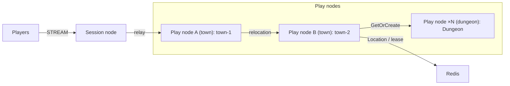

# my-game — MORPG channel town

Players join town channels, form parties of up to four players, and enter a dedicated Dungeon. Town User Spots own channel membership and parties. Dungeon User Spots own members and stage. Framework owns Actor identity, Session binding, placement and relocation.



## Prerequisites

Docker with Compose v2 and PowerShell 7 on Windows. Local process debugging requires Node.js 22 or later and npm. Framework packages are pinned to 0.34.0; the native binding is pinned in `package.json`. Copy this directory to build independently. No repository source or local feed is required. Application configuration is in `server/config/`.

## Build

```sh
./run-e2e.sh --build-only
```

```powershell
.\run-e2e.cmd -BuildOnly
```

The build generates JSON schemas from typed contracts for the Framework default JSON serializer. Use `bigint` for 64-bit integer fields; generated schemas and DTO classes preserve the typed contract. Relocation adapters serialize only application state. They do not serialize Framework routes, leases, membership or queues.

## Run the server and e2e

Install Node.js 22 or later, npm and Docker Compose v2 for local hosting. From this directory, leave the first command running and execute the second in another terminal.

```bash
./run-server.sh
./run-e2e.sh
```

```powershell
.\run-server.cmd
.\run-e2e.cmd
```

The Windows wrappers start PowerShell 7 with UTF-8 output and a process-scoped execution policy. The equivalent PowerShell scripts are `run-server.ps1` and `run-e2e.ps1`.

`run-server` runs `npm ci`, builds the project, starts Redis and the local nodes, and prints the WebSocket address next to `Server ready`. When present, HTTP API addresses are printed separately. Use Ctrl+C to stop the nodes and Redis. A second server start is rejected while the first server is starting or running.

`run-e2e` detects a ready server through `.logs/server.json` and runs the compatible scenarios against it. Node replacement requires isolation, so attached runs skip `update`. Stop the server before running the full Docker e2e. Use `--local` or `-Local` to request a separate local run with Redis in Docker.

`.logs/run-<id>/` contains generated node settings, separate `*.out.log`, `*.err.log` and `*.flow.log` files, and failure details. Attached runs keep their client results in a new run directory and print the path. The running server continues writing node logs to its own run directory. Docker build and cleanup logs are in `.logs/docker-<project>/`.

## Client connection

### Endpoint and first packet

Connect to the Session `players` STREAM listener. `server/config/session.json` sets `streamEndpoint` to `ws://127.0.0.1:0`: loopback WebSocket, OS-assigned port, root path `/`. Use the actual `endpoint` in Session `READY` JSON, as `e2e/runner.ts` does. Town/Instance mesh listeners and Redis are internal endpoints.

Send `JoinTownRequest(playerId, channel)` first; channel `1` selects `town-1`. The Session creates/binds the Actor and a fresh player receives a `TownView` push. A returning player may receive `DungeonView` when restoring Dungeon membership. Create or join a party after town entry, then let its leader send `EnterDungeonRequest`; internal `JoinDungeon` is not a client admission packet. `ActionRejected` reports rejected actions. Entry is send/push; `SessionInfoRequest` is request/reply after binding. There is no product authentication; validate identity before binding when adding it.

### Connector installation

The default loopback listener is reachable only within its host/network namespace. Docker e2e nodes share the runner network namespace and are removed at the end. External clients need a deployment kept running with a reachable listener and an exposed container port. Browser, Unity WebGL, and Cocos Creator web clients can use this WebSocket endpoint; HTTPS pages require a secure `wss://` deployment. HTTP entry points also need a browser-accessible origin/CORS policy when called from a web client.

Use the same connector release as `package.json` dependencies `@zlink-systems/framework` and `@zlink-systems/stream-connector`. Replace `<version>` in the installation commands with that release. Check linked guides against that pin; engine adapters follow the linked repository READMEs. All clients use this template's packet contract.

| Client                             | Connector installation                                                                                                                                                                                                                                                                                                                                                                                                                                                          | Documentation guide                                                                                                                                                          |
| ---------------------------------- | ------------------------------------------------------------------------------------------------------------------------------------------------------------------------------------------------------------------------------------------------------------------------------------------------------------------------------------------------------------------------------------------------------------------------------------------------------------------------------- | ---------------------------------------------------------------------------------------------------------------------------------------------------------------------------- |
| Unity                              | Native/Editor: restore `Zlink.Stream.Connector` with NuGetForUnity. WebGL: add the `com.zlink.stream-connector.webgl` UPM Git package; include only the connector assembly for the active target. See the [Unity README](https://github.com/zlink-systems/zlink/blob/main/framework/languages/engines/Unity/README.md) and its package manifest.                                                                                                                                | [.NET engine integration](https://docs.zlink.systems/dotnet/guide/stream-connector/12-engine-integration/)                                                                   |
| Unreal                             | Copy `framework/languages/cpp/connector/engines/unreal` into `Plugins/ZLinkStreamConnector`, then package the native connector under `ThirdParty/ZLink` as described in the [Unreal README](https://github.com/zlink-systems/zlink/blob/main/framework/languages/engines/Unreal/README.md).                                                                                                                                                                                     | [C++ engine integration](https://docs.zlink.systems/cpp/guide/stream-connector/12-engine-integration/)                                                                       |
| Godot                              | .NET: add the NuGet package `Zlink.Stream.Connector` and run `dotnet restore`; see the [C# README](https://github.com/zlink-systems/zlink/blob/main/framework/languages/engines/Godot/csharp/README.md). GDExtension: build the C++ Godot adapter against the framework prebuilt and matching `godot-cpp`; see the [C++ README](https://github.com/zlink-systems/zlink/blob/main/framework/languages/engines/Godot/cpp/README.md). The .NET sample does not support Web export. | [.NET](https://docs.zlink.systems/dotnet/guide/stream-connector/12-engine-integration/), [C++](https://docs.zlink.systems/cpp/guide/stream-connector/12-engine-integration/) |
| Cocos Creator                      | Web target: `npm install @zlink-systems/stream-connector@<version>`; see the [Cocos Creator README](https://github.com/zlink-systems/zlink/blob/main/framework/languages/engines/CocosCreator/README.md). This package does not provide a Creator native adapter.                                                                                                                                                                                                               | [TypeScript engine integration](https://docs.zlink.systems/node/guide/stream-connector/12-engine-integration/)                                                               |
| Axmol                              | Copy `framework/languages/cpp/connector/engines/axmol` into `third_party/zlink_axmol_connector` and link `zlink::stream_connector` from the installed C++ framework package; see the [Axmol README](https://github.com/zlink-systems/zlink/blob/main/framework/languages/engines/Axmol/README.md).                                                                                                                                                                              | [C++ engine integration](https://docs.zlink.systems/cpp/guide/stream-connector/12-engine-integration/)                                                                       |
| Web browser (TypeScript connector) | `npm install @zlink-systems/stream-connector@<version>`; import the package root in the browser build. Use `ws://` or `wss://`, subject to the page's security policy.                                                                                                                                                                                                                                                                                                          | [TypeScript connector](https://docs.zlink.systems/node/guide/stream-connector/)                                                                                              |
| C++                                | Install the C++ framework prebuilt containing the connector; use `find_package(zlink_stream_connector_cpp CONFIG REQUIRED)` and link `zlink::stream_connector`.                                                                                                                                                                                                                                                                                                                 | [C++ connector](https://docs.zlink.systems/cpp/guide/stream-connector/)                                                                                                      |
| C#/.NET                            | `dotnet add package Zlink.Stream.Connector --version <version>`                                                                                                                                                                                                                                                                                                                                                                                                                 | [.NET connector](https://docs.zlink.systems/dotnet/guide/stream-connector/)                                                                                                  |
| Java                               | Add Maven/Gradle dependency `systems.zlink:zlink-stream-connector:<version>`.                                                                                                                                                                                                                                                                                                                                                                                                   | [Java connector](https://docs.zlink.systems/java/guide/stream-connector/)                                                                                                    |
| Kotlin                             | Add `systems.zlink:zlink-stream-connector:<version>` and `systems.zlink:zlink-framework-kotlin:<version>` for the coroutine wrapper.                                                                                                                                                                                                                                                                                                                                            | [Kotlin connector](https://docs.zlink.systems/kotlin/guide/stream-connector/)                                                                                                |
| Node                               | `npm install @zlink-systems/stream-connector@<version>`; use the package root and Node.js 22 or later.                                                                                                                                                                                                                                                                                                                                                                          | [Node connector](https://docs.zlink.systems/node/guide/stream-connector/)                                                                                                    |

### First town example

Save as `e2e/connect-once.mts` in a copy, run `npm run build`, then `node dist/e2e/connect-once.mjs <actual-session-endpoint>`. Keep Session, Town/play nodes (dungeon), and Redis running separately; e2e removes its temporary deployment. Use a fresh player ID for the `TownView` path. The outgoing int64 channel uses `1n`; received int64 values remain decimal strings with the JSON codec. See `e2e/client.mts` for the complete flow.

```typescript
import '../.zlink-framework-json-schemas.cjs';
import {
  zlinkStreamConnectorFactory,
  zlinkStreamJsonCodec,
  ZlinkStreamDispatchMode
} from '@zlink-systems/stream-connector';
import { JoinTownRequest } from '../server/shared/messages.js';

const endpoint = process.argv[2];
if (!endpoint) throw new Error('Pass the Session endpoint from READY');
const client = zlinkStreamConnectorFactory.create({
  endpoint,
  codec: zlinkStreamJsonCodec,
  dispatchMode: ZlinkStreamDispatchMode.Immediate,
  reconnect: { enabled: false }
});
try {
  const view = new Promise<unknown>((resolve, reject) => {
    client.on('TownView', (message) => resolve(message.payload));
    client.on('ActionRejected', () => reject(new Error('Entry rejected')));
    client.onErrorReceived((error) => reject(new Error(error.message)));
    client.onDisconnected(() => reject(new Error('Disconnected before TownView')));
  });
  await client.connect();
  await client.send(new JoinTownRequest('guide-player', 1n)).submit();
  console.log(await view);
} finally {
  await client.close();
}
```

## Docker e2e

These commands use Docker isolation when no local server is ready.

Docker runs the e2e runner and each node in containers. All roles use one image; the runner image adds Docker CLI 28.5.1. `NODE_IMAGE` pins `node:22.20.0-trixie` with a slim runtime and the native binding's OpenSSL dependency. Nodes share the runner network namespace, preserving loopback listeners and OS-assigned ports. Configuration is copied with `docker cp`; stdin/stdout controls use `docker start -a -i`. Each invocation owns a unique Compose project, network and image tags. Cleanup failures return exit code 1, and shared Docker build cache remains available.

Build and outer cleanup logs are in `.logs/docker-<project>/`; node configuration, stdout, stderr and message-flow records remain in `.logs/run-<id>/`. For local process debugging, install Node.js 22 or later and npm, then run `./run-e2e.sh --local` or `.\run-e2e.cmd -Local`. Add `--no-build` or `-NoBuild` to reuse an existing local build. Redis remains in Docker.

```sh
./run-e2e.sh
./run-e2e.sh --scenario channel,dungeon,reconnect,update
./run-e2e.sh --check-structure
./run-e2e.sh --check-domain
```

```powershell
.\run-e2e.cmd
.\run-e2e.cmd -Scenario channel,dungeon,reconnect,update
.\run-e2e.cmd -CheckStructure
.\run-e2e.cmd -CheckDomain
```

| Scenario  | Verification                                                                                                                                |
| --------- | ------------------------------------------------------------------------------------------------------------------------------------------- |
| channel   | Server-issued PartyId, out-of-range rejection with unchanged state, and forming-party removal when changing channels.                       |
| dungeon   | Two entry sends use one RunId; nonleader and internal packet rejection preserve state; both members see each stage through completion.      |
| reconnect | Reconnect inside the Dungeon with the same Actor generation, RunId, Phase, members and stage.                                               |
| update    | Drain and relocate completed Dungeon state and Session identity, then verify the replacement accepts a distinct run from the other channel. |

`--check-domain` runs domain boundary checks without starting nodes. The runner checks `zlink.structure.json`, starts Redis with a unique Compose project and an ephemeral loopback port, then starts townA, townB, instanceA, instanceB and session. Mesh and STREAM listeners bind port 0; READY reports Framework-published endpoints. Every run uses a unique Redis prefix and `.logs/run-<id>/`. The runner captures Framework message flow in a dedicated file for each node. Cleanup failures return exit code 1.

## Framework behavior to know

- **Waiting for DB or file I/O in a handler** — An ordinary async terminal retains the turn, while `Yield` lets other handlers on the same Spot proceed. [Guide](https://docs.zlink.systems/node/guide/server/32-execution-model/#io-worker-wait).
- **Creation that misses its deadline** — `DeadlineExceeded` and caller cancellation have distinct outcomes. [Guide](https://docs.zlink.systems/node/guide/server/22-actor/#creation-deadline). [server/session/session.ts:38](server/session/session.ts).
- **Many logins at once** — Each creation for a different ID requires a Location Store round trip, so measure expected load when setting the deadline. [Guide](https://docs.zlink.systems/node/guide/server/25-location/#creation-load).
- **Sending under load** — Send waits for capacity, and the application sees the final result. [Guide](https://docs.zlink.systems/node/guide/server/33-backpressure/#send-backpressure). [server/session/session.ts:30](server/session/session.ts).
- **Duplicate login** — Without a callback, a bind from another Session is accepted; reject it in the Actor duplicate-bind callback to prevent this. [Guide](https://docs.zlink.systems/node/guide/server/39-session-binding/#duplicate-session-bind). This template keeps the default (accepts the new Session).
- **ObjectGeneration** — `ObjectGeneration` distinguishes logical incarnations of the same ID; it is not a data version or write authority. [Guide](https://docs.zlink.systems/node/guide/server/34-activation-lifetime/#object-generation). [server/session/session.ts:52](server/session/session.ts).
- **READY and Serving** — The Framework host prints `READY` after observing runtime `Serving`. [Guide](https://docs.zlink.systems/node/guide/server/12-operations/#wait-for-serving). [server/shared/hosting.ts:90](server/shared/hosting.ts); [server/shared/hosting.ts:140](server/shared/hosting.ts).

## Known issues

Validated against the published Framework 0.34.0 packages.

Node typed pushes are restored through one packet-name-to-class table for #1731; no custom message codec is used.

## Deployment sequence

Bootstrap Town providers sequentially and wait for each READY before starting the next. Each provider's public Town stable-type capacity must equal its configured fixed Town count; the structure checker enforces this. Earlier providers are full and later providers are absent, making each fixed Town's declared initial owner deterministic. Entry declarations describe the application Entry registered by Town and Instance, excluding Framework default Entries.

Start Redis, then townA and townB in order so each creates its configured fixed Town before the next provider starts. Start both instance processes, then session. Use the separate `dist/server/town/main.js`, `dist/server/instance/main.js` and `dist/server/session/main.js` entrypoints with a configuration file argument. Party order defines the leader. Forming members leave their party when changing channel; run rosters remain recorded after departure.

Write `drain` to a node's stdin to request PlannedMaintenance. Wait for `RELOCATION_REQUESTED`, `RELOCATED`, and `SAFE_TO_SHUTDOWN`. Write `shutdown`, verify `STOPPED` with a successful outcome and process exit, then start the replacement using the same configuration. Fixed Town replacements must set `bootstrap` to false because Location Store already owns their logical identity.

All Object Servers that register Player factories also register the shared Entry and first-admission handler, including both play nodes (dungeon). Entry admission joins the requested fixed Town channel. Each Instance declares its dynamic Dungeon factory in `zlink.structure.json`.

The e2e configuration uses one Dungeon slot per Instance. After drain, the surviving Instance is full, so only the replacement can accept the fresh Dungeon. The structure checker enforces this configuration. Message Follow remains 30 seconds; the SafeToShutdown observation budget is derived from that duration plus the existing relocation operation budget.
