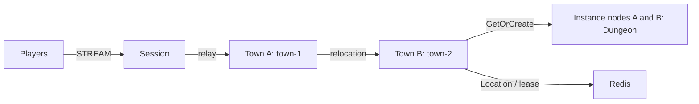

# my-game — MORPG channel town

Players join town channels, form parties of up to four players, and enter a dedicated Dungeon. Town User Spots own channel membership and parties. Dungeon User Spots own members and stage. Framework owns Actor identity, Session binding, placement and relocation.



## Prerequisites

Node.js 22 or later, npm, Docker with Compose v2, and PowerShell 7 on Windows. Framework packages are pinned to 0.30.1; the native binding is pinned in `package.json`. Copy this directory to build independently. No repository source or local feed is required. Application configuration is in `server/config/`.

## Build

```sh
npm install
npm run build
```

The build generates JSON schemas from the typed contracts for the Framework default JSON serializer. Relocation adapters serialize only application state. They do not serialize Framework routes, leases, membership or queues.

## Local e2e

```sh
./run-e2e.sh
./run-e2e.sh --scenario channel,dungeon,reconnect,update
```

```powershell
./run-e2e.ps1
./run-e2e.ps1 -Scenario channel,dungeon,reconnect,update
```

| Scenario  | Verification                                                                                                        |
| --------- | ------------------------------------------------------------------------------------------------------------------- |
| channel   | Move from town-1 to town-2 with the same connection and SessionInfo.                                                |
| dungeon   | Two party members enter the same Dungeon at stage 0; Advance pushes stage 1 to both.                                |
| reconnect | Reconnect inside the Dungeon with the same Actor generation, members and stage.                                     |
| update    | Drain the Dungeon host, preserve connections and state, stop it, then verify a replacement accepts a fresh Dungeon. |

The runner checks `zlink.structure.json`, starts Redis with a unique Compose project and an ephemeral loopback port, then starts townA, townB, instanceA, instanceB and session. Mesh and STREAM listeners bind port 0; READY reports Framework-published endpoints. Every run uses a unique Redis prefix and `.logs/run-<id>/`. Diagnostics write message flow to each node's stderr log. Cleanup failures return exit code 1.

Town providers bootstrap sequentially with capacity 1 to place each fixed town on its declared initial host. Instance capacity 1 makes replacement acceptance observable after the occupied Dungeon relocates to its peer. Increase capacity for production after adapting the deployment validation.

## Known issues

Public 0.30.0 validation can stop at host relocation inventory (#1725, fixed in 0.30.1). Keep the pinned target version. Node typed pushes are restored through one packet-name-to-class table for #1731; no custom message codec is used.

## Deployment sequence

Start Redis, then townA and townB in order so each creates its configured fixed Town before the next provider starts. Start both instance processes, then session. Use the separate `dist/server/town/main.js`, `dist/server/instance/main.js` and `dist/server/session/main.js` entrypoints with a configuration file argument.

Write `drain` to a node's stdin to request PlannedMaintenance. Wait for `RELOCATION_REQUESTED`, `RELOCATED`, and `SAFE_TO_SHUTDOWN`. Write `shutdown`, verify `STOPPED` with a successful outcome and process exit, then start the replacement using the same configuration. Fixed Town replacements must set `bootstrap` to false because Location Store already owns their logical identity.

All Object Servers that register Player factories also register the shared Entry and first-admission handler, including both Instance nodes. Entry admission joins the requested fixed Town channel. Each Instance declares its dynamic Dungeon factory in `zlink.structure.json`.

The e2e configuration uses one Dungeon slot per Instance. After drain, the surviving Instance is full, so only the replacement can accept the fresh Dungeon. The structure checker enforces this configuration. Message Follow remains 30 seconds; the SafeToShutdown observation budget is derived from that duration plus the existing relocation operation budget.

## 한국어 실행 안내

Node.js 22 이상과 Docker Compose v2를 준비한 뒤 이 디렉터리에서 `npm install`, `npm run build`를 실행합니다. Linux에서는 `./run-e2e.sh`, Windows PowerShell 7에서는 `./run-e2e.ps1`로 전체 시나리오를 실행합니다. 시나리오 선택 명령은 위 Local e2e 절에 있습니다.

실행별 설정과 node message flow 로그는 `.logs/run-<id>/`에 보존됩니다. 업데이트는 Dungeon을 소유한 instance의 drain 완료, 연결·상태 유지, 정상 종료, 대체 process의 새 Dungeon 수락을 순서대로 검사합니다.
