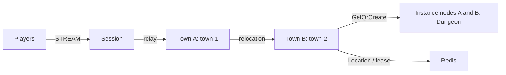

# my-game — MORPG channel town

Players join town channels, form parties of up to four players, and enter a dedicated Dungeon. Town User Spots own channel membership and parties. Dungeon User Spots own members and stage. Framework owns Actor identity, Session binding, placement and relocation.



## Prerequisites

Docker with Compose v2 and PowerShell 7 on Windows. Local process debugging requires Node.js 22 or later and npm. Framework packages are pinned to 0.30.1; the native binding is pinned in `package.json`. Copy this directory to build independently. No repository source or local feed is required. Application configuration is in `server/config/`.

## Build

```sh
./run-e2e.sh --build-only
```

```powershell
pwsh -NoProfile -File ./run-e2e.ps1 -BuildOnly
```

The build generates JSON schemas from the typed contracts for the Framework default JSON serializer. Relocation adapters serialize only application state. They do not serialize Framework routes, leases, membership or queues.

## Docker e2e

Docker runs the e2e runner and each node in containers. All roles use one image; the runner image adds Docker CLI 28.5.1. `NODE_IMAGE` pins `node:22.20.0-trixie` with a slim runtime and the native binding's OpenSSL dependency. Nodes share the runner network namespace, preserving loopback listeners and OS-assigned ports. Configuration is copied with `docker cp`; stdin/stdout controls use `docker start -a -i`. Each invocation owns a unique Compose project, network and image tags. Cleanup failures return exit code 1, and shared Docker build cache remains available.

Build and outer cleanup logs are in `.logs/docker-<project>/`; node configuration, stdout and message-flow stderr remain in `.logs/run-<id>/`. For local process debugging, install Node.js 22 or later and npm, then run `./run-e2e.sh --local` or `pwsh -NoProfile -File ./run-e2e.ps1 -Local`. Add `--no-build` or `-NoBuild` to reuse an existing local build. Redis remains in Docker.

```sh
./run-e2e.sh
./run-e2e.sh --scenario channel,dungeon,reconnect,update
```

```powershell
pwsh -NoProfile -File ./run-e2e.ps1
pwsh -NoProfile -File ./run-e2e.ps1 -Scenario channel,dungeon,reconnect,update
```

| Scenario  | Verification                                                                                                        |
| --------- | ------------------------------------------------------------------------------------------------------------------- |
| channel   | Move from town-1 to town-2 with the same connection and SessionInfo.                                                |
| dungeon   | Two party members enter the same Dungeon at stage 0; Advance pushes stage 1 to both.                                |
| reconnect | Reconnect inside the Dungeon with the same Actor generation, members and stage.                                     |
| update    | Drain the Dungeon host, preserve connections and state, stop it, then verify a replacement accepts a fresh Dungeon. |

The runner checks `zlink.structure.json`, starts Redis with a unique Compose project and an ephemeral loopback port, then starts townA, townB, instanceA, instanceB and session. Mesh and STREAM listeners bind port 0; READY reports Framework-published endpoints. Every run uses a unique Redis prefix and `.logs/run-<id>/`. Diagnostics write message flow to each node's stderr log. Cleanup failures return exit code 1.

## Known issues

Public 0.30.0 validation can stop at host relocation inventory (#1725, fixed in 0.30.1). Keep the pinned target version. Node typed pushes are restored through one packet-name-to-class table for #1731; no custom message codec is used.

## Deployment sequence

Bootstrap Town providers sequentially and wait for each READY before starting the next. Each provider's public Town stable-type capacity must equal its configured fixed Town count; the structure checker enforces this. Earlier providers are full and later providers are absent, making each fixed Town's declared initial owner deterministic. Entry declarations describe the application Entry registered by Town and Instance, excluding Framework default Entries.

Start Redis, then townA and townB in order so each creates its configured fixed Town before the next provider starts. Start both instance processes, then session. Use the separate `dist/server/town/main.js`, `dist/server/instance/main.js` and `dist/server/session/main.js` entrypoints with a configuration file argument.

Write `drain` to a node's stdin to request PlannedMaintenance. Wait for `RELOCATION_REQUESTED`, `RELOCATED`, and `SAFE_TO_SHUTDOWN`. Write `shutdown`, verify `STOPPED` with a successful outcome and process exit, then start the replacement using the same configuration. Fixed Town replacements must set `bootstrap` to false because Location Store already owns their logical identity.

All Object Servers that register Player factories also register the shared Entry and first-admission handler, including both Instance nodes. Entry admission joins the requested fixed Town channel. Each Instance declares its dynamic Dungeon factory in `zlink.structure.json`.

The e2e configuration uses one Dungeon slot per Instance. After drain, the surviving Instance is full, so only the replacement can accept the fresh Dungeon. The structure checker enforces this configuration. Message Follow remains 30 seconds; the SafeToShutdown observation budget is derived from that duration plus the existing relocation operation budget.

## 한국어 실행 안내

기본 빌드와 e2e는 Docker에서 runner와 node를 실행한다. Bash는 `./run-e2e.sh`, PowerShell 7은 `pwsh -NoProfile -File ./run-e2e.ps1`을 사용한다. 로컬 프로세스 디버깅은 Node.js와 npm을 설치한 뒤 `--local` 또는 `-Local`로 실행한다. Docker 빌드·정리 로그는 `.logs/docker-<project>/`에 남는다.

Docker Compose v2를 준비한 뒤 이 디렉터리에서 위 Build 명령으로 이미지를 빌드한다. Linux에서는 `./run-e2e.sh`, Windows PowerShell 7에서는 `./run-e2e.ps1`로 전체 시나리오를 실행합니다. 시나리오 선택 명령은 위 Docker e2e 절에 있습니다. 실행별 설정과 node message flow 로그는 `.logs/run-<id>/`에 보존됩니다. 업데이트는 Dungeon을 소유한 instance의 drain 완료, 연결·상태 유지, 정상 종료, 대체 process의 새 Dungeon 수락을 순서대로 검사합니다.
