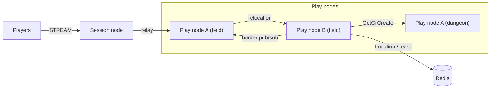

# MyGame MORPG fields and instances

Players move between fixed public fields and enter party dungeons. Field position domains own movement and visibility; independent Party Spots own membership, leadership, and run state across Fields. Dungeon Spots own prepared members and stages. Player Actors retain movement state across field transitions, and Session binding retains Actor identity across reconnects.



## Prerequisites

Docker Compose v2, and PowerShell 7 for the PowerShell runner are required. The project pins public Framework packages to 0.34.0 and the binding to 1.26.0 in `package.json`.

## Build

Run from this directory. POSIX shell:

```sh
./run-e2e.sh --build-only
```

PowerShell:

```powershell
.\run-e2e.cmd -BuildOnly
```

The build generates the Framework's standard typed JSON schemas from shared contracts. No message-specific codec is registered.

## Run the server and e2e

Install Node.js 22 or later, npm and Docker Compose v2 for local hosting. From this directory, leave the first command running and execute the second in another terminal.

```bash
./run-server.sh
./run-e2e.sh
```

```powershell
.\run-server.cmd
.\run-e2e.cmd
```

The Windows wrappers start PowerShell 7 with UTF-8 output and a process-scoped execution policy. The equivalent PowerShell scripts are `run-server.ps1` and `run-e2e.ps1`.

`run-server` runs `npm ci`, builds the project, starts Redis and the local nodes, and prints the WebSocket address next to `Server ready`. When present, HTTP API addresses are printed separately. Use Ctrl+C to stop the nodes and Redis. A second server start is rejected while the first server is starting or running.

`run-e2e` detects a ready server through `.logs/server.json` and runs the compatible scenarios against it. Attached runs execute field, dungeon, and reconnect. The update scenario replaces nodes and runs in isolation. Stop the server before running the full Docker e2e. Use `--local` or `-Local` to request a separate local run with Redis in Docker.

Send `LeaveDungeonRequest` as a request to leave a Dungeon. The last departure closes the Dungeon before the server replies with `DungeonLeft`. A connection loss preserves Dungeon membership for reconnect.

`.logs/run-<id>/` contains generated node settings, separate `*.out.log`, `*.err.log` and `*.flow.log` files, and failure details. Attached runs keep their client results in a new run directory and print the path. The running server continues writing node logs to its own run directory. Docker build and cleanup logs are in `.logs/docker-<project>/`.

## Client connection

### Endpoint and first packet

Connect to the Session `players` STREAM listener. `server/config/session.json` sets `streamEndpoint` to `ws://127.0.0.1:0`: loopback WebSocket, OS-assigned port, root path `/`. Use the actual `endpoint` in Session `READY` JSON, as `e2e/runner.ts` does. Field/Instance mesh listeners and Redis are internal endpoints.

Send `JoinWorldRequest(playerId, x)` first; `x: 0` enters the first Field. The Session creates/binds the Actor and entry produces a `WorldState` push. Party creation/join and leader-driven Dungeon entry happen after world entry; a client cannot use the internal `JoinDungeon` packet to enter. `ActionRejected` reports rejected actions. The first operation is send/push; `SessionInfoRequest` is request/reply after binding. There is no product authentication; validate identity before binding when adding it. Rejoining restores existing state where available.

### Connector installation

The default loopback listener is reachable only within its host/network namespace. Docker e2e nodes share the runner network namespace and are removed at the end. External clients need a deployment kept running with a reachable listener and an exposed container port. Browser, Unity WebGL, and Cocos Creator web clients can use this WebSocket endpoint; HTTPS pages require a secure `wss://` deployment. HTTP entry points also need a browser-accessible origin/CORS policy when called from a web client.

Use the same connector release as `package.json` dependencies `@zlink-systems/framework` and `@zlink-systems/stream-connector`. Replace `<version>` in the installation commands with that release. Check linked guides against that pin; engine adapters follow the linked repository READMEs. All clients use this template's packet contract.

| Client                             | Connector installation                                                                                                                                                                                                                                                                                                                                                                                                                                                          | Documentation guide                                                                                                                                                          |
| ---------------------------------- | ------------------------------------------------------------------------------------------------------------------------------------------------------------------------------------------------------------------------------------------------------------------------------------------------------------------------------------------------------------------------------------------------------------------------------------------------------------------------------- | ---------------------------------------------------------------------------------------------------------------------------------------------------------------------------- |
| Unity                              | Native/Editor: restore `Zlink.Stream.Connector` with NuGetForUnity. WebGL: add the `com.zlink.stream-connector.webgl` UPM Git package; include only the connector assembly for the active target. See the [Unity README](https://github.com/zlink-systems/zlink/blob/main/framework/languages/engines/Unity/README.md) and its package manifest.                                                                                                                                | [.NET engine integration](https://docs.zlink.systems/dotnet/guide/stream-connector/12-engine-integration/)                                                                   |
| Unreal                             | Copy `framework/languages/cpp/connector/engines/unreal` into `Plugins/ZLinkStreamConnector`, then package the native connector under `ThirdParty/ZLink` as described in the [Unreal README](https://github.com/zlink-systems/zlink/blob/main/framework/languages/engines/Unreal/README.md).                                                                                                                                                                                     | [C++ engine integration](https://docs.zlink.systems/cpp/guide/stream-connector/12-engine-integration/)                                                                       |
| Godot                              | .NET: add the NuGet package `Zlink.Stream.Connector` and run `dotnet restore`; see the [C# README](https://github.com/zlink-systems/zlink/blob/main/framework/languages/engines/Godot/csharp/README.md). GDExtension: build the C++ Godot adapter against the framework prebuilt and matching `godot-cpp`; see the [C++ README](https://github.com/zlink-systems/zlink/blob/main/framework/languages/engines/Godot/cpp/README.md). The .NET sample does not support Web export. | [.NET](https://docs.zlink.systems/dotnet/guide/stream-connector/12-engine-integration/), [C++](https://docs.zlink.systems/cpp/guide/stream-connector/12-engine-integration/) |
| Cocos Creator                      | Web target: `npm install @zlink-systems/stream-connector@<version>`; see the [Cocos Creator README](https://github.com/zlink-systems/zlink/blob/main/framework/languages/engines/CocosCreator/README.md). This package does not provide a Creator native adapter.                                                                                                                                                                                                               | [TypeScript engine integration](https://docs.zlink.systems/node/guide/stream-connector/12-engine-integration/)                                                               |
| Axmol                              | Copy `framework/languages/cpp/connector/engines/axmol` into `third_party/zlink_axmol_connector` and link `zlink::stream_connector` from the installed C++ framework package; see the [Axmol README](https://github.com/zlink-systems/zlink/blob/main/framework/languages/engines/Axmol/README.md).                                                                                                                                                                              | [C++ engine integration](https://docs.zlink.systems/cpp/guide/stream-connector/12-engine-integration/)                                                                       |
| Web browser (TypeScript connector) | `npm install @zlink-systems/stream-connector@<version>`; import the package root in the browser build. Use `ws://` or `wss://`, subject to the page's security policy.                                                                                                                                                                                                                                                                                                          | [TypeScript connector](https://docs.zlink.systems/node/guide/stream-connector/)                                                                                              |
| C++                                | Install the C++ framework prebuilt containing the connector; use `find_package(zlink_stream_connector_cpp CONFIG REQUIRED)` and link `zlink::stream_connector`.                                                                                                                                                                                                                                                                                                                 | [C++ connector](https://docs.zlink.systems/cpp/guide/stream-connector/)                                                                                                      |
| C#/.NET                            | `dotnet add package Zlink.Stream.Connector --version <version>`                                                                                                                                                                                                                                                                                                                                                                                                                 | [.NET connector](https://docs.zlink.systems/dotnet/guide/stream-connector/)                                                                                                  |
| Java                               | Add Maven/Gradle dependency `systems.zlink:zlink-stream-connector:<version>`.                                                                                                                                                                                                                                                                                                                                                                                                   | [Java connector](https://docs.zlink.systems/java/guide/stream-connector/)                                                                                                    |
| Kotlin                             | Add `systems.zlink:zlink-stream-connector:<version>` and `systems.zlink:zlink-framework-kotlin:<version>` for the coroutine wrapper.                                                                                                                                                                                                                                                                                                                                            | [Kotlin connector](https://docs.zlink.systems/kotlin/guide/stream-connector/)                                                                                                |
| Node                               | `npm install @zlink-systems/stream-connector@<version>`; use the package root and Node.js 22 or later.                                                                                                                                                                                                                                                                                                                                                                          | [Node connector](https://docs.zlink.systems/node/guide/stream-connector/)                                                                                                    |

### First field example

Save as `e2e/connect-once.mts` in a copy, run `npm run build`, then `node dist/e2e/connect-once.mjs <actual-session-endpoint>`. Keep Session, Field/play nodes (dungeon), and Redis running separately; e2e removes its temporary deployment. Use a fresh player ID. Received contract int64 values remain decimal strings with the JSON codec; the example prints the payload without numeric conversion. See `e2e/client.mts` for the complete flow.

```typescript
import '../.zlink-framework-json-schemas.cjs';
import {
  zlinkStreamConnectorFactory,
  zlinkStreamJsonCodec,
  ZlinkStreamDispatchMode
} from '@zlink-systems/stream-connector';
import { JoinWorldRequest } from '../server/shared/messages.js';

const endpoint = process.argv[2];
if (!endpoint) throw new Error('Pass the Session endpoint from READY');
const client = zlinkStreamConnectorFactory.create({
  endpoint,
  codec: zlinkStreamJsonCodec,
  dispatchMode: ZlinkStreamDispatchMode.Immediate,
  reconnect: { enabled: false }
});
try {
  const view = new Promise<unknown>((resolve, reject) => {
    client.on('WorldState', (message) => resolve(message.payload));
    client.on('ActionRejected', () => reject(new Error('Entry rejected')));
    client.onErrorReceived((error) => reject(new Error(error.message)));
    client.onDisconnected(() => reject(new Error('Disconnected before WorldState')));
  });
  await client.connect();
  await client.send(new JoinWorldRequest('guide-player', 0)).submit();
  console.log(await view);
} finally {
  await client.close();
}
```

## Docker e2e

These commands use Docker isolation when no local server is ready.

Docker runs the e2e runner and each node in containers. All roles use one image; the runner image adds Docker CLI 28.5.1. `NODE_IMAGE` pins `node:22.20.0-trixie` with a slim runtime and the native binding's OpenSSL dependency. Nodes share the runner network namespace, preserving loopback listeners and OS-assigned ports. Configuration is copied with `docker cp`; stdin/stdout controls use `docker start -a -i`. Each invocation owns a unique Compose project, network and image tags. Cleanup failures return exit code 1, and shared Docker build cache remains available.

Build and outer cleanup logs are in `.logs/docker-<project>/`; node configuration, stdout, stderr and message-flow records remain in `.logs/run-<id>/`. For local process debugging, install Node.js 22 or later and npm, then run `./run-e2e.sh --local` or `.\run-e2e.cmd -Local`. Add `--no-build` or `-NoBuild` to reuse an existing local build. Redis remains in Docker.

```sh
./run-e2e.sh
./run-e2e.sh --scenario field,dungeon,reconnect,update
./run-e2e.sh --check-structure
```

```powershell
.\run-e2e.cmd
.\run-e2e.cmd -Scenario field,dungeon,reconnect,update
.\run-e2e.cmd -CheckStructure
```

| Scenario    | Verification                                                                                                                                        |
| ----------- | --------------------------------------------------------------------------------------------------------------------------------------------------- |
| `field`     | Field crossing, border visibility, Session continuity, cross-field party membership and leader, immutable movement rejection and server retry delay |
| `dungeon`   | Server IDs, duplicate entry sharing one run, immutable nonleader rejection, shared Dungeon and completion at stage 3                                |
| `reconnect` | Reconnected member retains Actor identity, Dungeon, RunId, Phase and stage                                                                          |
| `update`    | Instance drain, relocation and SafeToShutdown; unchanged connections, RunId, Phase and stage; replacement accepts a distinct party run              |

The runner checks the structure before startup, creates a unique Redis Compose project and key prefix, and binds listeners to port zero. Run-specific configurations, node stdout/stderr, message-flow records and client events are preserved under `.logs/run-<id>/`. Cleanup failures produce a nonzero exit code.

Movement uses Delta and a bigint Sequence bounded by 9,007,199,254,740,991. MaxStep is 10 and MaxSpeed is 50 units/s. The first move has the full budget. Rejected inputs preserve values, sequence, and cooldown; only move-budget returns a positive RetryAfterMs. Relocation stores remaining milliseconds.

`./run-e2e.sh --check-domain` (PowerShell `-CheckDomain`) runs 95 domain boundary checks without starting play nodes.

## Framework behavior to know

- **Waiting for DB or file I/O in a handler** — An ordinary async terminal retains the turn, while `Yield` lets other handlers on the same Spot proceed. [Guide](https://docs.zlink.systems/node/guide/server/32-execution-model/#io-worker-wait).
- **Creation that misses its deadline** — `DeadlineExceeded` and caller cancellation have distinct outcomes. [Guide](https://docs.zlink.systems/node/guide/server/22-actor/#creation-deadline). [server/session/session.ts:31](server/session/session.ts).
- **Many logins at once** — Each creation for a different ID requires a Location Store round trip, so measure expected load when setting the deadline. [Guide](https://docs.zlink.systems/node/guide/server/25-location/#creation-load).
- **Sending under load** — Send waits for capacity, and the application sees the final result. [Guide](https://docs.zlink.systems/node/guide/server/33-backpressure/#send-backpressure). [server/session/session.ts:23](server/session/session.ts).
- **Duplicate login** — Without a callback, a bind from another Session is accepted; reject it in the Actor duplicate-bind callback to prevent this. [Guide](https://docs.zlink.systems/node/guide/server/39-session-binding/#duplicate-session-bind). This template keeps the default (accepts the new Session).
- **ObjectGeneration** — `ObjectGeneration` distinguishes logical incarnations of the same ID; it is not a data version or write authority. [Guide](https://docs.zlink.systems/node/guide/server/34-activation-lifetime/#object-generation). [server/session/session.ts:45](server/session/session.ts).
- **READY and Serving** — The Framework host prints `READY` after observing runtime `Serving`. [Guide](https://docs.zlink.systems/node/guide/server/12-operations/#wait-for-serving). [server/shared/hosting.ts:90](server/shared/hosting.ts); [server/shared/hosting.ts:140](server/shared/hosting.ts).

## Known issues

Validated against the published Framework 0.34.0 packages.

## Deployment sequence

Start Redis. Configure the endpoint and a shared deployment key prefix in `server/config/`. Start `server/field/main.js` from `dist/` for fieldA and await READY before starting fieldB; each process creates its configured fixed fields. Start both instance processes through `server/instance/main.js`, then the Session node through `server/session/main.js`. Each process takes its configuration file as its argument. Clients use the stream endpoint reported by Session READY.

For a planned update, send `drain` to the play node (dungeon) containing the dungeon. Wait for `RELOCATION_REQUESTED`, `RELOCATED` and `SAFE_TO_SHUTDOWN`. Send `shutdown`, verify the `STOPPED` result and process exit, and start its replacement with the same configuration. Framework owns placement, routing, membership, binding and lifecycle; relocation adapters preserve only application state.

Player Actor factories and the shared Entry implementation are registered on both play nodes (field and dungeon). Declare one Entry in `zlink.structure.json` for each play node (field or dungeon), where the application registers Entry and its first-entry handler. Do not declare Framework default Entries on other roles. The update scenario uses Dungeon capacity 1: after relocation, the occupied peer cannot create the new Dungeon, so the replacement must accept it.

Message Follow is explicitly 30 seconds, matching the Framework default and the other structures. Safe-shutdown observation is derived from the shared Message Follow duration plus the relocation budget. Relocation operation deadlines are unchanged.

Initial Field placement uses public stable-type capacity and sequential startup. Set each play node (field) capacity to exactly its configured Field ID count. Start one play node (field) and wait for its READY, which follows creation of all its Fields, before starting the next play node (field). Earlier nodes are full, so the newly started node is the only eligible play node (field). Do not start initial play nodes (field) concurrently.
