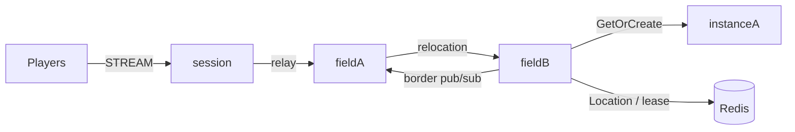

# MyGame MORPG fields and instances

Players move between fixed public fields and enter party dungeons. Field position domains own movement and visibility; independent Party Spots own membership, leadership, and run state across Fields. Dungeon Spots own prepared members and stages. Player Actors retain movement state across field transitions, and Session binding retains Actor identity across reconnects.



## Prerequisites

Docker Compose v2, and PowerShell 7 for the PowerShell runner are required. The project pins public Framework packages to 0.32.0 and the binding to 1.22.0 in `package.json`. A license, when required by the deployment, is provided externally and is never committed.

## Build

Run from this directory. POSIX shell:

```sh
./run-e2e.sh --build-only
```

PowerShell:

```powershell
pwsh -NoProfile -File ./run-e2e.ps1 -BuildOnly
```

The build generates the Framework's standard typed JSON schemas from shared contracts. No message-specific codec is registered.

## Docker e2e

Docker runs the e2e runner and each node in containers. All roles use one image; the runner image adds Docker CLI 28.5.1. `NODE_IMAGE` pins `node:22.20.0-trixie` with a slim runtime and the native binding's OpenSSL dependency. Nodes share the runner network namespace, preserving loopback listeners and OS-assigned ports. Configuration is copied with `docker cp`; stdin/stdout controls use `docker start -a -i`. Each invocation owns a unique Compose project, network and image tags. Cleanup failures return exit code 1, and shared Docker build cache remains available.

Build and outer cleanup logs are in `.logs/docker-<project>/`; node configuration, stdout and message-flow stderr remain in `.logs/run-<id>/`. For local process debugging, install Node.js 22 or later and npm, then run `./run-e2e.sh --local` or `pwsh -NoProfile -File ./run-e2e.ps1 -Local`. Add `--no-build` or `-NoBuild` to reuse an existing local build. Redis remains in Docker.

```sh
./run-e2e.sh
./run-e2e.sh --scenario field,dungeon,reconnect,update
./run-e2e.sh --check-structure
```

```powershell
pwsh -NoProfile -File ./run-e2e.ps1
pwsh -NoProfile -File ./run-e2e.ps1 -Scenario field,dungeon,reconnect,update
pwsh -NoProfile -File ./run-e2e.ps1 -CheckStructure
```

| Scenario    | Verification                                                                                                      |
| ----------- | ----------------------------------------------------------------------------------------------------------------- |
| `field`     | Field crossing, border visibility, Session continuity, cross-field party membership and leader, immutable movement rejection and server retry delay           |
| `dungeon`   | Server IDs, duplicate entry sharing one run, immutable nonleader rejection, shared Dungeon and completion at stage 3                                            |
| `reconnect` | Reconnected member retains Actor identity, Dungeon, RunId, Phase and stage                                                      |
| `update`    | Instance drain, relocation and SafeToShutdown; unchanged connections, RunId, Phase and stage; replacement accepts a distinct party run |

The runner checks the structure before startup, creates a unique Redis Compose project and key prefix, and binds listeners to port zero. Run-specific configurations, node stdout/stderr, message-flow records and client events are preserved under `.logs/run-<id>/`. Cleanup failures produce a nonzero exit code.

Movement uses Delta and a bigint Sequence bounded by 9,007,199,254,740,991. MaxStep is 10 and MaxSpeed is 50 units/s. The first move has the full budget. Rejected inputs preserve values, sequence, and cooldown; only move-budget returns a positive RetryAfterMs. Relocation stores remaining milliseconds.

`./run-e2e.sh --check-domain` (PowerShell `-CheckDomain`) runs 95 domain boundary checks without starting game nodes.

## Known issues

Validated against the published Framework 0.32.0 packages.

## Deployment sequence

Start Redis. Configure the endpoint and a shared deployment key prefix in `server/config/`. Start `server/field/main.js` from `dist/` for fieldA and await READY before starting fieldB; each process creates its configured fixed fields. Start both instance processes through `server/instance/main.js`, then the Session process through `server/session/main.js`. Each process takes its configuration file as its argument. Clients use the stream endpoint reported by Session READY.

For a planned update, send `drain` to the instance process containing the dungeon. Wait for `RELOCATION_REQUESTED`, `RELOCATED` and `SAFE_TO_SHUTDOWN`. Send `shutdown`, verify the `STOPPED` result and process exit, and start its replacement with the same configuration. Framework owns placement, routing, membership, binding and lifecycle; relocation adapters preserve only application state.

Player Actor factories and the shared Entry implementation are registered on both Field and Instance nodes. Declare one Entry in `zlink.structure.json` for each Field or Instance node, where the application registers Entry and its first-entry handler. Do not declare Framework default Entries on other roles. The update scenario uses Dungeon capacity 1: after relocation, the occupied peer cannot create the new Dungeon, so the replacement must accept it.

Message Follow is explicitly 30 seconds, matching the Framework default and the other structures. Safe-shutdown observation is derived from the shared Message Follow duration plus the relocation budget. Relocation operation deadlines are unchanged.

Initial Field placement uses public stable-type capacity and sequential startup. Set each Field node capacity to exactly its configured Field ID count. Start one Field node and wait for its READY, which follows creation of all its Fields, before starting the next Field node. Earlier nodes are full, so the newly started node is the only eligible Field host. Do not start initial Field hosts concurrently.
