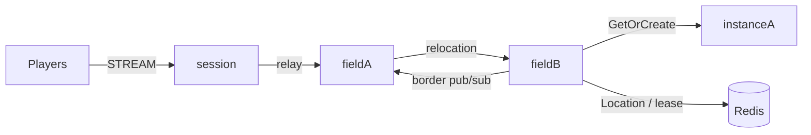

# MyGame MORPG fields and instances

Players move between fixed public fields and enter party dungeons. Field Spots own visibility and parties; Dungeon Spots own their member list and stage. Player Actors retain movement state across field transitions, and Session binding retains Actor identity across reconnects.



## Prerequisites

Node.js 22 or later, npm, Docker Compose v2, and PowerShell 7 for the PowerShell runner are required. The project pins public Framework packages to 0.30.1 and the binding to 1.19.0 in `package.json`. Framework 0.30.1 must be published before the normal install commands can resolve it. A license, when required by the deployment, is provided externally and is never committed.

## Build

Run from this directory. POSIX shell:

```sh
npm install && npm run build
```

PowerShell:

```powershell
npm install; if ($LASTEXITCODE -eq 0) { npm run build }
```

The build generates the Framework's standard typed JSON schemas from shared contracts. No message-specific codec is registered.

## Local e2e

```sh
./run-e2e.sh
./run-e2e.sh --scenario field,dungeon,reconnect,update
```

```powershell
./run-e2e.ps1
./run-e2e.ps1 -Scenario field,dungeon,reconnect,update
```

| Scenario    | Verification                                                                                                      |
| ----------- | ----------------------------------------------------------------------------------------------------------------- |
| `field`     | Field-2 to field-3 crossing between hosts, border visibility, unchanged Session identity and connection           |
| `dungeon`   | Same-field party admission, identical dungeon views, stage advancement                                            |
| `reconnect` | Reconnected member retains Actor identity, dungeon and stage                                                      |
| `update`    | Instance drain, relocation and SafeToShutdown; unchanged connections and state; replacement accepts a new dungeon |

The runner checks the structure before startup, creates a unique Redis Compose project and key prefix, and binds listeners to port zero. Run-specific configurations, node stdout/stderr, message-flow records and client events are preserved under `.logs/run-<id>/`. Cleanup failures produce a nonzero exit code.

## Known issues

The 0.30.0 baseline does not pass the complete suite. A new Player can be placed on an instance node without an application Entry Spot, leaving its first JoinWorldRequest without a handler ([#1772](https://github.com/zlink-systems/zlink/issues/1772)). Dungeon entry can fail because the bound-session send route is not connected ([#1775](https://github.com/zlink-systems/zlink/issues/1775)). Cleanup can return `ForceStopped/TeardownFailed`, and SafeToShutdown may not be observed after `RELOCATED` ([#1740](https://github.com/zlink-systems/zlink/issues/1740)). These failures remain visible, and 0.30.1 candidate verification is pending.

## Deployment sequence

Start Redis. Configure the endpoint and a shared deployment key prefix in `server/config/`. Start `server/field/main.js` from `dist/` for fieldA and await READY before starting fieldB; each process creates its configured fixed fields. Start both instance processes through `server/instance/main.js`, then the Session process through `server/session/main.js`. Each process takes its configuration file as its argument. Clients use the stream endpoint reported by Session READY.

For a planned update, send `drain` to the instance process containing the dungeon. Wait for `RELOCATION_REQUESTED`, `RELOCATED` and `SAFE_TO_SHUTDOWN`. Send `shutdown`, verify the `STOPPED` result and process exit, and start its replacement with the same configuration. Framework owns placement, routing, membership, binding and lifecycle; relocation adapters preserve only application state.

Player Actor factories and the shared Entry implementation are registered on both Field and Instance nodes. Declare one Entry in `zlink.structure.json` for each Field or Instance node, where the application registers Entry and its first-entry handler. Do not declare Framework default Entries on other roles. The update scenario uses Dungeon capacity 1: after relocation, the occupied peer cannot create the new Dungeon, so the replacement must accept it.

Message Follow is explicitly 30 seconds, matching the Framework default and the other structures. Safe-shutdown observation is derived from the shared Message Follow duration plus the relocation budget. Relocation operation deadlines are unchanged.

Initial Field placement uses public stable-type capacity and sequential startup. Set each Field node capacity to exactly its configured Field ID count. Start one Field node and wait for its READY, which follows creation of all its Fields, before starting the next Field node. Earlier nodes are full, so the newly started node is the only eligible Field host. Do not start initial Field hosts concurrently.

## 한국어 실행 안내

이 디렉터리에서 Build와 Local e2e의 명령을 실행합니다. `field`, `dungeon`, `reconnect`, `update`는 각각 필드 이동과 경계 표시, 파티 던전 입장, 던전 안 재접속, instance 교체를 검증합니다. 공개 패키지 0.30.1 게시 전에는 일반 설치 명령이 해당 버전을 받을 수 없습니다.

실행 로그와 message-flow 기록은 `.logs/run-<id>/`에 남습니다. 배포 시 Redis, fieldA, fieldB, 두 instance, Session 순서로 시작하고 READY를 확인합니다. instance 교체 시 drain의 relocation 및 SafeToShutdown 결과를 확인한 뒤 shutdown하고 같은 설정으로 대체 프로세스를 시작합니다.
