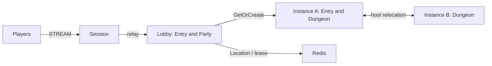

# my-game — MORPG lobby and dungeon instances

This Node.js template creates parties in a lobby and moves ready parties into Dungeon User Spots. Party owns membership and readiness; Dungeon owns its admitted party and stage. Session binds Player Actors and relays typed messages. Framework owns placement, binding, reconnect identity, and host relocation.



The Lobby and Instance roles (`lobby`, `instanceA`, and `instanceB`) explicitly register the shared stateless application Entry and initial party-admission handlers. The structure declares Entry only for those application registrations; Framework infrastructure Entry instances are not declared. Party state remains in the Lobby Party User Spot. Message Follow is explicitly 30 seconds; the safe-shutdown observation budget adds that duration to the existing host-operation budget. Each instance admits one Dungeon, so the relocated Dungeon fills the surviving instance and fresh work must use the replacement.

## Prerequisites

Docker Compose v2, and PowerShell 7 on Windows. Framework packages are pinned to 0.30.2 in `package.json`; the native binding is pinned to 1.20.0. These versions use public npm packages. Supply a ZLink license if required by your deployment.

## Build

Bash:

```sh
./run-e2e.sh --build-only
```

PowerShell:

```powershell
pwsh -NoProfile -File ./run-e2e.ps1 -BuildOnly
```

The build generates Framework JSON schemas for the shared typed DTOs. It does not introduce a message codec. All node roles use Framework's default typed JSON serializer.

## Docker e2e

Docker runs the e2e runner and each node in containers. All roles use one image; the runner image adds Docker CLI 28.5.1. `NODE_IMAGE` pins `node:22.20.0-trixie` with a slim runtime and the native binding's OpenSSL dependency. Nodes share the runner network namespace, preserving loopback listeners and OS-assigned ports. Configuration is copied with `docker cp`; stdin/stdout controls use `docker start -a -i`. Each invocation owns a unique Compose project, network and image tags. Cleanup failures return exit code 1, and shared Docker build cache remains available.

Build and outer cleanup logs are in `.logs/docker-<project>/`; node configuration, stdout and message-flow stderr remain in `.logs/run-<id>/`. For local process debugging, install Node.js 22 or later and npm, then run `./run-e2e.sh --local` or `pwsh -NoProfile -File ./run-e2e.ps1 -Local`. Add `--no-build` or `-NoBuild` to reuse an existing local build. Redis remains in Docker.

```sh
./run-e2e.sh
./run-e2e.sh --scenario party,reconnect,update
./run-e2e.sh --check-structure
```

```powershell
pwsh -NoProfile -File ./run-e2e.ps1
pwsh -NoProfile -File ./run-e2e.ps1 -Scenario party,reconnect,update
pwsh -NoProfile -File ./run-e2e.ps1 -CheckStructure
```

`party` verifies lobby login, two-member party broadcasts, `not-ready` rejection, readiness, dungeon entry, and shared stage advancement. `reconnect` verifies the same Actor generation and dungeon stage after a new Session. `update` drains the current dungeon host, checks relocation and Session continuity, shuts it down, and verifies new work on its replacement. Every selection creates its own Redis project, key prefix, and OS-assigned ports. The runner validates `zlink.structure.json` before creating resources and preserves node message-flow records and client events under `.logs/run-<id>/`.

## Known issues

Validated against the published Framework 0.30.2 packages.

Node typed handler payloads require the packet-name-to-class restoration table before forwarding (#1731, planned for 0.32.0). Keep this table until the published Framework preserves declared DTO classes.

## Deployment sequence

Start Redis, then Lobby and Instance processes, and finally Session. Each role has a separate entry point: `dist/server/lobby/main.js`, `dist/server/instance/main.js`, and `dist/server/session/main.js`. Pass the corresponding `server/config/<node>.json` as its sole argument. Listener endpoints use port zero; `READY` reports the bound endpoint. Instance capacity is one Dungeon per node in the example so the update test can prove replacement admission.

For maintenance, send `drain` on the selected Instance process's stdin. Wait for `RELOCATION_REQUESTED`, `RELOCATED`, and `SAFE_TO_SHUTDOWN`. Send `shutdown` and verify `STOPPED` with outcome `Stopped` and reason `None` before starting its replacement with the same settings. Production hosting must provide a reachable mesh address and Redis credentials appropriate to its environment.

## 한국어 실행 안내

기본 빌드와 e2e는 Docker에서 runner와 node를 실행한다. Bash는 `./run-e2e.sh`, PowerShell 7은 `pwsh -NoProfile -File ./run-e2e.ps1`을 사용한다. 로컬 프로세스 디버깅은 Node.js와 npm을 설치한 뒤 `--local` 또는 `-Local`로 실행한다. Docker 빌드·정리 로그는 `.logs/docker-<project>/`에 남는다.

Docker Compose v2를 준비하고 위 Build 명령으로 이미지를 빌드합니다. Windows에서는 PowerShell 7을 사용합니다. Docker e2e 명령은 독립 Redis와 node 컨테이너를 생성하며, 실행 로그는 `.logs/run-<id>/`에 보존합니다. 파티 상태는 Lobby의 Party User Spot, 던전 상태는 Instance의 Dungeon User Spot이 소유합니다. Instance를 교체할 때는 `drain` 뒤 세 relocation 신호를 확인하고 `shutdown`으로 종료한 다음 같은 설정으로 대체 process를 시작합니다. 0.30.2 게시 전 검증의 한계와 DTO 전달 관련 사항은 Known issues를 확인합니다.


Domain extension: change PartyState and DungeonState, add shared typed contracts, update the Session client allowlist and add boundary tests and scenario observations. Integer values are bounded by 9,007,199,254,740,991; rejected inputs leave state unchanged. ActionRejected includes a 32-bit RetryAfterMs, always zero in this structure. No floating-point action input or time restriction is used.

한국어 안내: 이 템플릿의 파티·던전 도메인을 확장하여 MORPG 서버를 만든다. party는 중복 입장·서버 발급 ID·거부 뒤 상태 불변·최종 완료를 관찰한다. reconnect·update는 RunId·Phase·Stage 보존을 검사한다. 도메인 경계 시험은 AGENTS의 확장 절차에 따라 실행한다.
