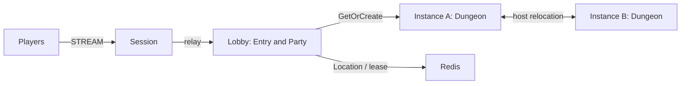

# my-game — MORPG lobby and dungeon instances

This Node.js template creates parties in a lobby and moves ready parties into Dungeon User Spots. Party owns membership and readiness; Dungeon owns its admitted party and stage. Session binds Player Actors and relays typed messages. Framework owns placement, binding, reconnect identity, and host relocation.



## Prerequisites

Node.js 22 or later, npm, Docker Compose v2, and PowerShell 7 on Windows. Framework packages are pinned to 0.30.1 in `package.json`; the native binding is pinned to 1.19.0. These versions use public npm packages. Supply a ZLink license if required by your deployment.

## Build

Bash:

```sh
npm install && npm run build
```

PowerShell:

```powershell
npm install; if ($LASTEXITCODE -eq 0) { npm run build }
```

The build generates Framework JSON schemas for the shared typed DTOs. It does not introduce a message codec. All node roles use Framework's default typed JSON serializer.

## Local e2e

```sh
./run-e2e.sh
./run-e2e.sh --scenario party,reconnect,update
```

```powershell
pwsh -NoProfile -File ./run-e2e.ps1
pwsh -NoProfile -File ./run-e2e.ps1 -Scenario party,reconnect,update
```

`party` verifies lobby login, two-member party broadcasts, `not-ready` rejection, readiness, dungeon entry, and shared stage advancement. `reconnect` verifies the same Actor generation and dungeon stage after a new Session. `update` drains the current dungeon host, checks relocation and Session continuity, shuts it down, and verifies new work on its replacement. Every selection creates its own Redis project, key prefix, and OS-assigned ports. The runner validates `zlink.structure.json` before creating resources and preserves node message-flow records and client events under `.logs/run-<id>/`.

## Known issues

Framework 0.30.1 is pending publication. Development validation uses a separate copy with public 0.30.0; successful build alone does not establish relocation correctness. Node typed handler payloads require the packet-name-to-class restoration table before forwarding (#1731, planned for 0.32.0). Keep this table until the published Framework preserves declared DTO classes.

The public 0.30.0 validation stopped before lobby login: the Player factory registered on Instance nodes also permits initial Actor placement there, where no application Lobby Entry handlers exist. The reference .NET composition registers the same factories. This placement/composition conflict blocks all STREAM scenarios pending supervisor resolution; do not introduce a second lobby, placement retry, or target selection workaround.

## Deployment sequence

Start Redis, then Lobby and Instance processes, and finally Session. Each role has a separate entry point: `dist/server/lobby/main.js`, `dist/server/instance/main.js`, and `dist/server/session/main.js`. Pass the corresponding `server/config/<node>.json` as its sole argument. Listener endpoints use port zero; `READY` reports the bound endpoint. Instance capacity is one Dungeon per node in the example so the update test can prove replacement admission.

For maintenance, send `drain` on the selected Instance process's stdin. Wait for `RELOCATION_REQUESTED`, `RELOCATED`, and `SAFE_TO_SHUTDOWN`. Send `shutdown` and verify `STOPPED` with outcome `Stopped` and reason `None` before starting its replacement with the same settings. Production hosting must provide a reachable mesh address and Redis credentials appropriate to its environment.

## 한국어 실행 안내

Node.js 22 이상과 Docker Compose v2를 준비하고 위 Build 명령으로 빌드합니다. Windows에서는 PowerShell 7을 사용합니다. Local e2e 명령은 독립 Redis와 node process를 생성하며, 실행 로그는 `.logs/run-<id>/`에 보존합니다.

파티 상태는 Lobby의 Party User Spot, 던전 상태는 Instance의 Dungeon User Spot이 소유합니다. Instance를 교체할 때는 `drain` 뒤 세 relocation 신호를 확인하고 `shutdown`으로 종료한 다음 같은 설정으로 대체 process를 시작합니다. 0.30.1 게시 전 검증의 한계와 DTO 전달 관련 사항은 Known issues를 확인합니다.
